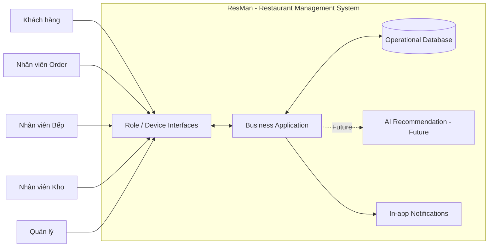
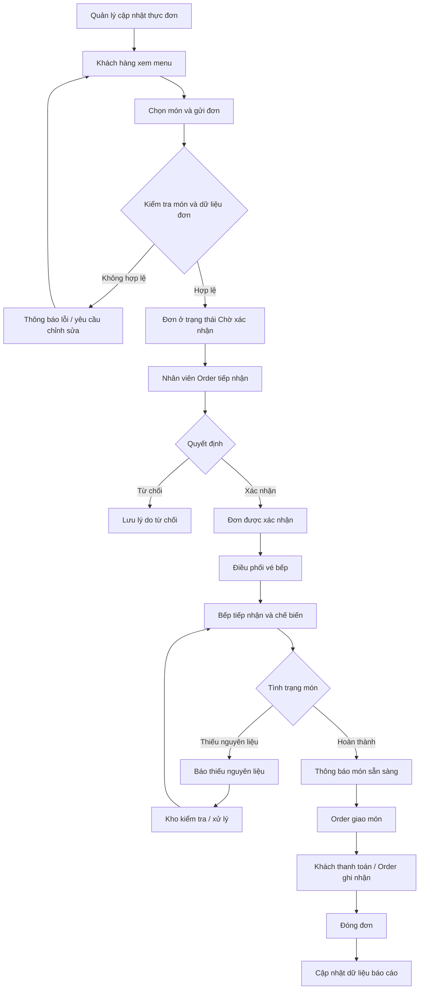
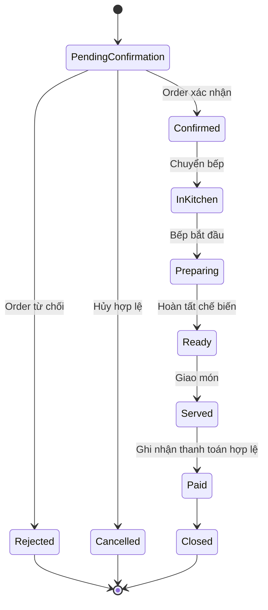
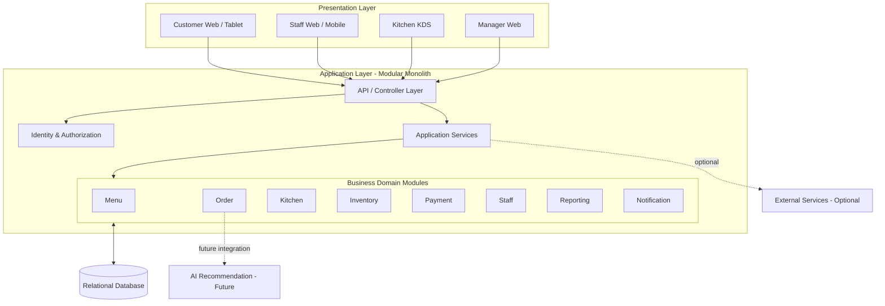
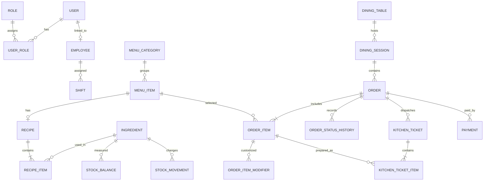

# Phân Tích và Thiết Kế Hệ Thống ResMan

> **Loại tài liệu:** System Analysis & System Design  
> **Phiên bản:** 1.0  
> **Ngày cập nhật:** 28/10/2026  
> **Nhánh thực hiện:** `member/minhhuy`  
> **Phạm vi:** Mô hình nghiệp vụ, hệ thống logic, kiến trúc tổng thể, miền dữ liệu, giao tiếp hệ thống và ánh xạ với giao diện hiện có.  
> **Tài liệu yêu cầu chuẩn:** [`docs/08-prd.md`](08-prd.md)

---

## 1. Mục đích và nguyên tắc

Tài liệu này chuyển các yêu cầu sản phẩm và giao diện hiện có của ResMan thành một mô hình hệ thống có thể dùng làm cơ sở cho các bước thiết kế kỹ thuật và triển khai tiếp theo.

Tài liệu bao gồm:
- Phân tích hiện trạng giao diện và mức độ hỗ trợ nghiệp vụ.
- Xác định ranh giới hệ thống, tác nhân, module và trách nhiệm.
- Mô hình hóa các quy trình nghiệp vụ xuyên module.
- Đề xuất kiến trúc logic và luồng dữ liệu.
- Xác định các thực thể nghiệp vụ và quan hệ dữ liệu ở mức khái niệm.
- Xác định nhóm API logic, phân quyền và các trạng thái quan trọng.
- Ghi nhận các điểm chưa thống nhất, giả định và quyết định cần xác nhận.

### 1.1 Nguyên tắc nguồn thông tin

Thứ tự ưu tiên khi đưa ra quyết định:
1. Yêu cầu được xác nhận trong PRD.
2. Project Vision và các tài liệu phân tích đã có.
3. Hành vi có thể quan sát trong source code giao diện.
4. Đề xuất thiết kế trong tài liệu này.
5. Kiến thức kỹ thuật chung.

**Không đồng nhất giao diện mô phỏng với chức năng đã triển khai hoàn chỉnh.** Một nút bấm, số liệu hiển thị hoặc Toast không chứng minh rằng nghiệp vụ đã có API, cơ sở dữ liệu hay cơ chế bảo mật thực tế.

### 1.2 Phân loại thông tin

- **Đã xác nhận:** Có trong PRD hoặc tài liệu yêu cầu hiện hành.
- **Quan sát từ UI:** Có thể xác nhận qua source code frontend trên nhánh này.
- **Đề xuất thiết kế:** Mô hình được đề xuất để đáp ứng yêu cầu, cần được duyệt trước khi triển khai.
- **Cần xác nhận:** Tài liệu nguồn còn mâu thuẫn hoặc chưa đủ thông tin để quyết định.

---

## 2. Bối cảnh và hiện trạng dự án

### 2.1 Mục tiêu nghiệp vụ

ResMan là hệ thống quản lý vận hành nhà hàng, kết nối khách hàng và các bộ phận nội bộ trong một quy trình thống nhất:

**Thiết lập thực đơn → Đặt món → Xác nhận đơn → Chế biến → Giao món → Thanh toán → Quản lý tồn kho → Báo cáo.**

Mục tiêu trọng tâm là giảm thao tác thủ công, hạn chế sai sót đơn hàng, tăng khả năng phối hợp giữa các bộ phận và cung cấp dữ liệu vận hành cho quản lý.

### 2.2 Phạm vi chức năng theo PRD

| Nhóm | Phạm vi | Trạng thái yêu cầu |
|---|---|---|
| Thực đơn | Quản lý món ăn, trạng thái còn/hết hàng, hiển thị menu | MVP |
| Đặt món | Khách xem menu, chọn món, tạo đơn | MVP |
| Đơn hàng | Tiếp nhận, xác nhận/từ chối, theo dõi và điều phối đơn | MVP |
| Bếp | Hàng đợi bếp, tiến độ chế biến, báo thiếu nguyên liệu | MVP |
| Kho | Theo dõi tồn, cập nhật/nhập kho, cảnh báo | MVP |
| Thanh toán | Ghi nhận giao dịch và đóng đơn | MVP |
| Nhân sự | Quản lý hồ sơ nhân viên cơ bản | MVP |
| Báo cáo | Báo cáo vận hành cơ bản | MVP |
| Dashboard realtime | Giám sát tổng hợp thời gian thực | Post-MVP |
| AI Recommendation | Gợi ý món cá nhân hóa | Future, chưa thuộc MVP |

Không mở rộng phạm vi MVP sang đa chi nhánh, logistics giao hàng, tích hợp cổng thanh toán nâng cao, loyalty hoặc BI nâng cao nếu chưa có phê duyệt mới.

### 2.3 Hiện trạng giao diện được kiểm tra

Các thành phần frontend được quan sát trên nhánh `member/minhhuy`:

| Màn hình / module | Hành vi thể hiện trong UI | Đánh giá hiện trạng |
|---|---|---|
| Menu Catalog | Danh sách món, tìm kiếm/lọc, thêm món, đổi trạng thái còn/hết hàng | Có tương tác frontend; dữ liệu cập nhật trong React state |
| Customer Ordering | Chọn món, tùy chọn món, giỏ hàng, chọn bàn, xác nhận đặt; có khung Mobile/Tablet | Có mô phỏng trải nghiệm khách; chưa chứng minh là ứng dụng độc lập hoặc thiết bị đã kết nối thật |
| Live Orders | Danh sách đơn, lọc trạng thái, xem chi tiết, điều phối bếp, ghi nhận thanh toán, hủy đơn | Có thao tác frontend; cần đối chiếu lại điều kiện nghiệp vụ và tính nhất quán trạng thái |
| KDS | Lọc trạm bếp, vé khẩn cấp, đánh dấu món hoàn thành, bắt đầu chế biến, hoàn tất vé | Có tương tác frontend; chưa có đồng bộ nhiều thiết bị |
| Inventory Audit | Xem tồn, điều chỉnh/nhập/hủy hao hụt, cảnh báo, xuất báo cáo | Có cập nhật state; một số hành vi đang mô phỏng |
| Staff & Shifts | Danh sách nhân viên, lọc vai trò, thêm nhân viên, đổi trạm, giao diện phân quyền | Chưa phải hệ thống tài khoản và phân quyền được thực thi ở backend |
| Reports & Telemetry | KPI, bộ lọc thời gian, món bán chạy, xuất báo cáo | Một phần số liệu đang là dữ liệu tĩnh/hard-code; chưa thể xem là báo cáo từ dữ liệu vận hành thực |

### 2.4 Đánh giá kỹ thuật từ source code UI

- `App.tsx` quản lý dữ liệu menu, KDS ticket, live order, inventory, staff và void log bằng React state.
- Dữ liệu ban đầu được nạp từ `src/frontend/src/data/mockData.ts`.
- Các module giao tiếp thông qua props và callback do `App.tsx` quản lý.
- Chưa thấy luồng frontend gọi backend API trong các file được kiểm tra.
- Không thể kết luận dữ liệu được lưu bền vững sau khi tải lại trang.
- Bộ chọn vai trò trong Header là công cụ chuyển ngữ cảnh demo; không thay thế đăng nhập, xác thực hoặc authorization.
- Sidebar hiện chứa danh mục điều hướng chung; chưa tự giới hạn menu theo quyền của từng vai trò.
- Customer Ordering có chế độ khung Mobile/Tablet trong cùng frontend; đây là mô phỏng responsive/device context, không phải bằng chứng đã có hai ứng dụng riêng.
- Một số báo cáo và thông tin trạng thái được tạo sẵn để minh họa giao diện.

**Kết luận hiện trạng:** Frontend đã cung cấp bộ khung trải nghiệm và các module nghiệp vụ trực quan. Giai đoạn tiếp theo cần biến những luồng state cục bộ thành luồng nghiệp vụ có backend, dữ liệu dùng chung, xác thực, phân quyền và quy tắc trạng thái nhất quán.

---

## 3. Tác nhân và ngữ cảnh sử dụng

### 3.1 Tác nhân nghiệp vụ chính

| Actor | Mục tiêu | Nhiệm vụ chính | Ngữ cảnh thiết bị đề xuất |
|---|---|---|---|
| Khách hàng | Đặt món thuận tiện, theo dõi tiến độ | Xem menu, chọn món, gửi đơn, theo dõi đơn | Tablet tại bàn hoặc điện thoại quét QR |
| Nhân viên Order | Xử lý yêu cầu của khách | Tiếp nhận, xác nhận/từ chối, chuyển bếp, giao món, ghi nhận thanh toán | Điện thoại hoặc máy POS |
| Nhân viên Bếp | Chế biến chính xác, đúng thứ tự | Nhận vé bếp, bắt đầu chế biến, cập nhật món, báo thiếu nguyên liệu | Màn hình KDS / máy tính bảng |
| Nhân viên Kho | Duy trì tồn kho chính xác | Kiểm tra tồn, nhập kho, điều chỉnh, ghi nhận hao hụt, xử lý cảnh báo | Máy tính hoặc tablet |
| Quản lý | Điều hành nhà hàng | Quản lý menu/nhân sự, theo dõi hoạt động, xem báo cáo | Máy tính |

### 3.2 Vai trò phụ và điểm cần thống nhất

- PRD hiện xác định **Nhân viên Order** là người ghi nhận thanh toán.
- Một số nội dung giao diện/AGENTS có nhắc đến **Cashier/Thu ngân** như một ngữ cảnh riêng.
- Trong phạm vi mô hình hiện tại, Thu ngân được xem là **nhiệm vụ có thể do Nhân viên Order đảm nhiệm**, chưa tách thành actor bắt buộc.
- Nếu nhóm muốn tách Thu ngân thành vai trò riêng, cần cập nhật Actor Analysis, Use Case, PRD và ma trận phân quyền trước khi thiết kế chi tiết.

### 3.3 Ma trận trách nhiệm ở mức hệ thống

| Nghiệp vụ | Khách hàng | Order | Bếp | Kho | Quản lý |
|---|---:|---:|---:|---:|---:|
| Xem thực đơn | Xem | Xem | Xem thông tin cần thiết | — | Quản lý |
| Tạo đơn | Tạo | Tạo hộ nếu được phép | — | — | Theo dõi |
| Xác nhận/từ chối đơn | Theo dõi kết quả | Thực hiện | — | — | Giám sát |
| Chuyển đơn vào bếp | — | Thực hiện | Tiếp nhận | — | Giám sát |
| Chế biến món | Theo dõi | Theo dõi | Thực hiện | Phối hợp thiếu nguyên liệu | Giám sát |
| Giao món | Nhận món | Xác nhận/giao | Báo sẵn sàng | — | Giám sát |
| Thanh toán | Thanh toán | Ghi nhận | — | — | Xem báo cáo |
| Quản lý tồn | — | Xem cảnh báo liên quan | Báo thiếu | Thực hiện | Giám sát |
| Quản lý nhân viên | — | — | — | — | Thực hiện |
| Báo cáo | — | Theo quyền nếu được cấp | — | Theo quyền nếu được cấp | Xem |

---

## 4. Ranh giới hệ thống và phân chia module

### 4.1 System Context

ResMan là hệ thống trung tâm. Các actor tương tác với hệ thống qua giao diện theo vai trò. Backend chịu trách nhiệm xác thực, áp dụng quy tắc nghiệp vụ, điều phối module và đọc/ghi dữ liệu.

### 4.2 Các module logic

| Module ID | Module | Trách nhiệm | Dữ liệu nghiệp vụ chính |
|---|---|---|---|
| MOD-01 | Identity & Access | Tài khoản, đăng nhập, vai trò, quyền | User, Role, Permission |
| MOD-02 | Menu Management | Danh mục món, giá, mô tả, trạng thái bán | MenuItem, Category, Modifier |
| MOD-03 | Table & Dining Context | Bàn, khu vực, phiên phục vụ tại bàn | DiningTable, DiningSession |
| MOD-04 | Order Management | Tạo đơn, xác nhận, từ chối, hủy, trạng thái | Order, OrderItem, OrderStatusHistory |
| MOD-05 | Kitchen Operations | Vé bếp, trạm chế biến, trạng thái món | KitchenTicket, KitchenTicketItem |
| MOD-06 | Inventory Management | Nguyên liệu, số lượng, nhập/xuất/hao hụt | Ingredient, StockBalance, StockMovement |
| MOD-07 | Recipe & Consumption | Định mức nguyên liệu theo món và ghi nhận tiêu hao | Recipe, RecipeItem |
| MOD-08 | Payment | Ghi nhận khoản thanh toán và đối soát đơn | Payment, PaymentMethod |
| MOD-09 | Staff Management | Hồ sơ nhân viên và phân công cơ bản | Employee, Shift |
| MOD-10 | Reporting | Tổng hợp doanh thu, đơn, tồn kho và hoạt động | Read models / report aggregates |
| MOD-11 | Notification | Thông báo nội bộ theo sự kiện | Notification |
| MOD-12 | AI Recommendation | Gợi ý món theo lịch sử và ngữ cảnh | Recommendation — Future |

**Lưu ý:** MOD-01 và MOD-11 là các module nền tảng cần thiết để vận hành an toàn và phối hợp; chi tiết chức năng phải được đối chiếu với phạm vi PRD trước khi đưa vào MVP. MOD-12 là Future, không phải điều kiện để hoàn thành MVP.

### 4.3 Nguyên tắc phân định trách nhiệm

- Order Management là nguồn quản lý vòng đời đơn hàng; KDS không tự tạo một đơn hàng độc lập.
- Kitchen Operations quản lý tiến độ chế biến; không sở hữu dữ liệu giá bán hoặc thanh toán.
- Inventory Management sở hữu số lượng tồn và lịch sử biến động kho.
- Recipe & Consumption xác định quan hệ món ăn - nguyên liệu; không nên suy ra định mức từ nội dung text hiển thị trên UI.
- Payment ghi nhận giao dịch; trạng thái thanh toán phải nhất quán với trạng thái đóng đơn.
- Reporting đọc dữ liệu đã phát sinh từ các module nghiệp vụ; không tự tạo số liệu.
- Identity & Access là nơi kiểm soát quyền thực tế; ẩn/hiện nút ở frontend chỉ là trải nghiệm, không phải bảo mật.

---

## 5. Mô hình quy trình nghiệp vụ end-to-end

### 5.1 Quy trình đặt món và xử lý đơn

### 5.2 Quy trình quản lý tồn kho

1. Nhân viên Kho xem số lượng và trạng thái nguyên liệu.
2. Hệ thống so sánh số lượng hiện tại với ngưỡng cảnh báo.
3. Nhân viên Kho ghi nhận nhập kho, điều chỉnh hoặc hao hụt với lý do.
4. Hệ thống tạo bản ghi biến động kho và cập nhật số lượng hiện tại.
5. Nếu dưới ngưỡng, hệ thống hiển thị cảnh báo.
6. Khi bếp báo thiếu nguyên liệu, thông tin được chuyển tới Kho để xử lý.

**Cần xác nhận:** Cơ chế tự động trừ kho theo định mức khi món được chế biến/hoàn thành chưa được PRD mô tả đủ chi tiết. Không nên tự động trừ kho chỉ dựa trên việc tạo đơn nếu chưa thống nhất thời điểm ghi nhận tiêu hao, xử lý hủy món và hoàn kho.

### 5.3 Quy trình thanh toán

1. Đơn đã giao món và đủ điều kiện thanh toán.
2. Nhân viên Order chọn đơn cần thanh toán.
3. Hệ thống tính số tiền phải thu dựa trên chi tiết đơn và các khoản phí/thuế đã được xác nhận.
4. Nhân viên ghi nhận phương thức và số tiền nhận.
5. Hệ thống lưu giao dịch.
6. Chỉ khi thanh toán hợp lệ, đơn mới chuyển sang trạng thái đã thanh toán/đóng.

Phương thức thanh toán và quy tắc phí/thuế là các quyết định nghiệp vụ cần được xác nhận; không cố định theo dữ liệu demo hiện tại.

---

## 6. Mô hình trạng thái nghiệp vụ

### 6.1 Vòng đời đơn hàng đề xuất

Các trạng thái trên là mô hình đề xuất chuẩn hóa từ PRD và giao diện. Cần thống nhất tên trạng thái cuối cùng trước khi triển khai API/database.

| Trạng thái | Ý nghĩa | Actor tạo chuyển đổi |
|---|---|---|
| PendingConfirmation | Đơn mới chờ nhân viên xử lý | Hệ thống sau khi khách gửi đơn |
| Confirmed | Đơn được chấp nhận | Nhân viên Order |
| Rejected | Đơn bị từ chối, phải có lý do | Nhân viên Order |
| Cancelled | Đơn bị hủy trong điều kiện cho phép | Khách hàng hoặc nhân viên có quyền |
| InKitchen | Đơn đã được điều phối đến bếp | Nhân viên Order / hệ thống |
| Preparing | Bếp đang chế biến | Nhân viên Bếp |
| Ready | Các món liên quan đã sẵn sàng | Nhân viên Bếp |
| Served | Món đã được giao | Nhân viên Order |
| Paid | Thanh toán hợp lệ đã được ghi nhận | Nhân viên Order / Thu ngân |
| Closed | Đơn đã kết thúc | Hệ thống |

**Quy tắc:** Không cho phép chuyển trạng thái tùy ý. Backend phải kiểm tra trạng thái hiện tại, vai trò thực hiện và điều kiện nghiệp vụ trước khi cập nhật.

### 6.2 Trạng thái món trong vé bếp

- Queued: Đã vào hàng đợi.
- Preparing: Đang chế biến.
- Ready: Đã hoàn thành.
- Cancelled: Món bị hủy theo quyền và quy tắc được xác nhận.

Một đơn có nhiều món; trạng thái tổng của đơn phải được tính hoặc cập nhật nhất quán từ các món và tiến trình giao món, không chỉ dựa trên một nút hoàn tất vé.

### 6.3 Trạng thái tồn kho

- InStock: Có thể sử dụng.
- LowStock: Dưới hoặc bằng ngưỡng cảnh báo.
- OutOfStock: Số lượng bằng 0.
- Inactive: Nguyên liệu ngừng theo dõi/sử dụng nếu nghiệp vụ cho phép.

Không được để số lượng tồn âm. Mọi điều chỉnh phải có loại biến động, số lượng, thời điểm và lý do.

---

## 7. Kiến trúc hệ thống logic đề xuất

### 7.1 Định hướng kiến trúc

Đề xuất bắt đầu bằng **Modular Monolith**: một backend ứng dụng thống nhất, được chia module theo nghiệp vụ rõ ràng. Cách tiếp cận này phù hợp với phạm vi dự án học tập/MVP, giảm chi phí vận hành và vẫn duy trì ranh giới module để có thể mở rộng khi cần.

Không đề xuất Microservices ở giai đoạn hiện tại vì chưa có yêu cầu về quy mô, tải, đội ngũ vận hành hoặc triển khai độc lập đủ mạnh để biện minh cho độ phức tạp bổ sung.

### 7.2 Sơ đồ kiến trúc

### 7.3 Trách nhiệm các lớp

| Lớp | Trách nhiệm | Không nên đảm nhiệm |
|---|---|---|
| Presentation | Hiển thị dữ liệu, nhập liệu, điều hướng, phản hồi thao tác | Tự quyết định quy tắc nghiệp vụ quan trọng |
| API / Controller | Nhận request, kiểm tra định dạng đầu vào, gọi application service, trả response | Chứa toàn bộ business logic |
| Application Service | Điều phối use case và transaction giữa các domain | Phụ thuộc trực tiếp vào chi tiết giao diện |
| Domain Module | Quy tắc nghiệp vụ, trạng thái, kiểm tra điều kiện, trách nhiệm dữ liệu | Xử lý layout/UI |
| Persistence | Lưu trữ và truy vấn dữ liệu | Tự quyết định quyền nghiệp vụ |
| Integration | Kết nối dịch vụ ngoài khi được phê duyệt | Làm thay trách nhiệm domain cốt lõi |

### 7.4 Luồng request điển hình

1. Client gửi request kèm thông tin phiên đăng nhập.
2. API xác thực danh tính và kiểm tra quyền truy cập.
3. Application Service nhận use case tương ứng.
4. Domain Module kiểm tra quy tắc và trạng thái.
5. Persistence đọc/ghi dữ liệu trong transaction phù hợp.
6. API trả kết quả thống nhất cho client.
7. Các module liên quan được thông báo/cập nhật theo cơ chế đã chọn.

Đối với thay đổi có ảnh hưởng nhiều module (ví dụ xác nhận đơn và tạo vé bếp), cần đảm bảo không xảy ra trường hợp đơn đã xác nhận nhưng vé bếp không được tạo mà không có cơ chế khôi phục hoặc phát hiện lỗi.

---

## 8. Mô hình dữ liệu nghiệp vụ ở mức khái niệm

> Phần này xác định các thực thể và quan hệ ở mức domain để làm cơ sở cho ERD/database design chi tiết. Đây **chưa phải** schema vật lý, chưa chốt kiểu dữ liệu, tên cột, index hay migration.

### 8.1 Danh sách thực thể đề xuất

| Nhóm | Thực thể | Ý nghĩa |
|---|---|---|
| Tài khoản | User | Danh tính đăng nhập |
| Tài khoản | Role / Permission | Vai trò và quyền thao tác |
| Nhân sự | Employee | Hồ sơ nhân viên gắn với tài khoản nếu có |
| Thực đơn | MenuCategory | Nhóm món ăn |
| Thực đơn | MenuItem | Món ăn, giá, mô tả, trạng thái bán |
| Thực đơn | Modifier / ModifierGroup | Tùy chọn thêm/bớt của món, nếu được xác nhận |
| Bàn | DiningTable | Bàn và khu vực phục vụ |
| Bàn | DiningSession | Phiên phục vụ tại bàn, nếu cần quản lý nhiều lượt khách |
| Đơn hàng | Order | Thông tin chung của đơn |
| Đơn hàng | OrderItem | Món, số lượng, đơn giá tại thời điểm đặt |
| Đơn hàng | OrderItemModifier | Tùy chọn của từng món trong đơn |
| Đơn hàng | OrderStatusHistory | Lịch sử chuyển trạng thái |
| Bếp | KitchenTicket | Phiếu/vé bếp gắn với đơn |
| Bếp | KitchenTicketItem | Món cần chế biến và trạng thái món |
| Kho | Ingredient | Nguyên liệu/vật tư |
| Kho | StockBalance | Số lượng hiện tại theo nguyên liệu/kho |
| Kho | StockMovement | Lịch sử nhập, xuất, điều chỉnh, hao hụt |
| Công thức | Recipe | Định mức nguyên liệu của một món |
| Công thức | RecipeItem | Nguyên liệu và lượng dùng trong công thức |
| Thanh toán | Payment | Giao dịch thanh toán gắn với đơn |
| Nhân sự | Shift | Ca làm việc/phân công nếu nằm trong phạm vi |
| Hệ thống | Notification | Thông báo trong ứng dụng |

### 8.2 Quan hệ nghiệp vụ chính

- Một MenuCategory có nhiều MenuItem.
- Một Order có nhiều OrderItem.
- Một OrderItem tham chiếu một MenuItem nhưng phải lưu snapshot tên/đơn giá tại thời điểm đặt để lịch sử đơn không thay đổi khi menu cập nhật.
- Một Order có thể có nhiều OrderStatusHistory.
- Một Order được điều phối thành một hoặc nhiều KitchenTicket nếu cần chia theo trạm bếp.
- Một KitchenTicket có nhiều KitchenTicketItem.
- Một MenuItem có thể có một Recipe gồm nhiều RecipeItem.
- Một Ingredient có thể xuất hiện trong nhiều Recipe.
- Một Ingredient có các StockMovement; số dư hiện tại được duy trì và đối chiếu với lịch sử biến động.
- Một Order có thể có một hoặc nhiều Payment tùy chính sách thanh toán được xác nhận.
- Một User có một hoặc nhiều Role nếu mô hình phân quyền cho phép; phạm vi đơn giản có thể bắt đầu bằng một role chính.

### 8.3 ERD khái niệm

### 8.4 Nguyên tắc toàn vẹn dữ liệu

- Đơn hàng phải lưu snapshot thông tin món và giá tại thời điểm đặt.
- Không xóa cứng dữ liệu đơn hàng/giao dịch đã phát sinh nếu làm mất khả năng đối soát.
- Số lượng tồn kho không âm.
- StockMovement phải lưu nguyên nhân và người thực hiện.
- Payment phải tham chiếu đơn hợp lệ và không được ghi nhận trùng do request gửi lại.
- OrderStatusHistory phải ghi nhận trạng thái trước/sau, thời điểm và tác nhân.
- Thay đổi giá món không làm thay đổi tổng tiền của đơn cũ.
- Quy tắc tính tổng tiền phải được thực hiện ở backend; frontend chỉ hiển thị kết quả.

---

## 9. Thiết kế giao tiếp API ở mức tài nguyên

Đây là nhóm API logic dự kiến, không phải hợp đồng API cuối cùng. Chi tiết request/response, mã lỗi và phân quyền từng endpoint sẽ được đặc tả ở bước API Design.

| Nhóm tài nguyên | Endpoint minh họa | Mục đích |
|---|---|---|
| Authentication | POST /api/auth/login | Đăng nhập |
| Authentication | POST /api/auth/logout | Kết thúc phiên |
| Current user | GET /api/users/me | Lấy danh tính và quyền hiện tại |
| Menu | GET /api/menu-items | Xem danh sách món |
| Menu | POST /api/menu-items | Tạo món |
| Menu | PATCH /api/menu-items/{id} | Cập nhật thông tin/trạng thái món |
| Orders | POST /api/orders | Tạo đơn |
| Orders | GET /api/orders | Danh sách đơn theo quyền/bộ lọc |
| Orders | GET /api/orders/{id} | Chi tiết đơn |
| Orders | POST /api/orders/{id}/confirm | Xác nhận đơn |
| Orders | POST /api/orders/{id}/reject | Từ chối đơn và ghi lý do |
| Orders | POST /api/orders/{id}/cancel | Hủy đơn nếu hợp lệ |
| Orders | POST /api/orders/{id}/dispatch | Điều phối đơn đến bếp |
| Kitchen | GET /api/kitchen/tickets | Lấy hàng đợi bếp |
| Kitchen | PATCH /api/kitchen/tickets/{id}/items/{itemId} | Cập nhật trạng thái món |
| Inventory | GET /api/inventory/items | Xem nguyên liệu và tồn kho |
| Inventory | POST /api/inventory/movements | Ghi nhận biến động kho |
| Payments | POST /api/orders/{id}/payments | Ghi nhận thanh toán |
| Staff | GET /api/employees | Danh sách nhân viên |
| Staff | POST /api/employees | Tạo hồ sơ nhân viên |
| Reports | GET /api/reports/operations | Báo cáo vận hành |

### 9.1 Nguyên tắc API

- API phản ánh nghiệp vụ, không tạo endpoint chỉ vì một nút UI.
- Các thao tác thay đổi trạng thái dùng command endpoint rõ nghĩa hoặc PATCH có kiểm soát.
- Backend kiểm tra quyền và quy tắc trạng thái ở mọi thao tác ghi.
- Request tạo đơn/thanh toán cần cơ chế chống gửi lặp phù hợp.
- Response lỗi phải phân biệt lỗi xác thực, không đủ quyền, dữ liệu không hợp lệ, xung đột trạng thái và lỗi hệ thống.
- Danh sách lớn cần phân trang và lọc ở server.
- Không trả thông tin nhạy cảm của nhân viên/tài khoản cho vai trò không liên quan.

---

## 10. Mô hình phân quyền

### 10.1 Nguyên tắc

Sử dụng RBAC (Role-Based Access Control) ở backend:
- Mỗi request được gắn với danh tính đã xác thực.
- Backend xác định vai trò/quyền của người dùng.
- Quyền được kiểm tra theo hành động và tài nguyên.
- Frontend có thể ẩn menu/nút không phù hợp để cải thiện trải nghiệm, nhưng không được xem đó là cơ chế bảo mật.
- Khách hàng truy cập dữ liệu đơn của chính phiên/bàn/định danh hợp lệ; không được xem đơn của khách khác.

### 10.2 Ma trận quyền sơ bộ

| Chức năng | Customer | Order Staff | Kitchen | Warehouse | Manager |
|---|---|---|---|---|---|
| Xem menu công khai | Có | Có | Theo nhu cầu | — | Có |
| Tạo đơn | Có | Có thể tạo hộ | — | — | Theo quyền |
| Xem đơn | Đơn của mình | Đơn vận hành | Đơn được điều phối | Thông tin cần xử lý | Tất cả |
| Xác nhận/từ chối đơn | — | Có | — | — | Giám sát |
| Chuyển đơn đến bếp | — | Có | — | — | Giám sát |
| Cập nhật tiến độ bếp | — | Xem | Có | — | Xem |
| Điều chỉnh tồn kho | — | — | Báo thiếu | Có | Có/duyệt theo chính sách |
| Ghi nhận thanh toán | Thanh toán | Có | — | — | Xem/đối soát |
| Quản lý nhân viên | — | — | — | — | Có |
| Xem báo cáo | — | Theo quyền nếu được cấp | — | Báo cáo kho nếu được cấp | Có |

Ma trận này là đề xuất thiết kế; cần xác nhận các quyền đặc biệt như hoàn tiền, hủy món sau khi vào bếp, điều chỉnh tồn kho và xem báo cáo tài chính.

---

## 11. Đối chiếu UI với mô hình mục tiêu

| UI hiện có | Module mục tiêu | Điều cần giữ | Khoảng trống cần xử lý |
|---|---|---|---|
| Menu Catalog | Menu Management | Danh sách, lọc, tạo món, đổi trạng thái | API, lưu bền vững, category/modifier chuẩn hóa, phân quyền |
| Customer Ordering | Menu + Order | Menu, giỏ hàng, modifier, chọn bàn, gửi đơn | Định danh phiên khách/bàn, kiểm tra giá/tồn phía server, theo dõi đơn thực |
| Live Orders | Order + Payment | Danh sách, chi tiết, trạng thái, điều phối, thanh toán | State machine thống nhất, lịch sử trạng thái, transaction và kiểm soát thao tác |
| KDS | Kitchen | Vé bếp, trạm, tiến độ từng món | Đồng bộ realtime/polling, chống cập nhật trùng, xử lý chia trạm và hoàn tất một phần |
| Inventory Audit | Inventory | Tồn, nhập/điều chỉnh/hao hụt, cảnh báo | Stock ledger, recipe, thời điểm trừ kho, audit trail |
| Staff & Shifts | Staff + Identity | Danh sách, vai trò, phân công | Tài khoản, mật khẩu/đăng nhập, quyền backend, ca làm việc có dữ liệu |
| Reports & Telemetry | Reporting | KPI và lọc thời gian | Truy vấn dữ liệu thực, định nghĩa công thức KPI, xuất file thực |
| Header role switcher | Identity / role context | Hữu ích cho demo và kiểm tra UI theo vai trò | Không dùng thay authentication/authorization |
| Sidebar | Role-based navigation | Giữ nhóm điều hướng | Menu phải phụ thuộc quyền và thiết bị/ngữ cảnh |

### 11.1 Các sai khác UI - nghiệp vụ cần ưu tiên

1. **Luồng đặt đơn:** PRD yêu cầu đơn mới ở trạng thái chờ xác nhận và chuyển đến Nhân viên Order. Trong `App.tsx`, callback `handleCustomerPlacedOrder` hiện tạo đơn rồi gọi trực tiếp `handleSendOrderToKDS`. Điều này bỏ qua bước xác nhận/điều phối của Nhân viên Order trong luồng demo.
2. **Điều phối KDS:** Cần bảo đảm một đơn chỉ tạo đúng số vé bếp cần thiết; tránh việc tạo ticket lúc khách gửi đơn rồi lại tạo thêm ticket khi Order dispatch.
3. **Thanh toán:** UI hiện cập nhật đơn sang completed trong state; mô hình mục tiêu phải lưu Payment và kiểm tra điều kiện được thanh toán trước khi đóng đơn.
4. **Hủy đơn/hủy món:** UI có hành vi xóa đơn khỏi danh sách hoặc Toast xác nhận; mô hình mục tiêu phải giữ lịch sử và lưu lý do, không xóa dữ liệu giao dịch.
5. **Kho:** Một số hành động demo cập nhật số lượng trực tiếp; mô hình mục tiêu cần ghi StockMovement và xác định rõ tác động của chế biến/hủy món đến tồn kho.
6. **Báo cáo:** KPI và danh sách bán chạy cần được lấy từ dữ liệu nghiệp vụ, không dùng hằng số mẫu.
7. **Vai trò:** Header hiện chuyển role để demo; cần bổ sung luồng đăng nhập và quyền thực tế ở backend.
8. **Đa thiết bị:** Customer có khung Mobile/Tablet, nhưng nhân viên vẫn dùng chung frontend shell. Cần xác định phạm vi responsive web/PWA hay ứng dụng riêng ở bước kế hoạch nền tảng.

---

## 12. Yêu cầu phi chức năng và chất lượng hệ thống

Các mục dưới đây là tiêu chí thiết kế cần được cụ thể hóa thành chỉ số kiểm thử khi nhóm xác nhận.

| Nhóm | Định hướng |
|---|---|
| Bảo mật | Xác thực người dùng, RBAC, kiểm tra quyền ở backend, bảo vệ dữ liệu phiên khách |
| Toàn vẹn dữ liệu | Transaction cho xác nhận đơn, điều phối bếp, thanh toán và biến động kho |
| Tính sẵn sàng | Giao diện thể hiện trạng thái lỗi/mất kết nối; không báo thành công giả khi API thất bại |
| Tính nhất quán | Một nguồn dữ liệu chuẩn cho đơn, món, thanh toán và tồn kho |
| Hiệu năng | Phân trang danh sách, truy vấn báo cáo có giới hạn, tối ưu màn hình KDS |
| Khả năng sử dụng | Giao diện theo vai trò, thiết bị và tần suất thao tác |
| Khả năng bảo trì | Module có trách nhiệm rõ ràng, business logic tách khỏi UI |
| Khả năng kiểm thử | Unit test cho quy tắc nghiệp vụ; integration test cho transaction; E2E cho luồng chính |
| Quan sát hệ thống | Log lỗi, lịch sử trạng thái, người thao tác và thời điểm thay đổi |

Chưa có SLA, số lượng người dùng đồng thời hoặc chỉ tiêu thời gian phản hồi được xác nhận trong PRD. Không tự đặt các con số này làm cam kết.

---

## 13. Các quyết định còn mở và rủi ro

| ID | Vấn đề | Tác động | Trạng thái / hướng xử lý |
|---|---|---|---|
| OQ-01 | Khách hàng có tài khoản hay dùng mã phiên/bàn/QR? | Xác định cách xem lại và bảo vệ đơn của khách | Cần xác nhận |
| OQ-02 | Thu ngân là actor riêng hay thuộc Nhân viên Order? | Ảnh hưởng RBAC và UI | PRD hiện gộp vào Order; cần nhóm chốt |
| OQ-03 | Thời điểm trừ nguyên liệu: khi xác nhận đơn, bắt đầu nấu hay hoàn thành món? | Ảnh hưởng tồn kho và hủy/hoàn kho | Cần xác nhận |
| OQ-04 | Công thức định lượng nguyên liệu có bắt buộc cho MVP? | Ảnh hưởng Recipe và tự động trừ kho | Cần xác nhận; UI mới có nội dung minh họa |
| OQ-05 | Một đơn có thể chia nhiều trạm bếp không? | Ảnh hưởng KitchenTicket | UI có station; cần chốt quy tắc |
| OQ-06 | Hủy đơn sau khi xác nhận/đã vào bếp có được phép không? | Ảnh hưởng trạng thái và hoàn kho | PRD có câu hỏi mở về điều kiện hủy |
| OQ-07 | Một đơn có thể thanh toán nhiều lần/chia hóa đơn không? | Ảnh hưởng Payment | Chưa xác nhận |
| OQ-08 | Phí dịch vụ, VAT và làm tròn được tính thế nào? | Ảnh hưởng tổng tiền | Cần chính sách nghiệp vụ |
| OQ-09 | Có cần thông báo ngoài ứng dụng không? | Ảnh hưởng tích hợp | Chưa xác nhận |
| OQ-10 | Nền tảng đa thiết bị là responsive web/PWA hay app riêng? | Ảnh hưởng kiến trúc client và triển khai | Cần chốt |
| OQ-11 | Quản lý có cần duyệt điều chỉnh kho/hoàn tiền/hủy món? | Ảnh hưởng phân quyền | Cần xác nhận |
| OQ-12 | Chỉ tiêu hiệu năng và số người dùng đồng thời? | Ảnh hưởng kiểm thử và hạ tầng | Chưa có số liệu |

### 13.1 Rủi ro nếu bỏ qua

- Nếu không chuẩn hóa state machine, các màn hình có thể hiển thị trạng thái đơn khác nhau.
- Nếu không có transaction/idempotency, đơn có thể tạo ticket trùng hoặc ghi nhận thanh toán lặp.
- Nếu không có stock ledger, không thể truy vết vì sao số lượng tồn thay đổi.
- Nếu coi role switcher là bảo mật, người dùng có thể gọi API vượt quyền.
- Nếu dùng số liệu tĩnh cho báo cáo, dashboard không phản ánh tình hình vận hành.
- Nếu trừ kho sai thời điểm, hủy đơn và hoàn nguyên liệu sẽ làm sai số tồn.

---

## 14. Lộ trình chuyển từ UI hiện tại sang hệ thống hoàn chỉnh

| Giai đoạn | Công việc | Kết quả cần đạt |
|---|---|---|
| 1. Chốt nghiệp vụ | Giải quyết OQ ảnh hưởng trực tiếp đến Order, Payment, Inventory, Role | Quy tắc nghiệp vụ được duyệt |
| 2. Hoàn thiện thiết kế | Chốt ERD, state machine, RBAC, API contract | Bộ thiết kế kỹ thuật nhất quán |
| 3. Nền tảng backend | Authentication, authorization, cấu trúc module, persistence | API và dữ liệu dùng chung hoạt động |
| 4. Menu & Order | Kết nối Menu Catalog, Customer Ordering, Live Orders | Luồng đặt và xác nhận đơn chạy với dữ liệu thật |
| 5. Kitchen | Kết nối KDS, đồng bộ ticket và trạng thái món | Luồng Order → KDS → Ready |
| 6. Inventory | Ingredient, StockMovement, cảnh báo, quy tắc tiêu hao | Kho có lịch sử và dữ liệu đáng tin cậy |
| 7. Payment & Reports | Ghi nhận thanh toán, đóng đơn, báo cáo từ DB | Hoàn tất vòng đời MVP |
| 8. Role & Device validation | Kiểm thử quyền và giao diện theo vai trò/thiết bị | Mỗi actor chỉ truy cập đúng chức năng |
| 9. Testing & hardening | Unit, integration, E2E, bảo mật, lỗi kết nối | Có bằng chứng kiểm thử cho MVP |
| 10. AI Future | Chỉ triển khai sau khi có dữ liệu lịch sử đủ chất lượng và yêu cầu được duyệt | AI recommendation tích hợp đúng workflow |

Không triển khai AI Recommendation trước khi luồng đơn hàng và dữ liệu lịch sử có độ tin cậy cần thiết.

---

## 15. Tiêu chí nghiệm thu thiết kế

- [ ] Mỗi actor có mục tiêu, trách nhiệm và phạm vi truy cập rõ ràng.
- [ ] Mỗi module có trách nhiệm riêng, không chồng lấn nguồn dữ liệu.
- [ ] Luồng đặt món thể hiện đầy đủ bước xác nhận của Nhân viên Order theo PRD.
- [ ] Vòng đời đơn hàng có trạng thái và điều kiện chuyển trạng thái rõ ràng.
- [ ] Luồng KDS không tạo ticket trùng và hỗ trợ cập nhật trạng thái món.
- [ ] Mọi thay đổi tồn kho có lịch sử biến động.
- [ ] Thanh toán được lưu thành giao dịch và liên kết với đơn.
- [ ] Báo cáo lấy dữ liệu từ nguồn nghiệp vụ, không dùng KPI giả lập.
- [ ] Quyền được kiểm tra tại backend, không chỉ ẩn/hiện giao diện.
- [ ] Mô hình dữ liệu đáp ứng các luồng nghiệp vụ và quy tắc toàn vẹn.
- [ ] Các câu hỏi mở có ảnh hưởng lớn đã được chủ dự án xác nhận.
- [ ] Phạm vi MVP, Post-MVP và Future không bị trộn lẫn.

---

## 16. Kết luận

Giao diện ResMan hiện đã thể hiện tương đối rõ các khu vực nghiệp vụ cốt lõi: thực đơn, khách đặt món, đơn hàng, KDS, kho, nhân sự và báo cáo. Đây là nền tảng tốt để thiết kế hệ thống, nhưng hiện trạng frontend vẫn chủ yếu là mô phỏng tương tác dựa trên state cục bộ.

Mô hình mục tiêu được đề xuất là một hệ thống quản lý nhà hàng theo module nghiệp vụ, có backend trung tâm, cơ sở dữ liệu quan hệ, xác thực/phân quyền tập trung và các client giao diện thích nghi theo vai trò/thiết bị. Với quy mô MVP hiện tại, Modular Monolith là hướng đơn giản và dễ kiểm soát hơn so với phân tán thành nhiều microservice.

**Các việc cần duyệt trước khi đi sâu vào triển khai:** chốt actor Thu ngân, định danh khách hàng, state machine đơn hàng, thời điểm trừ kho, quy tắc thanh toán và nền tảng đa thiết bị. Sau khi các điểm này được thống nhất, tài liệu tiếp theo nên là **ERD chi tiết + API Contract + ma trận RBAC chi tiết**, sau đó mới phân rã task triển khai.

---

## 17. Nguồn tham chiếu trong repository

- `AGENTS.md` — nguyên tắc làm việc, phạm vi, thứ tự nguồn sự thật và lựa chọn skill.
- `docs/01-project-vision.md` — mục tiêu, actor và phạm vi.
- `docs/02-actor-analysis.md` — phân tích tác nhân.
- `docs/03-user-flows.md` — luồng người dùng.
- `docs/04-use-cases.md` — use case và luồng thay thế.
- `docs/05-system-model.md` — system area, logical component và dependency.
- `docs/06-feature-breakdown.md` — phân rã tính năng.
- `docs/08-prd.md` — yêu cầu sản phẩm hợp nhất.
- `ai/skills/project-analysis/skill.md`
- `ai/skills/system-analysis/skill.md`
- `ai/skills/architecture-design/skill.md`
- `ai/skills/database-design/skill.md`
- `ai/skills/api-design/skill.md`
- `ai/skills/ui-ux-design/skill.md`
- `src/frontend/src/App.tsx`
- `src/frontend/src/data/mockData.ts`
- `src/frontend/src/components/layout/Header.tsx`
- `src/frontend/src/components/layout/Sidebar.tsx`
- `src/frontend/src/components/menu/MenuCatalogView.tsx`
- `src/frontend/src/components/customer/CustomerOrderView.tsx`
- `src/frontend/src/components/orders/LiveOrdersView.tsx`
- `src/frontend/src/components/kds/KDSView.tsx`
- `src/frontend/src/components/inventory/InventoryAuditView.tsx`
- `src/frontend/src/components/staff/StaffShiftsView.tsx`
- `src/frontend/src/components/reports/ReportsTelemetryView.tsx`

**Ghi chú nhánh:** Tài liệu được tạo trên `member/minhhuy` theo yêu cầu. Tại thời điểm kiểm tra, nhánh này đang chậm hơn `main` 19 commit và không có commit riêng đi trước `main`; nội dung phân tích UI phản ánh source code đang có trên chính nhánh `member/minhhuy`. Không có thay đổi nào được thực hiện trên `main`.

---

## 18. Phụ lục quyết định nghiệp vụ đã xác nhận — 28/10/2026

Phụ lục này là phần cập nhật có hiệu lực và **ưu tiên hơn các mô tả mâu thuẫn ở những mục trước**.

### 18.1 Đặt món, tài khoản khách và thiết bị tại bàn

- Mỗi tablet đặt tại nhà hàng được cấu hình gắn với một bàn cụ thể thông qua mã thiết bị/bàn; không cho khách tự chọn một bàn khác trên thiết bị đã gán.
- Khách có thể đặt món ở chế độ khách (guest) hoặc đăng nhập tài khoản. Đăng nhập là tùy chọn, không phải điều kiện để đặt món.
- Khi khách đăng nhập, các đơn mới được liên kết với tài khoản khách để tích lũy lịch sử đặt món; đơn guest vẫn được liên kết với bàn và dining session.
- Cần có thao tác đăng xuất/kết thúc phiên khách trên tablet dùng chung để tránh gắn đơn của khách tiếp theo vào tài khoản trước đó.
- Tài khoản khách ở MVP chỉ phục vụ định danh và lịch sử đơn cơ bản. Loyalty/tích điểm và AI Recommendation vẫn là phạm vi tương lai, không tự động được đưa vào MVP.

### 18.2 Trạng thái từng món và xử lý bếp

Nguồn trạng thái thực thi là từng `order_item`, không phải chỉ trạng thái tổng của đơn. Luồng chuẩn:

`PENDING_CONFIRMATION → QUEUED → PREPARING → READY → SERVED`

Các nhánh kết thúc:
- `REJECTED`: Bếp từ chối món và bắt buộc lưu lý do, người thực hiện, thời điểm.
- `CANCELLED`: Món bị hủy hợp lệ và phải lưu lý do, người thực hiện, thời điểm.

Quy tắc:
- Khách hoặc Nhân viên Order được hủy món khi món còn `QUEUED`, tức bếp chưa tiếp nhận/bắt đầu chế biến.
- Sau khi bếp chuyển món sang `PREPARING`, khách không thể tự hủy trực tiếp; trường hợp ngoại lệ cần nhân viên có thẩm quyền xử lý theo chính sách riêng.
- Bếp có thể từ chối món nếu không thể chế biến; phải nhập lý do và hệ thống thông báo cho Nhân viên Order/khách.
- Đơn có thể tiếp tục với các món còn lại. Trạng thái tổng đơn được tổng hợp từ trạng thái các món và tiến trình phục vụ; phải biểu diễn trường hợp hoàn thành một phần, bị từ chối một phần hoặc hủy một phần.
- Ghi chú tùy chỉnh của khách được lưu tại `order_items.note`; không xây dựng hệ thống modifier/options trong MVP.

### 18.3 Trạm bếp — DD-07 = ONE

Một đơn chỉ chứa các món thuộc **một trạm bếp**. Khi tạo đơn, backend phải xác thực tất cả món có cùng `kitchen_station_id`; nếu giỏ hàng có món thuộc trạm khác, hệ thống yêu cầu khách tạo đơn riêng. Mỗi đơn có tối đa một kitchen ticket. Không tự chia một đơn thành nhiều ticket.

### 18.4 Tồn kho — kiểm kê đầu ngày/cuối ngày và nhập hàng

Nghiệp vụ kho được giới hạn ở:
1. Đầu ngày: nhân viên kho kiểm đếm và ghi số lượng thực tế đầu ngày.
2. Trong ngày: ghi nhận lượng hàng nhập thêm; từng lần nhập có thể lưu thành stock movement, tổng lượng nhập được tổng hợp theo ngày/nguyên liệu.
3. Cuối ngày: nhân viên kho kiểm đếm và ghi số lượng thực tế cuối ngày.
4. Nếu số lượng cuối ngày thấp hơn ngưỡng tối thiểu của nguyên liệu, hệ thống cảnh báo để nhân viên kho/quản lý lên kế hoạch nhập hàng ngày tiếp theo.

Mỗi bản ghi kiểm kê ngày/nguyên liệu cần có ngày, số lượng đầu ngày, tổng số lượng nhập trong ngày, số lượng cuối ngày, ghi chú và nhân viên xác nhận. Số lượng đầu/cuối ngày là số đếm thực tế. Không suy ra lượng tiêu thụ chính xác bằng phép trừ vì MVP không theo dõi định mức nguyên liệu và không tự động trừ kho theo đơn.

**DD-08 = AUTO:** Hệ thống tự động đánh dấu món không khả dụng và chặn đơn mới khi nguyên liệu bắt buộc được liên kết với món có số lượng tồn được ghi nhận bằng 0 hoặc thấp hơn ngưỡng tối thiểu. Hệ thống hiển thị nguyên liệu gây thiếu và lý do. Nhân viên kho/quản lý cập nhật lại trạng thái khả dụng khi kiểm kê/nhập hàng cho thấy nguyên liệu đã đủ. Cơ chế này chỉ chính xác trong phạm vi dữ liệu kiểm kê và mapping nguyên liệu đã khai báo; không dự đoán được lượng tiêu hao theo số phần món vì không có recipe/định mức.

### 18.5 Tài khoản khách — DD-10 = OPTIONAL

Đăng nhập khách hàng là tùy chọn. Hệ thống hỗ trợ guest ordering và account ordering. `orders.customer_id` có thể NULL; nếu khách đã đăng nhập thì lưu customer_id trực tiếp trên từng đơn để giữ lịch sử chính xác kể cả khi một bàn có nhiều người dùng/tài khoản khác nhau. Tablet được ánh xạ với bàn thông qua thực thể thiết bị-bàn.

### 18.6 Danh sách quyết định đã chốt

| ID | Quyết định | Kết quả |
|---|---|---|
| DD-01 | Trạm bếp | Một đơn chỉ chứa món thuộc một trạm; tối đa một ticket/đơn |
| DD-02 | Tùy chỉnh món | Dùng ghi chú tự do `order_items.note`, không có modifier |
| DD-03 | Thanh toán | Một payment/đơn; không chia thanh toán trong MVP |
| DD-04 | Định mức nguyên liệu | Không quản lý recipe/định lượng |
| DD-05 | Tự động trừ kho | Không tự động trừ; kiểm kê và cập nhật thủ công |
| DD-06 | Tài khoản khách | Quyết định cũ “không có tài khoản” được thay bằng DD-10 |
| DD-07 | Đơn nhiều trạm | ONE — không cho phép một đơn chứa nhiều trạm |
| DD-08 | Thiếu nguyên liệu | AUTO — tự động khóa món dựa trên tồn/ngưỡng đã kiểm kê |
| DD-09 | Hủy món | Khách và Order Staff được hủy khi món còn QUEUED |
| DD-10 | Tài khoản khách | OPTIONAL — đăng nhập tùy chọn, guest vẫn đặt được |

---

## 16. Quyết định kiến trúc và nghiệp vụ đã được xác nhận (28/10/2026)

Phần này là căn cứ cập nhật cho các mô tả cũ còn khác biệt trong tài liệu.

### 16.1 Kiến trúc đa nền tảng

ResMan sử dụng một backend API trung tâm để phục vụ các giao diện web quản lý, tablet khách hàng, giao diện nhân viên/KDS và ứng dụng mobile nếu triển khai. Định hướng backend đã chọn là Node.js/NestJS, cơ sở dữ liệu PostgreSQL và Prisma ORM/migrations. Client không kết nối trực tiếp đến PostgreSQL; xác thực, phân quyền và quy tắc nghiệp vụ phải được thực thi ở backend.

### 16.2 Customer và tablet theo bàn

- Mỗi tablet được đăng ký và gán với một dining_table.
- Đăng nhập khách là tùy chọn; guest ordering vẫn được hỗ trợ.
- orders.customer_id nullable để ghi nhận khách đã đăng nhập ở đúng đơn.
- Không lưu customer identity chỉ ở dining_sessions vì một bàn/phiên có thể có nhiều khách.
- Khi kết thúc lượt khách, phải kết thúc/xóa customer session trên tablet; không tái sử dụng danh tính khách trước cho người tiếp theo.
- Device credential/token phải được lưu an toàn; chỉ lưu hash nếu token được dùng như bí mật xác thực.

### 16.3 Đơn hàng và state machine món

- Một đơn chỉ gồm các món cùng kitchen station; backend kiểm tra trước khi tạo đơn và database giữ ràng buộc nhất quán.
- order_items là nguồn trạng thái chuẩn của từng món; không duy trì trạng thái trùng trong kitchen_ticket_items.
- Trạng thái: PENDING_CONFIRMATION → QUEUED → PREPARING → READY → SERVED; nhánh CANCELLED và REJECTED có lý do phù hợp.
- Khách/Order Staff chỉ hủy khi QUEUED; sau khi PREPARING không được hủy theo quyền này.
- Bếp có thể REJECTED món không thể chế biến và ghi lý do; món khác trong đơn vẫn tiếp tục.
- order_item_status_history ghi mọi lần chuyển trạng thái. orders.status chỉ là trạng thái tổng hợp của toàn đơn, không thay thế trạng thái từng món.
- kitchen_tickets là bản ghi dispatch cho đơn và trạm; không lưu bản sao trạng thái item.

### 16.4 Tồn kho và availability

- Không có recipe/định mức số lượng theo khẩu phần và không tự động trừ kho.
- menu_item_ingredients chỉ ánh xạ nguyên liệu bắt buộc cho món.
- Backend tính trạng thái tự động hết hàng khi một nguyên liệu được ánh xạ có số dư bằng 0 hoặc thấp hơn low_stock_threshold. Trạng thái thủ công do Quản lý đặt không được tự động ghi đè.
- Giới hạn của cách làm này phải được thể hiện trong giao diện: đây là cảnh báo/khóa món theo ngưỡng nguyên liệu, không phải tính toán đủ nguyên liệu theo số phần.
- inventory_balances là số dư hiện tại; stock_movements là sổ lịch sử.
- Kiểm kê đầu/cuối ngày lưu số đếm thực tế trong daily_inventory_records. Tổng nhập trong ngày được tổng hợp từ stock_movements loại IN.
- Khi chốt kiểm kê cuối ngày, chênh lệch được ghi thành movement ADJUSTMENT cùng transaction cập nhật balance.

### 16.5 Trách nhiệm module và công nghệ

| Thành phần | Trách nhiệm |
|---|---|
| NestJS API | Authentication, authorization, validation, business rules, transactions |
| PostgreSQL | Dữ liệu quan hệ, FK, unique/check constraints, indexes |
| Prisma | Data access, schema mapping, versioned migrations |
| Web/tablet/mobile clients | Hiển thị giao diện và gọi API; không chứa logic bảo mật cốt lõi |

### 16.6 Những nội dung ngoài MVP

Không đưa recipe/consumption, supplier/purchase order, split payment, loyalty, multi-branch hoặc AI recommendation vào migration MVP. Các nội dung Future/Post-MVP vẫn cần được duyệt riêng trước khi mở rộng schema.
