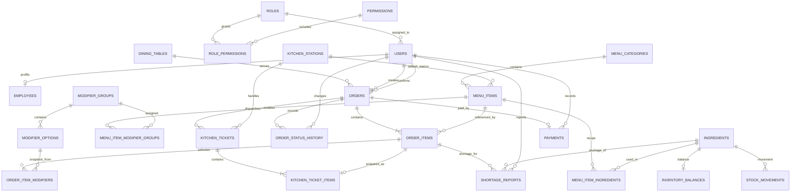

# Thiết Kế Cơ Sở Dữ Liệu ResMan (Database Design & ERD)

> **Loại tài liệu:** Database Design  
> **Phiên bản:** 1.0  
> **Ngày cập nhật:** 28/10/2026  
> **Nhánh:** `member/minhhuy`  
> **Nguồn yêu cầu chính:** [`docs/08-prd.md`](08-prd.md)  
> **Thiết kế hệ thống:** [`docs/09-system-analysis-and-design.md`](09-system-analysis-and-design.md)  
> **Skill áp dụng:** [`ai/skills/database-design/skill.md`](../ai/skills/database-design/skill.md)

---

## 1. Mục tiêu và phạm vi

Tài liệu xác định mô hình dữ liệu quan hệ cho ResMan, bao gồm:
- Danh sách thực thể và mục đích nghiệp vụ.
- Thuộc tính, kiểu dữ liệu, bắt buộc/tùy chọn.
- Khóa chính (PK), khóa ngoại (FK), unique và check constraints.
- Quan hệ giữa các thực thể và ERD.
- Nguyên tắc chuẩn hóa, toàn vẹn dữ liệu, transaction và indexing.
- Luồng ghi/đọc dữ liệu theo các nghiệp vụ chính.
- Những quyết định còn mở cần chủ dự án xác nhận.

### 1.1 Nguồn sự thật và nguyên tắc

Thứ tự ưu tiên:
1. PRD `docs/08-prd.md`.
2. System Analysis & Design `docs/09-system-analysis-and-design.md`.
3. Source code UI và dữ liệu mock hiện tại.
4. Đề xuất thiết kế trong tài liệu này.

Quy tắc:
- Không tạo bảng chỉ vì một component/màn hình UI tồn tại.
- Mỗi bảng phải có mục đích nghiệp vụ cụ thể.
- Giữ dữ liệu lịch sử đơn hàng và thanh toán ổn định, kể cả khi món ăn thay đổi.
- Không lưu trùng dữ liệu có thể suy ra nếu không có lý do nghiệp vụ.
- Mọi thao tác thay đổi tồn kho phải có lịch sử biến động.
- Các câu hỏi còn mở trong PRD không được âm thầm quyết định; thiết kế sẽ nêu rõ giả định và giới hạn.
- Đây là thiết kế logic/triển khai đề xuất, chưa phải migration SQL và chưa thay đổi source code ứng dụng.

### 1.2 Phạm vi MVP và phần chưa đưa vào

| Nhóm | Thiết kế trong tài liệu | Lý do |
|---|---|---|
| Tài khoản, vai trò, nhân viên | Có | F-013 quản lý nhân viên; backend cần danh tính và quyền |
| Danh mục và món ăn | Có | F-001, F-002 |
| Bàn | Có | UI đặt món theo bàn và ngữ cảnh phục vụ tại bàn |
| Đơn hàng, chi tiết đơn, lịch sử trạng thái | Có | F-003 đến F-007 |
| Vé bếp, món trong vé bếp, trạm bếp | Có | F-006, F-008, F-009; UI có KDS theo trạm |
| Nguyên liệu, tồn kho, biến động kho | Có | F-009 đến F-011 |
| Công thức/định mức nguyên liệu | Có ở mức liên kết đơn giản | UI hiển thị nguyên liệu theo món; hỗ trợ phân tích tiêu hao, nhưng thời điểm tự động trừ kho chưa chốt |
| Báo cáo | Không tạo bảng báo cáo riêng | Báo cáo tổng hợp từ đơn, thanh toán và tồn kho |
| Tài khoản khách hàng/hồ sơ khách hàng | Chưa đưa vào | OQ-06 chưa xác nhận khách cần tài khoản hay không |
| Ca làm việc | Chưa đưa vào | PRD F-013 chỉ xác nhận hồ sơ và vai trò nhân viên; UI có shift không đủ để mở rộng phạm vi |
| Nhà cung cấp/đơn mua hàng | Không | Chuỗi cung ứng nâng cao nằm ngoài phạm vi |
| Đa nhà hàng/chi nhánh/kho nhiều địa điểm | Không | Out of Scope |
| AI Recommendation | Không | F-016 là Future |
| Notification center tổng quát | Không tạo bảng riêng trong MVP | Chưa có yêu cầu dữ liệu/thông báo tổng quát; có thể bổ sung khi chốt kênh thông báo |
| Modifier/tùy chọn món | Có cấu trúc mở rộng gắn với UI, cần xác nhận phạm vi MVP | UI hiện có lựa chọn thêm/bớt món; PRD chưa đặc tả đầy đủ |

---

## 2. Các quyết định thiết kế nền tảng

### 2.1 Hệ quản trị và quy ước

Thiết kế theo PostgreSQL, phù hợp định hướng lưu trữ quan hệ của dự án.

| Quy ước | Lựa chọn |
|---|---|
| Primary key | `BIGINT GENERATED BY DEFAULT AS IDENTITY` |
| Foreign key | `BIGINT`, cùng kiểu với PK được tham chiếu |
| Thời gian | `TIMESTAMPTZ`, lưu theo UTC; client hiển thị theo múi giờ địa phương |
| Tiền tệ | `NUMERIC(14,2)`; đơn vị tiền VND được quy ước thống nhất |
| Số lượng tồn/định mức | `NUMERIC(14,3)` để hỗ trợ gram, ml và đơn vị lẻ |
| Trạng thái | `VARCHAR` + `CHECK` constraint; tránh PostgreSQL ENUM khó thay đổi khi MVP còn điều chỉnh |
| Boolean | `BOOLEAN NOT NULL DEFAULT ...` |
| Tên bảng/cột | snake_case, tên bảng số nhiều |
| Mặc định xóa | Không cascade delete dữ liệu nghiệp vụ đã phát sinh |
| Soft delete | Chỉ dùng khi cần bảo toàn lịch sử hoặc ẩn dữ liệu |

### 2.2 Phạm vi đơn nhà hàng

PRD xác nhận hệ thống cho một nhà hàng và loại trừ đa nhà hàng/đa chi nhánh. Vì vậy:
- Không tạo bảng `restaurants`, `branches` hoặc `locations` trong MVP.
- Không thêm `restaurant_id` vào mọi bảng.
- `dining_tables` và `inventory_balances` đại diện dữ liệu của một nhà hàng.
- Nếu yêu cầu đa chi nhánh xuất hiện sau này, phải thiết kế lại ranh giới tenant/location một cách có chủ đích.

### 2.3 Danh tính khách hàng

PRD OQ-06 chưa quyết định khách có tài khoản hay không. Do đó:
- Không tạo `customers`, `customer_accounts` hoặc lịch sử khách hàng cá nhân trong MVP.
- Đơn hàng có thể gắn với bàn và được tạo từ giao diện khách hoặc do Nhân viên Order tạo hộ.
- Nếu cần theo dõi đơn không đăng nhập, có thể bổ sung cơ chế mã theo dõi an toàn ở API; không lưu token thô trong database.
- AI Recommendation cần định danh khách hàng qua nhiều lần đặt món nên vẫn nằm ngoài schema MVP.

### 2.4 Định danh nhân viên và vai trò

- `users` lưu thông tin xác thực.
- `roles` định nghĩa các vai trò nghiệp vụ.
- `permissions` và `role_permissions` mô tả quyền ở mức hành động.
- `employees` lưu hồ sơ nhân viên; `employees.user_id` liên kết một-một với tài khoản nhân viên.
- Khách hàng không bắt buộc phải có bản ghi trong `users`.
- Một tài khoản có một vai trò chính trong MVP. Nếu sau này một nhân viên kiêm nhiều vai trò, có thể chuyển sang bảng `user_roles`.

---

## 3. Danh sách thực thể

### 3.1 Tổng quan

| Mã | Bảng | Mục đích | Nhóm |
|---|---|---|---|
| DB-01 | roles | Danh mục vai trò | Identity |
| DB-02 | permissions | Danh mục quyền | Identity |
| DB-03 | role_permissions | Liên kết vai trò - quyền | Identity |
| DB-04 | users | Tài khoản đăng nhập nhân viên | Identity |
| DB-05 | employees | Hồ sơ nhân viên | Staff |
| DB-06 | menu_categories | Danh mục món | Menu |
| DB-07 | kitchen_stations | Trạm chế biến | Kitchen |
| DB-08 | menu_items | Thông tin món ăn | Menu |
| DB-09 | modifier_groups | Nhóm tùy chọn món | Menu - UI extension |
| DB-10 | modifier_options | Tùy chọn trong nhóm | Menu - UI extension |
| DB-11 | menu_item_modifier_groups | Nhóm tùy chọn được áp dụng cho món | Menu - UI extension |
| DB-12 | dining_tables | Danh sách bàn | Dining |
| DB-13 | orders | Đơn hàng | Order |
| DB-14 | order_items | Các món trong đơn | Order |
| DB-15 | order_item_modifiers | Tùy chọn được chọn trong từng món của đơn | Order - UI extension |
| DB-16 | order_status_history | Lịch sử trạng thái đơn | Order |
| DB-17 | kitchen_tickets | Phiếu/vé bếp theo đơn và trạm | Kitchen |
| DB-18 | kitchen_ticket_items | Các món cần chế biến trong vé bếp | Kitchen |
| DB-19 | ingredients | Danh mục nguyên liệu | Inventory |
| DB-20 | menu_item_ingredients | Định mức nguyên liệu theo món | Inventory |
| DB-21 | inventory_balances | Số lượng tồn hiện tại | Inventory |
| DB-22 | stock_movements | Lịch sử nhập/xuất/điều chỉnh/hao hụt | Inventory |
| DB-23 | shortage_reports | Báo cáo thiếu nguyên liệu từ bếp | Inventory / Kitchen |
| DB-24 | payments | Giao dịch thanh toán | Payment |

Bảng báo cáo không được lưu riêng ở MVP. KPI được truy vấn/tổng hợp từ dữ liệu nghiệp vụ.

### 3.2 Quy ước ký hiệu thuộc tính

- **PK:** Khóa chính.
- **FK:** Khóa ngoại.
- **UQ:** Unique.
- **NN:** NOT NULL.
- **NULL:** Cho phép không có giá trị.
- **DF:** Giá trị mặc định.
- Các kiểu dữ liệu dưới đây theo PostgreSQL.

---

## 4. Thiết kế bảng chi tiết

### 4.1 Identity & Staff

#### DB-01 — `roles`

Danh mục vai trò được cấp cho tài khoản nhân viên.

| Cột | Kiểu | Ràng buộc | Ý nghĩa |
|---|---|---|---|
| id | BIGINT | PK | ID vai trò |
| code | VARCHAR(40) | NN, UQ | Mã vai trò |
| name | VARCHAR(100) | NN | Tên hiển thị |
| description | TEXT | NULL | Mô tả |
| created_at | TIMESTAMPTZ | NN, DF now() | Ngày tạo |

Seed ban đầu theo PRD: `MANAGER`, `ORDER_STAFF`, `KITCHEN_STAFF`, `WAREHOUSE_STAFF`. Không tạo role CUSTOMER trong `users` khi chưa có customer account.

#### DB-02 — `permissions`

Danh mục hành động mà backend có thể kiểm tra.

| Cột | Kiểu | Ràng buộc | Ý nghĩa |
|---|---|---|---|
| id | BIGINT | PK | ID quyền |
| code | VARCHAR(80) | NN, UQ | Mã quyền, ví dụ `ORDER_CONFIRM` |
| name | VARCHAR(120) | NN | Tên quyền |
| module | VARCHAR(50) | NN | Module áp dụng |
| description | TEXT | NULL | Mô tả |

Danh mục quyền phải được chốt trong API/RBAC design; không suy ra bảo mật chỉ từ menu frontend.

#### DB-03 — `role_permissions`

Bảng nối N-N giữa vai trò và quyền.

| Cột | Kiểu | Ràng buộc | Ý nghĩa |
|---|---|---|---|
| role_id | BIGINT | PK, FK → roles.id | Vai trò |
| permission_id | BIGINT | PK, FK → permissions.id | Quyền |

Khóa chính kép `(role_id, permission_id)` ngăn cấp cùng một quyền hai lần.

#### DB-04 — `users`

Thông tin xác thực cho nhân viên.

| Cột | Kiểu | Ràng buộc | Ý nghĩa |
|---|---|---|---|
| id | BIGINT | PK | ID tài khoản |
| role_id | BIGINT | NN, FK → roles.id | Vai trò chính |
| username | VARCHAR(80) | NN, UQ | Tên đăng nhập |
| email | VARCHAR(255) | NULL, UQ nếu có | Email |
| password_hash | VARCHAR(255) | NN | Mật khẩu đã băm |
| is_active | BOOLEAN | NN, DF true | Tài khoản hoạt động |
| last_login_at | TIMESTAMPTZ | NULL | Lần đăng nhập gần nhất |
| created_at | TIMESTAMPTZ | NN, DF now() | Ngày tạo |
| updated_at | TIMESTAMPTZ | NN, DF now() | Ngày cập nhật |

Không lưu mật khẩu dạng rõ. Nếu email nullable, cần dùng unique index có điều kiện hoặc cơ chế tương đương để cho phép nhiều tài khoản chưa khai báo email.

#### DB-05 — `employees`

Hồ sơ nhân viên do Quản lý quản lý.

| Cột | Kiểu | Ràng buộc | Ý nghĩa |
|---|---|---|---|
| id | BIGINT | PK | ID nhân viên |
| user_id | BIGINT | NN, UQ, FK → users.id | Tài khoản tương ứng |
| employee_code | VARCHAR(30) | NN, UQ | Mã nhân viên |
| full_name | VARCHAR(150) | NN | Họ tên |
| phone | VARCHAR(20) | NULL | Số điện thoại |
| employment_status | VARCHAR(20) | NN, DF 'ACTIVE', CHECK | ACTIVE / INACTIVE |
| hired_at | DATE | NULL | Ngày bắt đầu |
| created_at | TIMESTAMPTZ | NN, DF now() | Ngày tạo |
| updated_at | TIMESTAMPTZ | NN, DF now() | Ngày cập nhật |

Không đưa bảng ca làm việc vào MVP vì PRD F-013 mới xác nhận quản lý thông tin và vai trò nhân viên.

### 4.2 Menu & Kitchen setup

#### DB-06 — `menu_categories`

| Cột | Kiểu | Ràng buộc | Ý nghĩa |
|---|---|---|---|
| id | BIGINT | PK | ID danh mục |
| name | VARCHAR(100) | NN | Tên danh mục |
| code | VARCHAR(40) | NN, UQ | Mã danh mục |
| description | TEXT | NULL | Mô tả |
| display_order | INTEGER | NN, DF 0 | Thứ tự hiển thị |
| is_active | BOOLEAN | NN, DF true | Đang sử dụng |
| created_at | TIMESTAMPTZ | NN, DF now() | Ngày tạo |
| updated_at | TIMESTAMPTZ | NN, DF now() | Ngày cập nhật |

#### DB-07 — `kitchen_stations`

Danh mục trạm bếp/quầy pha chế được UI KDS sử dụng để phân luồng món.

| Cột | Kiểu | Ràng buộc | Ý nghĩa |
|---|---|---|---|
| id | BIGINT | PK | ID trạm |
| code | VARCHAR(40) | NN, UQ | Mã trạm |
| name | VARCHAR(100) | NN | Tên trạm |
| is_active | BOOLEAN | NN, DF true | Đang hoạt động |
| created_at | TIMESTAMPTZ | NN, DF now() | Ngày tạo |

#### DB-08 — `menu_items`

| Cột | Kiểu | Ràng buộc | Ý nghĩa |
|---|---|---|---|
| id | BIGINT | PK | ID món |
| category_id | BIGINT | NN, FK → menu_categories.id | Danh mục |
| kitchen_station_id | BIGINT | NULL, FK → kitchen_stations.id | Trạm chế biến mặc định |
| code | VARCHAR(40) | NN, UQ | Mã món |
| name | VARCHAR(150) | NN | Tên món |
| description | TEXT | NULL | Mô tả |
| price | NUMERIC(14,2) | NN, CHECK >= 0 | Giá bán hiện tại |
| image_url | TEXT | NULL | Đường dẫn ảnh |
| availability_status | VARCHAR(20) | NN, CHECK | AVAILABLE / OUT_OF_STOCK / INACTIVE |
| created_at | TIMESTAMPTZ | NN, DF now() | Ngày tạo |
| updated_at | TIMESTAMPTZ | NN, DF now() | Ngày cập nhật |
| deleted_at | TIMESTAMPTZ | NULL | Thời điểm ẩn/xóa mềm nếu áp dụng |

Không xóa cứng món đã được tham chiếu bởi đơn hàng. `order_items` lưu snapshot tên và giá nên báo cáo/lịch sử không bị thay đổi khi menu được cập nhật.

### 4.3 Modifier / tùy chọn món — phần mở rộng từ UI

PRD chưa đặc tả chi tiết modifier, nhưng UI có các lựa chọn như thêm trứng, ít đường, không hành. Thiết kế dưới đây hỗ trợ giao diện hiện có; cần xác nhận nhóm có đưa toàn bộ chức năng này vào MVP hay không.

#### DB-09 — `modifier_groups`

| Cột | Kiểu | Ràng buộc | Ý nghĩa |
|---|---|---|---|
| id | BIGINT | PK | ID nhóm |
| name | VARCHAR(100) | NN | Tên nhóm |
| selection_type | VARCHAR(20) | NN, CHECK | SINGLE / MULTIPLE |
| is_required | BOOLEAN | NN, DF false | Có bắt buộc chọn |
| min_select | INTEGER | NN, DF 0, CHECK >= 0 | Số lựa chọn tối thiểu |
| max_select | INTEGER | NULL, CHECK > 0 | Số lựa chọn tối đa nếu có |
| is_active | BOOLEAN | NN, DF true | Đang hoạt động |

#### DB-10 — `modifier_options`

| Cột | Kiểu | Ràng buộc | Ý nghĩa |
|---|---|---|---|
| id | BIGINT | PK | ID lựa chọn |
| modifier_group_id | BIGINT | NN, FK → modifier_groups.id | Nhóm cha |
| name | VARCHAR(120) | NN | Tên lựa chọn |
| price_delta | NUMERIC(14,2) | NN, DF 0 | Phần giá cộng/trừ |
| is_active | BOOLEAN | NN, DF true | Đang hoạt động |

#### DB-11 — `menu_item_modifier_groups`

| Cột | Kiểu | Ràng buộc | Ý nghĩa |
|---|---|---|---|
| menu_item_id | BIGINT | PK, FK → menu_items.id | Món áp dụng |
| modifier_group_id | BIGINT | PK, FK → modifier_groups.id | Nhóm lựa chọn |
| display_order | INTEGER | NN, DF 0 | Thứ tự hiển thị |

### 4.4 Dining & Order

#### DB-12 — `dining_tables`

| Cột | Kiểu | Ràng buộc | Ý nghĩa |
|---|---|---|---|
| id | BIGINT | PK | ID bàn |
| table_code | VARCHAR(30) | NN, UQ | Mã bàn |
| display_name | VARCHAR(60) | NN | Tên hiển thị |
| area_name | VARCHAR(100) | NULL | Khu vực |
| capacity | INTEGER | NULL, CHECK > 0 | Sức chứa |
| status | VARCHAR(20) | NN, DF 'ACTIVE', CHECK | ACTIVE / INACTIVE |
| created_at | TIMESTAMPTZ | NN, DF now() | Ngày tạo |

Không tạo `dining_sessions` ở MVP vì PRD chưa yêu cầu quản lý phiên sử dụng bàn. Đơn mang đi có thể để `table_id` NULL.

#### DB-13 — `orders`

Bảng trung tâm của vòng đời đơn hàng.

| Cột | Kiểu | Ràng buộc | Ý nghĩa |
|---|---|---|---|
| id | BIGINT | PK | ID đơn |
| order_code | VARCHAR(40) | NN, UQ | Mã đơn hiển thị |
| order_type | VARCHAR(20) | NN, CHECK | DINE_IN / TAKEAWAY |
| table_id | BIGINT | NULL, FK → dining_tables.id | Bàn nếu ăn tại chỗ |
| guest_count | INTEGER | NULL, CHECK > 0 | Số khách nếu biết |
| created_by_user_id | BIGINT | NULL, FK → users.id | Nhân viên tạo hộ; NULL nếu khách tự tạo |
| status | VARCHAR(30) | NN, CHECK | PENDING_CONFIRMATION / CONFIRMED / REJECTED / CANCELLED / IN_KITCHEN / PREPARING / READY / SERVED / COMPLETED |
| note | TEXT | NULL | Ghi chú chung |
| rejection_reason | TEXT | NULL | Lý do từ chối |
| cancellation_reason | TEXT | NULL | Lý do hủy nếu có |
| confirmed_by_user_id | BIGINT | NULL, FK → users.id | Nhân viên xác nhận |
| confirmed_at | TIMESTAMPTZ | NULL | Thời điểm xác nhận |
| dispatched_at | TIMESTAMPTZ | NULL | Thời điểm chuyển bếp |
| served_at | TIMESTAMPTZ | NULL | Thời điểm giao món |
| completed_at | TIMESTAMPTZ | NULL | Thời điểm hoàn tất |
| created_at | TIMESTAMPTZ | NN, DF now() | Thời điểm tạo |
| updated_at | TIMESTAMPTZ | NN, DF now() | Thời điểm cập nhật |

Ràng buộc nghiệp vụ:
- `order_type = 'DINE_IN'` thì `table_id` phải có giá trị.
- `order_type = 'TAKEAWAY'` thì `table_id` có thể NULL.
- Đơn bị từ chối phải có `rejection_reason`.
- Đơn bị hủy phải lưu lý do nếu quy trình yêu cầu.
- Chỉ đơn hợp lệ mới được xác nhận.
- Chỉ đơn đã giao món mới được ghi nhận thanh toán theo BR-006/F-012.
- Không cho phép khách hủy đơn sau khi đã vượt trạng thái chờ xác nhận theo BR-003 hiện tại.

**Lưu ý trạng thái:** PRD có trạng thái nghiệp vụ chờ xác nhận, đã xác nhận, từ chối, hủy, chuyển bếp, đang chế biến, hoàn tất và giao món. Tên mã ở trên là chuẩn hóa kỹ thuật; cần chốt một state machine cuối cùng trước khi viết migration. `COMPLETED` chỉ được dùng sau khi payment được ghi nhận thành công; không đồng nhất `READY` với `COMPLETED`.

#### DB-14 — `order_items`

Snapshot các món tại thời điểm khách đặt.

| Cột | Kiểu | Ràng buộc | Ý nghĩa |
|---|---|---|---|
| id | BIGINT | PK | ID chi tiết |
| order_id | BIGINT | NN, FK → orders.id | Đơn hàng |
| menu_item_id | BIGINT | NN, FK → menu_items.id | Món gốc |
| item_name_snapshot | VARCHAR(150) | NN | Tên món tại thời điểm đặt |
| unit_price | NUMERIC(14,2) | NN, CHECK >= 0 | Đơn giá snapshot |
| quantity | INTEGER | NN, CHECK > 0 | Số lượng |
| line_total | NUMERIC(14,2) | NN, CHECK >= 0 | Thành tiền snapshot |
| note | TEXT | NULL | Ghi chú riêng cho món |
| created_at | TIMESTAMPTZ | NN, DF now() | Thời điểm thêm |

`line_total` phải được backend tính và kiểm tra theo `unit_price × quantity` cùng các modifier đã chọn. Không tin giá/total do client gửi lên.

#### DB-15 — `order_item_modifiers`

Lưu lựa chọn modifier của từng dòng đơn, nếu chức năng modifier được duyệt.

| Cột | Kiểu | Ràng buộc | Ý nghĩa |
|---|---|---|---|
| id | BIGINT | PK | ID lựa chọn |
| order_item_id | BIGINT | NN, FK → order_items.id | Dòng đơn |
| modifier_option_id | BIGINT | NULL, FK → modifier_options.id | Lựa chọn gốc |
| option_name_snapshot | VARCHAR(120) | NN | Tên lựa chọn tại thời điểm đặt |
| price_delta_snapshot | NUMERIC(14,2) | NN, DF 0 | Phần giá tại thời điểm đặt |

Snapshot giúp đơn cũ không đổi khi quản lý đổi tên hoặc giá modifier.

#### DB-16 — `order_status_history`

Lưu vết mọi lần chuyển trạng thái.

| Cột | Kiểu | Ràng buộc | Ý nghĩa |
|---|---|---|---|
| id | BIGINT | PK | ID lịch sử |
| order_id | BIGINT | NN, FK → orders.id | Đơn hàng |
| from_status | VARCHAR(30) | NULL | Trạng thái trước; NULL khi tạo đơn |
| to_status | VARCHAR(30) | NN | Trạng thái sau |
| changed_by_user_id | BIGINT | NULL, FK → users.id | Nhân viên thực hiện; NULL nếu hệ thống/khách |
| reason | TEXT | NULL | Lý do |
| changed_at | TIMESTAMPTZ | NN, DF now() | Thời điểm thay đổi |

Mỗi thay đổi trạng thái đơn và bản ghi lịch sử phải nằm trong cùng transaction.

### 4.5 Kitchen Operations

#### DB-17 — `kitchen_tickets`

Một đơn có thể được chia thành các vé theo trạm chế biến.

| Cột | Kiểu | Ràng buộc | Ý nghĩa |
|---|---|---|---|
| id | BIGINT | PK | ID vé bếp |
| order_id | BIGINT | NN, FK → orders.id | Đơn nguồn |
| kitchen_station_id | BIGINT | NN, FK → kitchen_stations.id | Trạm phụ trách |
| status | VARCHAR(20) | NN, CHECK | QUEUED / PREPARING / READY / CANCELLED |
| priority | INTEGER | NN, DF 0 | Mức ưu tiên |
| dispatched_at | TIMESTAMPTZ | NN | Thời điểm vào hàng đợi |
| started_at | TIMESTAMPTZ | NULL | Bắt đầu chế biến |
| completed_at | TIMESTAMPTZ | NULL | Hoàn tất vé |

Unique đề xuất: `(order_id, kitchen_station_id)` nếu mỗi đơn chỉ có một vé cho mỗi trạm. Nếu nghiệp vụ cho phép nhiều đợt gửi cùng trạm, cần thay bằng mã đợt/sequence thay vì áp unique này.

#### DB-18 — `kitchen_ticket_items`

| Cột | Kiểu | Ràng buộc | Ý nghĩa |
|---|---|---|---|
| id | BIGINT | PK | ID dòng vé |
| kitchen_ticket_id | BIGINT | NN, FK → kitchen_tickets.id | Vé bếp |
| order_item_id | BIGINT | NN, UQ, FK → order_items.id | Món thuộc đơn |
| status | VARCHAR(20) | NN, CHECK | QUEUED / PREPARING / READY / SHORTAGE / CANCELLED |
| preparation_note | TEXT | NULL | Ghi chú bếp |
| started_at | TIMESTAMPTZ | NULL | Thời điểm bắt đầu |
| completed_at | TIMESTAMPTZ | NULL | Thời điểm hoàn thành |

Một `order_item` chỉ thuộc một trạm/vé trong thiết kế MVP. Nếu cần chia cùng một món qua nhiều trạm, mô hình cần thay đổi.

### 4.6 Inventory

#### DB-19 — `ingredients`

| Cột | Kiểu | Ràng buộc | Ý nghĩa |
|---|---|---|---|
| id | BIGINT | PK | ID nguyên liệu |
| code | VARCHAR(40) | NN, UQ | Mã nguyên liệu |
| name | VARCHAR(150) | NN | Tên |
| base_unit | VARCHAR(20) | NN | Đơn vị chuẩn: g, kg, ml, l, piece... |
| low_stock_threshold | NUMERIC(14,3) | NULL, CHECK >= 0 | Ngưỡng cảnh báo |
| is_active | BOOLEAN | NN, DF true | Đang sử dụng |
| created_at | TIMESTAMPTZ | NN, DF now() | Ngày tạo |
| updated_at | TIMESTAMPTZ | NN, DF now() | Ngày cập nhật |

OQ-03 chưa quyết định ai/cách thiết lập ngưỡng tồn thấp. Cột này cho phép cấu hình sau khi nhóm chốt chính sách; không tự mặc định một ngưỡng cụ thể.

#### DB-20 — `menu_item_ingredients`

Liên kết món ăn với nguyên liệu và lượng dùng theo một đơn vị phục vụ.

| Cột | Kiểu | Ràng buộc | Ý nghĩa |
|---|---|---|---|
| menu_item_id | BIGINT | PK, FK → menu_items.id | Món ăn |
| ingredient_id | BIGINT | PK, FK → ingredients.id | Nguyên liệu |
| quantity_per_item | NUMERIC(14,3) | NN, CHECK > 0 | Lượng nguyên liệu cho một món |
| note | TEXT | NULL | Ghi chú định mức |

`quantity_per_item` phải dùng cùng đơn vị chuẩn `ingredients.base_unit`. Ví dụ nguyên liệu có base unit là gram thì recipe cũng lưu gram. Không tự động chuyển đổi kg/g hoặc lít/ml nếu chưa có quy tắc chuyển đổi rõ ràng.

Bảng này hỗ trợ định mức dữ liệu; thời điểm trừ kho tự động vẫn là câu hỏi mở. Khi chưa chốt, hệ thống chỉ ghi nhận nhập/xuất/điều chỉnh do nghiệp vụ được duyệt.

#### DB-21 — `inventory_balances`

Số lượng hiện tại của mỗi nguyên liệu tại nhà hàng đơn lẻ.

| Cột | Kiểu | Ràng buộc | Ý nghĩa |
|---|---|---|---|
| id | BIGINT | PK | ID số dư |
| ingredient_id | BIGINT | NN, UQ, FK → ingredients.id | Nguyên liệu |
| quantity_on_hand | NUMERIC(14,3) | NN, DF 0, CHECK >= 0 | Số lượng tồn hiện tại |
| updated_at | TIMESTAMPTZ | NN, DF now() | Thời điểm cập nhật |

Mỗi nguyên liệu có một dòng số dư. Việc thay đổi số dư phải đi kèm bản ghi `stock_movements` trong cùng transaction.

#### DB-22 — `stock_movements`

Sổ cái ghi nhận mọi biến động tồn kho.

| Cột | Kiểu | Ràng buộc | Ý nghĩa |
|---|---|---|---|
| id | BIGINT | PK | ID biến động |
| ingredient_id | BIGINT | NN, FK → ingredients.id | Nguyên liệu |
| movement_type | VARCHAR(20) | NN, CHECK | IN / OUT / ADJUSTMENT / WASTE |
| quantity_delta | NUMERIC(14,3) | NN, CHECK <> 0 | Lượng thay đổi có dấu (+/-) |
| reason | TEXT | NN | Lý do |
| reference_type | VARCHAR(30) | NULL | Nguồn nghiệp vụ nếu có |
| reference_id | BIGINT | NULL | ID nguồn nghiệp vụ; không dùng FK đa hình |
| created_by_user_id | BIGINT | NN, FK → users.id | Người thực hiện |
| created_at | TIMESTAMPTZ | NN, DF now() | Thời điểm |

Quy ước:
- IN: `quantity_delta > 0`.
- OUT/WASTE: `quantity_delta < 0`.
- ADJUSTMENT: dương hoặc âm tùy điều chỉnh.
- Backend khóa dòng `inventory_balances` khi cập nhật đồng thời để tránh lost update.
- Không xóa hoặc sửa lịch sử biến động đã ghi nhận; sai sót phải được điều chỉnh bằng một movement mới.
- `reference_type/reference_id` chỉ để truy vết nguồn nghiệp vụ; nếu cần ràng buộc FK mạnh cho từng nguồn, dùng các cột FK riêng hoặc bảng liên kết chuyên biệt.

#### DB-23 — `shortage_reports`

Bếp báo thiếu nguyên liệu để Kho và Order phối hợp xử lý theo BR-007/BR-008.

| Cột | Kiểu | Ràng buộc | Ý nghĩa |
|---|---|---|---|
| id | BIGINT | PK | ID báo thiếu |
| order_item_id | BIGINT | NN, FK → order_items.id | Món đang gặp vấn đề |
| ingredient_id | BIGINT | NULL, FK → ingredients.id | Nguyên liệu thiếu nếu xác định |
| reported_by_user_id | BIGINT | NN, FK → users.id | Nhân viên bếp báo |
| description | TEXT | NN | Nội dung thiếu hụt |
| status | VARCHAR(20) | NN, DF 'OPEN', CHECK | OPEN / IN_PROGRESS / RESOLVED / CANCELLED |
| resolved_by_user_id | BIGINT | NULL, FK → users.id | Người xử lý |
| resolved_at | TIMESTAMPTZ | NULL | Thời điểm xử lý |
| created_at | TIMESTAMPTZ | NN, DF now() | Thời điểm tạo |

Thông báo tới Order và Kho có thể được phát qua application event/in-app notification ở tầng ứng dụng; bảng này lưu nghiệp vụ báo thiếu, không thay thế một notification center tổng quát.

### 4.7 Payment

#### DB-24 — `payments`

Ghi nhận khoản thanh toán cho đơn hàng.

| Cột | Kiểu | Ràng buộc | Ý nghĩa |
|---|---|---|---|
| id | BIGINT | PK | ID thanh toán |
| order_id | BIGINT | NN, UQ, FK → orders.id | Đơn hàng được thanh toán |
| amount | NUMERIC(14,2) | NN, CHECK > 0 | Số tiền ghi nhận |
| payment_method | VARCHAR(30) | NN | Phương thức thanh toán |
| status | VARCHAR(20) | NN, DF 'RECORDED', CHECK | RECORDED / VOIDED |
| recorded_by_user_id | BIGINT | NN, FK → users.id | Nhân viên ghi nhận |
| transaction_reference | VARCHAR(100) | NULL | Mã tham chiếu nếu có |
| paid_at | TIMESTAMPTZ | NN, DF now() | Thời điểm thanh toán |
| created_at | TIMESTAMPTZ | NN, DF now() | Thời điểm tạo |

Thiết kế MVP hiện giả định một khoản thanh toán được ghi nhận cho mỗi đơn. OQ-02 chưa chốt phương thức tiền mặt/thẻ/ví; `payment_method` giữ dạng mã để dễ mở rộng. Nếu nhóm cần chia hóa đơn, thanh toán nhiều lần hoặc tích hợp gateway, phải xem xét lại unique `order_id` và vòng đời Payment trước khi triển khai.

---

## 5. Sơ đồ ERD tổng thể

Sơ đồ dưới đây thể hiện quan hệ chính giữa các bảng. Các bảng nối và chi tiết modifier được giữ lại để phản ánh cấu trúc dữ liệu, không có nghĩa tất cả tính năng UI modifier đã được chốt MVP.

### 5.1 Cardinality chính

| Quan hệ | Cardinality | Giải thích |
|---|---|---|
| Role - User | 1-N | Một vai trò có nhiều tài khoản; mỗi tài khoản có một vai trò chính |
| Role - Permission | N-N | Thông qua role_permissions |
| User - Employee | 1-0..1 | Một tài khoản nhân viên có tối đa một hồ sơ nhân sự |
| Category - Menu Item | 1-N | Một danh mục có nhiều món |
| Menu Item - Order Item | 1-N | Một món có thể xuất hiện ở nhiều đơn |
| Order - Order Item | 1-N | Một đơn gồm ít nhất một dòng món |
| Order - Status History | 1-N | Một đơn có nhiều lần thay đổi trạng thái |
| Order - Kitchen Ticket | 1-N | Một đơn có thể đi qua nhiều trạm bếp |
| Kitchen Ticket - Ticket Item | 1-N | Một vé có nhiều món cần chế biến |
| Menu Item - Ingredient | N-N | Thông qua menu_item_ingredients |
| Ingredient - Stock Movement | 1-N | Một nguyên liệu có nhiều biến động |
| Ingredient - Inventory Balance | 1-1 | Mỗi nguyên liệu có một số dư trong nhà hàng đơn lẻ |
| Order - Payment | 1-0..1 | Một đơn có tối đa một thanh toán được ghi nhận trong giả định MVP |

---

## 6. Quy tắc toàn vẹn dữ liệu

### 6.1 Primary key và Foreign key

- Mỗi bảng có PK ổn định, không dùng tên hoặc mã hiển thị làm PK.
- FK phải tham chiếu bản ghi tồn tại.
- Dữ liệu lịch sử không được cascade delete theo bản ghi cha.
- Khi món đã xuất hiện trong đơn, không xóa cứng món; chuyển trạng thái INACTIVE hoặc dùng deleted_at.
- Không xóa nhân viên đã thực hiện giao dịch; vô hiệu hóa tài khoản/hồ sơ thay vì xóa lịch sử.

### 6.2 Check constraints quan trọng

| Bảng | Constraint |
|---|---|
| menu_items | price >= 0 |
| modifier_options | price_delta có thể âm/dương nhưng tổng giá dòng không âm |
| dining_tables | capacity IS NULL OR capacity > 0 |
| orders | guest_count IS NULL OR guest_count > 0 |
| orders | order_type thuộc DINE_IN, TAKEAWAY |
| orders | DINE_IN yêu cầu table_id |
| order_items | quantity > 0, unit_price >= 0, line_total >= 0 |
| ingredients | low_stock_threshold IS NULL OR >= 0 |
| menu_item_ingredients | quantity_per_item > 0 |
| inventory_balances | quantity_on_hand >= 0 |
| stock_movements | quantity_delta <> 0; dấu phù hợp movement_type |
| payments | amount > 0 |
| employees | employment_status thuộc ACTIVE, INACTIVE |

### 6.3 Quy tắc lịch sử và snapshot

- Tên món, đơn giá và modifier được snapshot trong chi tiết đơn.
- Đổi giá menu không làm thay đổi đơn cũ.
- Đổi tên nguyên liệu không làm mất ý nghĩa các biến động kho cũ; nếu cần lịch sử tên chính xác, có thể snapshot tên nguyên liệu vào movement ở bước triển khai.
- Lịch sử trạng thái đơn chỉ được append; không ghi đè bản ghi cũ.
- Stock movement chỉ append; điều chỉnh sai được bù bằng movement mới.
- Payment đã ghi nhận không xóa cứng; nếu cần hủy/đảo giao dịch phải có quy trình và quyền riêng.

---

## 7. Chuẩn hóa dữ liệu

Thiết kế hướng đến chuẩn hóa tối thiểu 3NF cho dữ liệu nghiệp vụ:

1. **1NF:** Các cột chứa giá trị đơn; danh sách món trong đơn không lưu thành chuỗi JSON hoặc text trong bảng orders.
2. **2NF:** Các bảng nối N-N như role_permissions và menu_item_ingredients có khóa kép; thuộc tính phụ thuộc toàn bộ khóa.
3. **3NF:** Thông tin vai trò nằm trong roles, danh mục món nằm trong menu_categories, nguyên liệu nằm trong ingredients; không lặp lại tên danh mục/nguyên liệu ở các bảng giao dịch trừ snapshot có mục đích lịch sử.

### 7.1 Những dữ liệu có chủ đích được lặp lại

| Dữ liệu | Vị trí snapshot | Lý do |
|---|---|---|
| Tên món | order_items.item_name_snapshot | Bảo toàn lịch sử đơn khi menu đổi tên |
| Giá món | order_items.unit_price | Bảo toàn giá tại thời điểm đặt |
| Tên modifier | order_item_modifiers.option_name_snapshot | Bảo toàn lựa chọn cũ |
| Giá modifier | order_item_modifiers.price_delta_snapshot | Không để thay đổi giá tùy chọn làm đổi đơn cũ |

### 7.2 Dữ liệu không nên lưu trùng

- Không lưu danh sách món trong cột JSON của orders.
- Không lưu tên role trong employees khi đã có users.role_id → roles.
- Không tạo bảng report_daily chứa bản sao doanh thu nếu chưa có nhu cầu tối ưu/đóng sổ.
- Không tạo cột status_label song song với status; label được ánh xạ ở frontend.
- Không lưu tổng tồn kho trong ingredients nếu inventory_balances là nguồn số dư chuẩn.

---

## 8. Transaction và luồng ghi dữ liệu

### 8.1 Tạo đơn hàng

Một transaction:
1. Kiểm tra tất cả menu_items tồn tại, đang AVAILABLE và giá hiện tại hợp lệ.
2. Kiểm tra bàn tồn tại/đang hoạt động nếu DINE_IN.
3. Tạo orders với PENDING_CONFIRMATION.
4. Tạo các order_items với snapshot tên và giá.
5. Tạo order_item_modifiers nếu được sử dụng.
6. Tạo order_status_history với from_status NULL và to_status PENDING_CONFIRMATION.
7. Commit.

Nếu bất kỳ bước nào lỗi, rollback toàn bộ. Không tạo Kitchen Ticket ở bước khách gửi đơn vì PRD yêu cầu Nhân viên Order xác nhận trước khi chuyển bếp.

### 8.2 Nhân viên Order xác nhận và điều phối bếp

Transaction xác nhận:
1. Khóa đơn cần xử lý hoặc kiểm tra version/state để tránh hai nhân viên xác nhận đồng thời.
2. Kiểm tra status hiện tại là PENDING_CONFIRMATION.
3. Kiểm tra lại trạng thái còn bán của các món theo BR-001/BR-004.
4. Cập nhật orders sang CONFIRMED, người xác nhận và thời điểm.
5. Ghi order_status_history.
6. Commit.

Transaction điều phối:
1. Chỉ cho phép đơn CONFIRMED được dispatch.
2. Phân nhóm order_items theo kitchen_station_id của menu_items.
3. Tạo kitchen_tickets và kitchen_ticket_items theo trạm.
4. Cập nhật đơn sang IN_KITCHEN và dispatched_at.
5. Ghi lịch sử trạng thái.
6. Commit.

Cần idempotency/unique rule để thao tác dispatch lặp không tạo vé bếp trùng.

### 8.3 Cập nhật tiến độ bếp

- Bếp cập nhật trạng thái ticket item: QUEUED → PREPARING → READY (hoặc SHORTAGE/CANCELLED theo điều kiện).
- Khi toàn bộ món thuộc ticket hoàn tất, ticket chuyển READY.
- Khi tất cả ticket/món liên quan của đơn hoàn tất, đơn có thể chuyển READY.
- Nhân viên Order xác nhận giao món; đơn chuyển SERVED.
- Không đánh dấu toàn bộ đơn hoàn tất chỉ vì một ticket/trạm đã hoàn tất.

### 8.4 Ghi nhận thanh toán

Một transaction:
1. Khóa order.
2. Kiểm tra đơn ở trạng thái SERVED.
3. Kiểm tra chưa có payment hợp lệ.
4. Tính số tiền phải thu từ dữ liệu server và chính sách phí/thuế đã duyệt.
5. Tạo payment.
6. Chuyển order sang COMPLETED.
7. Ghi order_status_history.
8. Commit.

Không để payment đã ghi nhận thành công nhưng order chưa cập nhật, hoặc order hoàn tất mà không có payment.

### 8.5 Nhập/xuất/điều chỉnh tồn kho

Một transaction cho mỗi nguyên liệu:
1. Khóa inventory_balances của ingredient.
2. Tính số dư mới từ số dư hiện tại + quantity_delta.
3. Kiểm tra số dư mới >= 0.
4. Cập nhật inventory_balances.
5. Tạo stock_movements với loại, lượng thay đổi, lý do, người thực hiện và thời điểm.
6. Commit.

Không cho phép cập nhật số dư trực tiếp mà không tạo movement tương ứng.

### 8.6 Thời điểm tiêu hao nguyên liệu

PRD yêu cầu cập nhật tồn kho sau khi sử dụng hoặc nhập hàng, nhưng chưa chốt thời điểm tự động trừ theo công thức. Do đó:
- Thiết kế đã có menu_item_ingredients để lưu định mức.
- Không tự động trừ tồn khi khách mới tạo đơn.
- Chưa chọn thời điểm trừ tại xác nhận, bắt đầu chế biến hay hoàn thành món.
- Cần quyết định OQ liên quan trước khi bật tự động tiêu hao.

---

## 9. Indexing đề xuất

Index chỉ tạo khi phục vụ truy vấn thực tế; không index mọi cột.

| Bảng | Index | Mục đích |
|---|---|---|
| users | UNIQUE(username) | Đăng nhập |
| users | UNIQUE(email) WHERE email IS NOT NULL | Email không trùng nếu có |
| employees | UNIQUE(employee_code) | Tra cứu hồ sơ |
| menu_items | (availability_status, category_id) | Hiển thị menu |
| menu_items | (kitchen_station_id) | Phân nhóm món vào trạm |
| orders | UNIQUE(order_code) | Tra cứu mã đơn |
| orders | (status, created_at DESC) | Danh sách đơn theo trạng thái/thời gian |
| orders | (table_id, created_at DESC) | Lịch sử đơn theo bàn |
| order_items | (order_id) | Lấy chi tiết đơn |
| order_status_history | (order_id, changed_at DESC) | Timeline đơn |
| kitchen_tickets | (kitchen_station_id, status, dispatched_at) | KDS theo trạm và trạng thái |
| kitchen_ticket_items | (kitchen_ticket_id, status) | Lọc món trong vé |
| ingredients | UNIQUE(code) | Tra cứu nguyên liệu |
| stock_movements | (ingredient_id, created_at DESC) | Lịch sử biến động nguyên liệu |
| shortage_reports | (status, created_at DESC) | Danh sách báo thiếu đang mở |
| payments | UNIQUE(order_id) | Một thanh toán/đơn trong giả định MVP |
| payments | (paid_at DESC) | Báo cáo doanh thu theo thời gian |

PostgreSQL tự tạo index cho PK và UNIQUE constraint. Không tạo thêm index trùng lặp với các index này.

---

## 10. Mapping yêu cầu PRD với bảng dữ liệu

| Feature / Requirement | Bảng liên quan | Mục đích |
|---|---|---|
| F-001 / FR-001 Quản lý món ăn | menu_categories, menu_items, kitchen_stations | Lưu danh mục, món, giá, trạng thái và trạm |
| F-002 / FR-002 Xem thực đơn | menu_categories, menu_items | Đọc menu và trạng thái còn/hết |
| F-003 / FR-003 Tạo đơn | orders, order_items, dining_tables | Lưu đơn và các món |
| F-004 / FR-004 Kiểm tra hợp lệ | menu_items, orders, order_items | Kiểm tra trạng thái món và dữ liệu đơn |
| F-005 / FR-005 Xử lý đơn mới | orders, order_status_history, users | Xác nhận/từ chối, lưu lý do và tác nhân |
| F-006 / FR-006 Điều phối bếp/giao món | orders, kitchen_tickets, kitchen_ticket_items | Điều phối và cập nhật vòng đời |
| F-007 / FR-007 Theo dõi/hủy đơn | orders, order_status_history | Đọc trạng thái mới nhất, lưu hủy |
| F-008 / FR-008 Hàng đợi bếp | kitchen_tickets, kitchen_ticket_items, kitchen_stations | Hiển thị hàng đợi theo trạm |
| F-009 / FR-009 Tiến độ chế biến/thiếu nguyên liệu | kitchen_ticket_items, shortage_reports | Cập nhật món, báo thiếu |
| F-010 / FR-010 Giám sát tồn | ingredients, inventory_balances | Hiển thị số lượng và cảnh báo |
| F-011 / FR-011 Cập nhật tồn | ingredients, inventory_balances, stock_movements | Cập nhật số dư và lịch sử |
| F-012 / FR-012 Thanh toán | payments, orders, order_status_history | Ghi nhận giao dịch và đóng đơn |
| F-013 / FR-013 Quản lý nhân viên | users, roles, permissions, role_permissions, employees | Hồ sơ, tài khoản, vai trò |
| F-014 / FR-014 Báo cáo | orders, order_items, payments, ingredients, inventory_balances, stock_movements | Tổng hợp doanh thu, đơn, tồn |

---

## 11. Câu hỏi mở cần xác nhận trước migration

Các mục sau đã được giữ nguyên trạng thái chưa quyết định theo PRD; thiết kế hiện tại chỉ đưa ra cấu trúc có thể điều chỉnh.

| ID PRD | Câu hỏi | Ảnh hưởng schema | Thiết kế tạm thời |
|---|---|---|---|
| OQ-02 | Phương thức thanh toán cụ thể? | Giá trị payment_method và tích hợp | Lưu mã VARCHAR; chưa tạo gateway table |
| OQ-03 | Ai/cách thiết lập ngưỡng tồn thấp? | low_stock_threshold và quyền cập nhật | Cột nullable; chờ chính sách |
| OQ-04 | Điều kiện chính xác để hủy đơn? | Status transition, cancellation_reason | Theo BR-003: chỉ hủy khi chờ xác nhận |
| OQ-05 | Chuyển đơn sang KDS tự động hay thủ công? | Thời điểm tạo ticket và người dispatch | Có dispatched_at; chỉ tạo sau xác nhận |
| OQ-06 | Khách có cần tài khoản? | Customer/User/session/tracking | Chưa tạo customer account |
| OQ-07 | Xóa món đang nằm trong đơn chưa hoàn tất? | FK và soft delete | Giữ FK lịch sử; dùng INACTIVE/deleted_at |
| OQ-09 | Có thông báo SMS/Email hay chỉ trong ứng dụng? | Notification/outbox/integration | Chưa tạo notification center tổng quát |

### 11.1 Các quyết định thiết kế bổ sung cần nhóm duyệt

| ID | Quyết định | Đề xuất hiện tại | Lý do |
|---|---|---|---|
| DD-01 | Một đơn có thể chia nhiều trạm bếp? | Có, một ticket cho mỗi trạm | UI KDS có station |
| DD-02 | Một order item có thuộc nhiều ticket? | Không trong MVP | Đơn giản hóa điều phối |
| DD-03 | Một đơn có thể thanh toán nhiều lần/chia bill? | Không trong MVP; một payment/đơn | PRD chưa yêu cầu split payment |
| DD-04 | Có modifier trong MVP? | Chuẩn bị bảng, cần xác nhận | UI có modifier nhưng PRD chưa đặc tả |
| DD-05 | Có tự động trừ kho theo recipe? | Chưa bật cho đến khi chốt thời điểm | Tránh sai tồn khi hủy/thiếu món |
| DD-06 | Có lưu ca làm việc? | Không trong MVP | PRD chỉ xác nhận hồ sơ/vai trò |

---

## 12. Các điểm cần chú ý khi triển khai PostgreSQL

1. Tạo bảng theo thứ tự phụ thuộc FK: roles/permissions → users/employees; categories/stations → menu; tables → orders → order_items; kitchen tickets; ingredients → balances/movements; payments.
2. Seed role, permission, category, station và trạng thái ban đầu bằng migration/seed có thể chạy lặp an toàn.
3. Dùng migration versioned; không chỉnh trực tiếp database production bằng thao tác thủ công không có migration.
4. Tạo index và constraint trong migration, không chỉ validate ở frontend.
5. Dùng transaction ở use case tạo đơn, xác nhận/dispatch, thanh toán và điều chỉnh kho.
6. Dùng row-level lock hoặc optimistic locking phù hợp để tránh hai người cập nhật cùng đơn/tồn kho.
7. Không lưu password dạng rõ; hash bằng thuật toán phù hợp ở backend.
8. Không lưu access token hoặc session secret dạng rõ nếu sau này bổ sung customer tracking.
9. Seed dữ liệu demo tách khỏi dữ liệu production.
10. Backup và thử restore database trước khi có dữ liệu vận hành quan trọng.

---

## 13. Kiểm tra mô hình với luồng nghiệp vụ

### 13.1 Customer → Order → Kitchen → Payment

- Khách chọn món: đọc menu_categories/menu_items.
- Gửi đơn: tạo orders, order_items, order_status_history.
- Order Staff xác nhận: cập nhật orders và lịch sử.
- Dispatch: tạo kitchen_tickets và kitchen_ticket_items.
- Bếp cập nhật: thay đổi ticket/ticket item.
- Order giao món: cập nhật orders sang SERVED.
- Ghi nhận thanh toán: tạo payments, cập nhật orders sang COMPLETED.
- Báo cáo: tổng hợp từ orders, order_items, payments.

### 13.2 Kitchen → Inventory

- Bếp báo thiếu: tạo shortage_reports gắn với order_item và nguyên liệu nếu biết.
- Kho kiểm tra tồn: đọc inventory_balances và stock_movements.
- Kho nhập/điều chỉnh/ghi hao hụt: cập nhật balance và append movement.
- Cảnh báo tồn thấp: so sánh quantity_on_hand với low_stock_threshold.

### 13.3 Manager → Menu & Staff

- Quản lý cập nhật menu: thay đổi menu_categories/menu_items.
- Quản lý nhân viên: tạo/cập nhật employees và users, gán role.
- Báo cáo: truy vấn các bảng giao dịch; không ghi đè dữ liệu nguồn.

---

## 14. Tiêu chí nghiệm thu Database Design

- [ ] Mỗi bảng có mục đích nghiệp vụ rõ ràng và liên kết được với PRD.
- [ ] Mỗi bảng có PK.
- [ ] Quan hệ có FK và cardinality hợp lý.
- [ ] Unique/check constraints được xác định.
- [ ] Các trường bắt buộc/tùy chọn đã được phân biệt.
- [ ] Lịch sử đơn hàng không bị thay đổi khi menu cập nhật.
- [ ] Tồn kho có số dư và sổ cái biến động.
- [ ] Thanh toán gắn với đơn và chỉ hoàn tất đơn sau khi ghi nhận hợp lệ.
- [ ] Không có bảng AI/Future bị đưa nhầm vào MVP.
- [ ] Không đưa đa chi nhánh, nhà cung cấp hoặc quản lý ca vào MVP khi chưa được duyệt.
- [ ] Có kế hoạch transaction cho các luồng ghi quan trọng.
- [ ] Có indexing theo truy vấn dự kiến.
- [ ] Các OQ/DD ảnh hưởng schema đã được chủ dự án xác nhận trước khi tạo migration.

---

## 15. Kết luận và bước tiếp theo

Mô hình đề xuất gồm 24 bảng, chia thành Identity/Staff, Menu, Order, Kitchen, Inventory và Payment. Đây là mô hình quan hệ cho phạm vi MVP cùng một số cấu trúc mở rộng được đánh dấu riêng để hỗ trợ giao diện hiện tại.

Các điểm thiết kế quan trọng:
- `orders` và `order_items` là trung tâm vòng đời đơn.
- `order_status_history` lưu vết chuyển trạng thái.
- `kitchen_tickets` và `kitchen_ticket_items` tách tiến độ chế biến khỏi thông tin đơn hàng.
- `inventory_balances` giữ số dư hiện tại; `stock_movements` là lịch sử biến động.
- `payments` ghi nhận giao dịch và liên kết với đơn.
- `menu_item_ingredients` hỗ trợ định mức, nhưng chưa tự động trừ kho cho đến khi nhóm quyết định thời điểm tiêu hao.
- Không có bảng riêng cho báo cáo, AI, khách hàng có tài khoản, nhà cung cấp, chi nhánh hoặc ca làm việc trong MVP hiện tại.

**Bước tiếp theo sau khi duyệt ERD:** chốt các quyết định DD/OQ ảnh hưởng trực tiếp đến schema, sau đó chuyển mô hình này thành PostgreSQL DDL/migration và kiểm tra schema bằng migration test. Chưa nên viết migration production trước khi các điểm về modifier, thanh toán, chia trạm bếp và tiêu hao kho được xác nhận.

---

## 16. Tài liệu tham chiếu

- `docs/08-prd.md` — Product Requirements Document, nguồn yêu cầu chính.
- `docs/09-system-analysis-and-design.md` — Phân tích và thiết kế hệ thống.
- `docs/02-actor-analysis.md` — Actor Analysis.
- `docs/05-system-model.md` — System Model.
- `ai/skills/database-design/skill.md` — Quy trình và quy tắc Database Design.
- `src/frontend/src/App.tsx` — State và luồng kết nối các module UI.
- `src/frontend/src/data/mockData.ts` — Dữ liệu minh họa menu, order, KDS và inventory.
- `src/frontend/src/components/customer/CustomerOrderView.tsx` — Giao diện khách đặt món.
- `src/frontend/src/components/orders/LiveOrdersView.tsx` — Giao diện quản lý đơn.
- `src/frontend/src/components/kds/KDSView.tsx` — Giao diện KDS.
- `src/frontend/src/components/inventory/InventoryAuditView.tsx` — Giao diện kho.
- `src/frontend/src/components/staff/StaffShiftsView.tsx` — Giao diện nhân sự.
