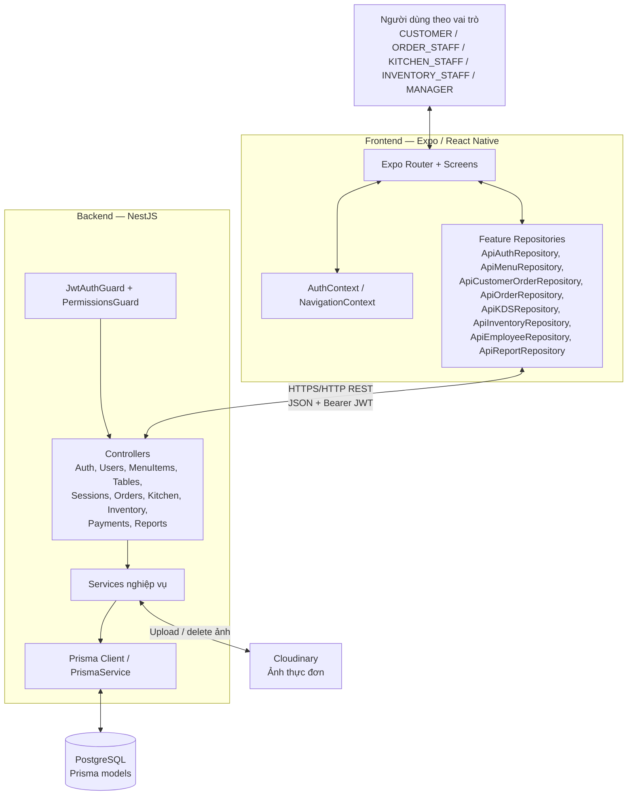
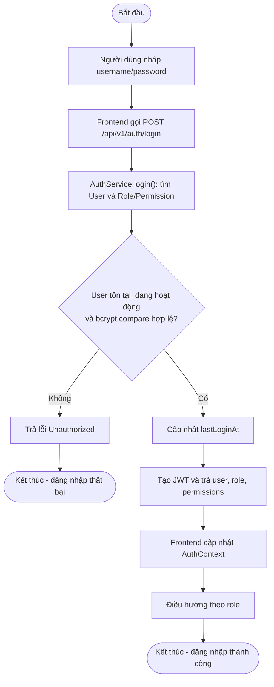
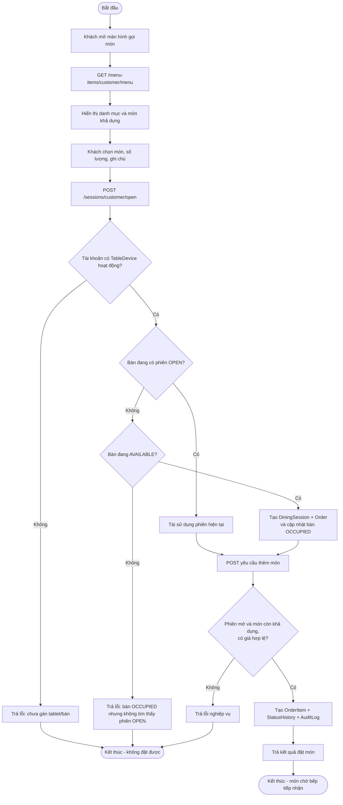
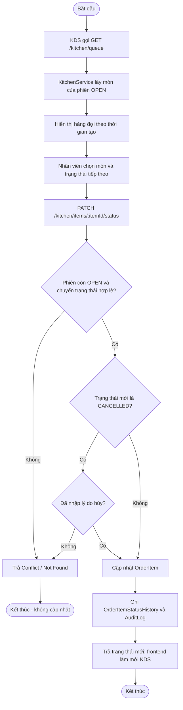
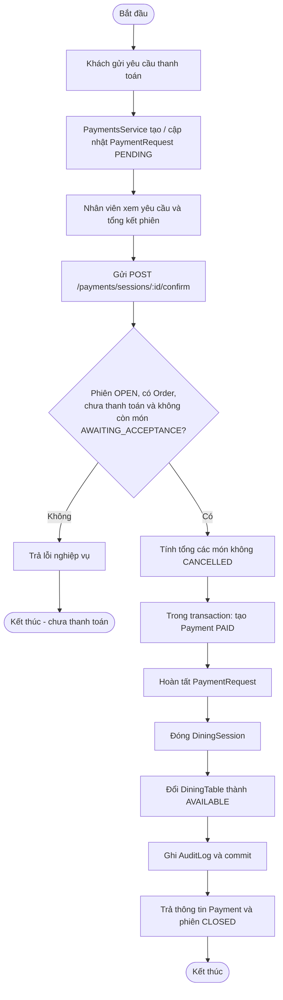
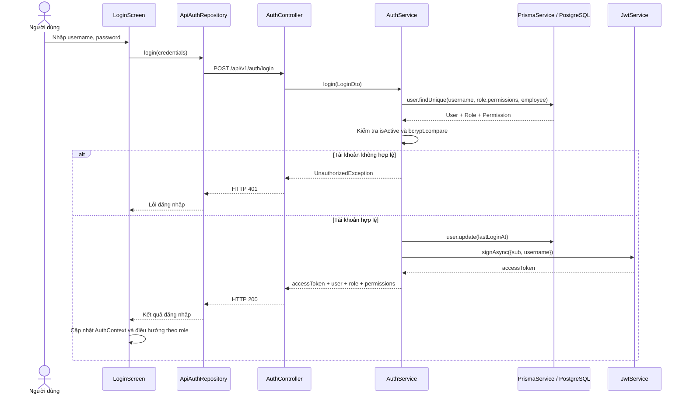
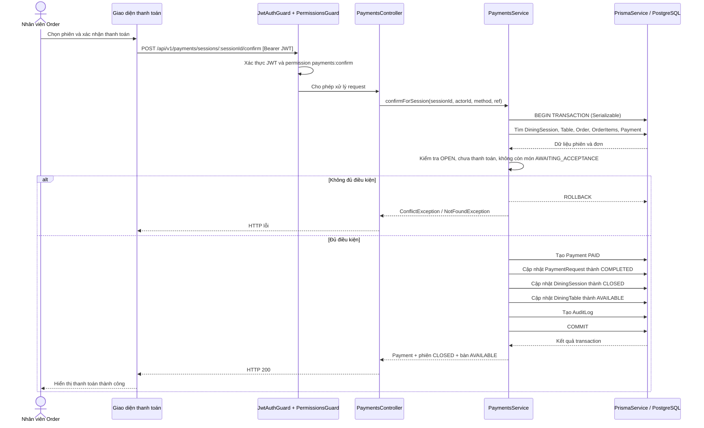
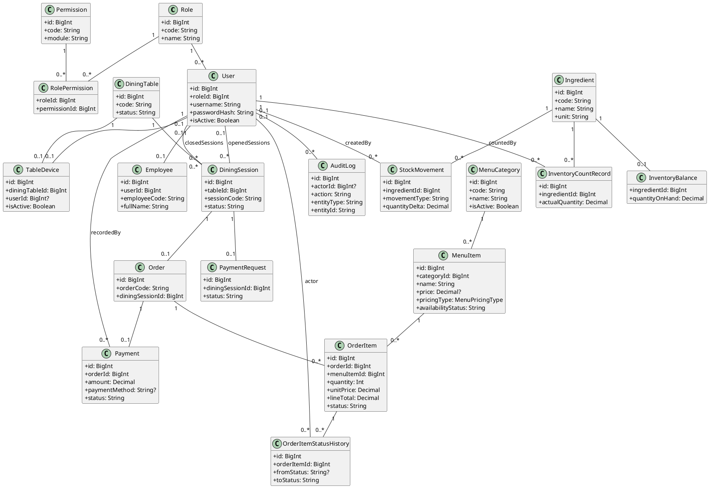
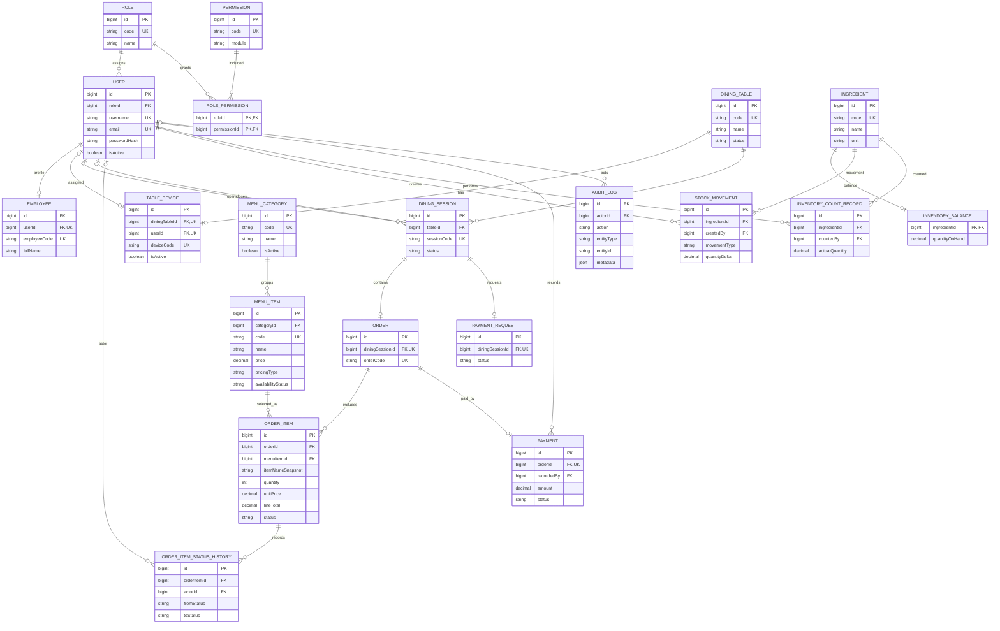

# CHƯƠNG 3. PHÂN TÍCH VÀ THIẾT KẾ HỆ THỐNG

> **Phạm vi khảo sát:** Nhánh `member/minhhuy` của `NTMHuy/ResMan`. Nội dung kế thừa tác nhân, yêu cầu FR/NFR và Use Case trong [Chương 2](requirements-analysis.md). Đây là mô hình thiết kế phản ánh mã nguồn và Prisma schema được khảo sát tĩnh; không thay thế kiểm thử tích hợp hoặc xác nhận trạng thái vận hành.

## 3.1. Thiết kế kiến trúc tổng thể

### 3.1.1. Kiến trúc hệ thống

ResMan được tổ chức theo mô hình ứng dụng frontend – backend – cơ sở dữ liệu. Frontend là ứng dụng React Native chạy trên Expo, sử dụng Expo Router để điều hướng và phân chia màn hình theo nhóm chức năng. Frontend gọi REST API thông qua Axios và các lớp repository. Backend được xây dựng bằng NestJS, chia thành các module nghiệp vụ; mỗi module thường có Controller tiếp nhận HTTP request và Service xử lý nghiệp vụ. Dữ liệu được truy cập bằng Prisma Client thông qua `PrismaService` và adapter PostgreSQL.

Kiến trúc này có thể mô tả theo các lớp logic sau, nhưng không nên hiểu đây là ba dự án hoặc ba tầng vật lý độc lập: lớp giao diện nằm ở frontend; lớp điều phối và nghiệp vụ nằm trong NestJS Controller/Service; lớp truy cập dữ liệu nằm ở Prisma Client/`PrismaService`. PostgreSQL là nơi lưu trữ dữ liệu lâu dài. Cloudinary là dịch vụ bên ngoài được dùng cho ảnh món ăn.

### 3.1.2. Các thành phần chính

| Thành phần | Công nghệ / thành phần thực tế | Trách nhiệm |
|---|---|---|
| Giao diện người dùng | React Native 0.88, Expo SDK 58, Expo Router | Hiển thị màn hình theo vai trò, nhận thao tác và điều hướng. |
| Điều phối giao diện | `AuthContext`, `NavigationContext`, `FeatureRouteView`, `AppShell` | Quản lý trạng thái đăng nhập, quyền truy cập route và hiển thị màn hình tính năng. |
| Tầng gọi API frontend | Axios API client và các lớp `Api*Repository` | Đóng gói lời gọi REST API theo hợp đồng repository. `repositories/index.ts` đăng ký các implementation API. |
| Tiếp nhận HTTP | NestJS Controllers | Ánh xạ endpoint, DTO, guard và permission tới phương thức Service. |
| Nghiệp vụ ứng dụng | NestJS Services | Thực hiện xác thực, kiểm tra điều kiện nghiệp vụ, phối hợp truy vấn và transaction. |
| Truy cập dữ liệu | Prisma Client, `PrismaService`, `@prisma/adapter-pg`, `pg` | Ánh xạ model Prisma sang truy vấn PostgreSQL; quản lý kết nối và vòng đời client. |
| Cơ sở dữ liệu | PostgreSQL | Lưu tài khoản, thực đơn, bàn, phiên, đơn, kho, thanh toán và nhật ký. |
| Dịch vụ ảnh | Cloudinary | Lưu trữ ảnh thực đơn; backend nhận file, tải lên và lưu URL cùng public ID. |

### 3.1.3. Công nghệ và cách thức giao tiếp

Frontend khởi tạo request qua repository API, gửi HTTP tới backend với tiền tố `/api/v1`. API client đảm nhiệm cấu hình kết nối và thông tin xác thực Bearer token. Backend áp dụng `JwtAuthGuard` để xác thực, `PermissionsGuard` để kiểm tra quyền tại endpoint có khai báo `@Permissions`. Sau đó Controller gọi Service. Service truy vấn hoặc cập nhật dữ liệu thông qua Prisma Client. Với nghiệp vụ nhiều bước như mở phiên, gọi món, nhập kho, cập nhật trạng thái món và thanh toán, mã nguồn có sử dụng transaction để nhóm các thay đổi dữ liệu.

Ảnh thực đơn được gửi theo multipart field `file` tới endpoint upload của `MenuItemsController`. Backend kiểm tra loại và kích thước file, gọi `CloudinaryService.uploadImage()`, sau đó cập nhật `imageUrl` và `imagePublicId` trong database. Đây là tích hợp dịch vụ ngoài đã có trong mã nguồn; không phải mọi dữ liệu ảnh đều được lưu trực tiếp trong PostgreSQL.

**Hình 3.1. Kiến trúc tổng thể ResMan (hiện trạng).** Sơ đồ thể hiện các thành phần giao tiếp chính, không biểu diễn triển khai vật lý hoặc hạ tầng mạng.



**Nhận xét:** Frontend và backend được tách biệt qua REST API. Frontend có lớp repository để cô lập màn hình khỏi chi tiết endpoint; backend dùng module để phân chia nghiệp vụ và guard để bảo vệ API. Tuy nhiên, repository pattern chỉ được thể hiện ở frontend; backend truy cập dữ liệu trực tiếp qua Prisma Service trong các Service nghiệp vụ, không có bằng chứng về một lớp repository backend riêng.

## 3.2. Thiết kế các phân hệ

Các phân hệ dưới đây được xác định từ danh sách module trong `backend/src/app.module.ts`, các repository frontend trong `frontend/src/repositories/index.ts`, và các màn hình được ánh xạ tại `frontend/src/navigation/FeatureRouteView.tsx`.

| Phân hệ | Mục đích và chức năng chính | Frontend tiêu biểu | Backend tiêu biểu | Dữ liệu liên quan |
|---|---|---|---|---|
| Tài khoản và phân quyền | Đăng nhập, xem hồ sơ, quản lý tài khoản, vai trò và quyền. | `features/auth`, `AuthContext`, `ApiAuthRepository`, `ApiEmployeeRepository` | `AuthModule`, `UsersModule`, `AuthController`, `AuthService`, JWT strategy và permission guards | `User`, `Role`, `Permission`, `RolePermission`, `Employee` |
| Thực đơn | Quản lý danh mục, món, giá, trạng thái khả dụng và ảnh; cung cấp thực đơn đọc cho khách. | `features/menu`, `MenuScreen`, `ApiMenuRepository` | `MenuCategoriesModule`, `MenuItemsModule`, `MenuItemsController`, `GuestMenuController`, `MenuItemsService`, `CloudinaryService` | `MenuCategory`, `MenuItem` |
| Bàn và phiên phục vụ | Quản lý bàn; mở, tra cứu và đóng phiên phục vụ; gắn tablet khách với bàn. | `features/tables`, `TablesScreen` | `TablesModule`, `SessionsModule`, `TablesController`, `SessionsController`, `SessionsService` | `DiningTable`, `DiningSession`, `TableDevice` |
| Gọi món và đơn hàng | Khách hoặc nhân viên thêm món; xem đơn; cập nhật ghi chú hoặc hủy món theo quyền và trạng thái. | `features/customer-order`, `features/orders`, `CustomerOrderScreen`, `OrdersScreen` | `OrdersModule`, `OrdersController`, `StaffOrdersController`, `OrdersService` | `Order`, `OrderItem`, `OrderItemStatusHistory` |
| Chế biến món ăn (KDS) | Hiển thị hàng đợi món đang xử lý và cập nhật trạng thái chế biến. | `features/kds`, `KitchenScreen`, `ApiKDSRepository` | `KitchenModule`, `KitchenController`, `KitchenService` | `OrderItem`, `OrderItemStatusHistory`, `DiningSession` |
| Kho và nguyên liệu | Quản lý nguyên liệu, số dư, nhập kho, kiểm kê, lịch sử biến động và cảnh báo tồn thấp. | `features/inventory`, `InventoryScreen`, `ApiInventoryRepository` | `InventoryModule`, `InventoryController`, `InventoryService` | `Ingredient`, `InventoryBalance`, `StockMovement`, `InventoryCountRecord` |
| Thanh toán | Khách gửi yêu cầu; nhân viên xem yêu cầu, tổng kết và xác nhận thanh toán; đóng phiên và giải phóng bàn. | Màn hình customer order và các phần giao diện nghiệp vụ Order | `PaymentsModule`, `PaymentsController`, `PaymentsService` | `PaymentRequest`, `Payment`, `Order`, `DiningSession`, `DiningTable` |
| Nhân viên | Quản lý tài khoản nhân viên, thông tin hồ sơ và role; không phải một bảng nhân viên độc lập với tài khoản. | `features/employees`, `EmployeesScreen` | `UsersModule`, `UsersController`, `UsersService` | `User`, `Employee`, `Role` |
| Báo cáo | Tổng quan doanh thu, doanh thu theo kỳ, món bán chạy, đơn hàng và tồn kho. | `features/reports`, `ReportsScreen`, `ApiReportRepository`, `DashboardScreen` | `ReportsModule`, `ReportsController`, `ReportsService` | Tổng hợp từ `Payment`, `Order`, `OrderItem`, `Ingredient`, `InventoryBalance` |

**Lưu ý về phạm vi:** Module báo cáo có API đọc dữ liệu; AuditLog có model và được nhiều Service ghi nhận, nhưng Chương 2 chưa tìm thấy controller/API đọc nhật ký. Không mô tả màn hình xem audit như chức năng đã triển khai. Kho hiện hỗ trợ nhập kho và kiểm kê thủ công; chưa có bằng chứng về xuất kho độc lập, định mức nguyên liệu hoặc tự động trừ tồn theo món bán.

## 3.3. Thiết kế quy trình nghiệp vụ

### 3.3.1. Quy trình đăng nhập và xác thực

**Mục đích:** Xác thực người dùng và xác định vai trò/quyền để giới hạn chức năng được truy cập.

**Tác nhân:** Khách hàng, Nhân viên Order, Nhân viên Bếp, Nhân viên Kho, Quản lý.

**Luồng xử lý:** Người dùng nhập tên đăng nhập và mật khẩu tại `LoginScreen`. Frontend gọi API đăng nhập. `AuthService.login()` tìm tài khoản theo username, kiểm tra trạng thái hoạt động và đối chiếu mật khẩu bằng bcrypt. Nếu hợp lệ, hệ thống cập nhật `lastLoginAt`, tạo JWT và trả về thông tin người dùng, role và permissions. Frontend lưu trạng thái xác thực và điều hướng theo role. Với request cần bảo vệ, `JwtStrategy.validate()` tải lại tài khoản và permission từ database; guard từ chối token hết hạn, tài khoản không hoạt động hoặc thiếu quyền.

**Điều kiện và kết quả:** Tài khoản không tồn tại, bị khóa hoặc mật khẩu không đúng sẽ nhận lỗi xác thực. Đăng nhập thành công trả JWT Bearer và danh sách quyền. Việc có token không đồng nghĩa mọi endpoint đều được phép truy cập.

**Hình 3.2. Activity Diagram – Đăng nhập và xác thực.**



### 3.3.2. Quy trình khách hàng xem thực đơn và gọi món

**Mục đích:** Cho phép khách hàng tại bàn xem các món đang bán và gửi yêu cầu gọi món vào phiên phục vụ hiện tại.

**Tác nhân:** Khách hàng (CUSTOMER).

**Luồng xử lý:** Frontend tải thực đơn công khai qua `GET /api/v1/menu-items/customer/menu`. Khách chọn món, số lượng và ghi chú; frontend yêu cầu mở hoặc tiếp tục phiên qua `POST /api/v1/sessions/customer/open`. Backend xác định bàn từ `TableDevice` gắn với tài khoản CUSTOMER, tái sử dụng phiên OPEN nếu có hoặc tạo phiên cùng Order nếu bàn đang AVAILABLE. Khi gửi món, backend xác định phiên từ tài khoản/thiết bị, kiểm tra phiên còn mở, món và danh mục còn hoạt động, món đang AVAILABLE và có giá cố định phù hợp. Service tạo các `OrderItem` mới ở trạng thái `AWAITING_ACCEPTANCE`, tạo bản ghi lịch sử trạng thái và audit log trong transaction.

**Quy tắc nghiệp vụ:** Khách không tự chọn bàn; bàn được xác định từ tài khoản CUSTOMER và TableDevice. Một DiningSession có tối đa một Order theo ràng buộc unique `Order.diningSessionId`. Mỗi lần gửi yêu cầu tạo các OrderItem mới; không tự động gộp vào item đã tồn tại. Khách chỉ hủy món trước khi bếp tiếp nhận.

**Kết quả:** Hệ thống trả thông tin Order và các món vừa tạo. Các món xuất hiện trong hàng đợi bếp nếu phiên còn mở.

**Hình 3.3. Activity Diagram – Khách hàng gọi món.**



### 3.3.3. Quy trình bếp tiếp nhận và cập nhật món

**Mục đích:** Theo dõi và cập nhật tiến độ chế biến từng món trong các phiên đang mở.

**Tác nhân:** Nhân viên Bếp (KITCHEN_STAFF).

**Luồng xử lý:** Frontend KDS gọi `GET /api/v1/kitchen/queue`. `KitchenService.getQueue()` lấy các món ở trạng thái `AWAITING_ACCEPTANCE`, `ACCEPTED`, `IN_PREPARATION` thuộc phiên OPEN. Khi nhân viên cập nhật trạng thái, `KitchenController` gọi `KitchenService.updateStatus()`. Service kiểm tra phiên, trạng thái hiện tại và chuyển trạng thái hợp lệ; cập nhật có điều kiện, ghi `OrderItemStatusHistory` và `AuditLog` trong transaction.

**Điều kiện hiện tại trong code:** `AWAITING_ACCEPTANCE` có thể chuyển sang `ACCEPTED` hoặc `CANCELLED`; `ACCEPTED` chuyển sang `IN_PREPARATION` hoặc `CANCELLED`; `IN_PREPARATION` chuyển sang `COMPLETED` hoặc `CANCELLED`. Bếp phải nhập lý do khi hủy. Đây là quy tắc đang được thực thi trong `KitchenService`, dù có điểm khác với tài liệu nghiệp vụ đã xác nhận (xem mục 3.8).

**Hình 3.4. Activity Diagram – Xử lý món tại bếp.**



### 3.3.4. Quy trình thanh toán và kết thúc phiên

**Mục đích:** Ghi nhận yêu cầu thanh toán, xác nhận số tiền đã thu, đóng phiên và giải phóng bàn.

**Tác nhân:** Khách hàng và Nhân viên Order hoặc người dùng có permission `payments:confirm`.

**Luồng xử lý:** Khách gửi yêu cầu qua `POST /api/v1/payments/customer/request`. Backend xác định bàn từ TableDevice, tìm phiên OPEN và tạo hoặc tái sử dụng PaymentRequest PENDING. Nhân viên xem yêu cầu qua `GET /api/v1/payments/requests`, xem tổng kết phiên qua `GET /api/v1/payments/sessions/:sessionId/summary`, sau đó xác nhận qua `POST /api/v1/payments/sessions/:sessionId/confirm`. `PaymentsService.confirmForSession()` kiểm tra phiên, đơn, thanh toán trước đó và các món còn `AWAITING_ACCEPTANCE`. Nếu đủ điều kiện, service tạo Payment PAID, hoàn tất yêu cầu thanh toán, đóng DiningSession, cập nhật DiningTable về AVAILABLE và ghi AuditLog trong cùng transaction.

**Quy tắc nghiệp vụ:** Không cho thanh toán nếu còn món chờ bếp tiếp nhận. Tổng tiền chỉ cộng các món không ở trạng thái CANCELLED. Một Order chỉ có một Payment theo unique `Payment.orderId`. Việc tạo thanh toán, đóng phiên và giải phóng bàn được thực hiện trong cùng transaction.

**Hình 3.5. Activity Diagram – Thanh toán và đóng phiên.**



## 3.4. Thiết kế tương tác hệ thống

Các sơ đồ trình tự dưới đây mô tả những lời gọi đã xác định trong Controller và Service. Tên API sử dụng tiền tố `/api/v1` được cấu hình tại `backend/src/main.ts`.

### 3.4.1. Sequence Diagram – Đăng nhập

**Hình 3.6.** Luồng đăng nhập từ `LoginScreen` qua `ApiAuthRepository`, Controller và Service. JWT được tạo sau khi xác thực mật khẩu; quyền được lấy từ quan hệ Role–Permission.



### 3.4.2. Sequence Diagram – Khách hàng đặt món

**Hình 3.7.** Luồng lấy thực đơn, mở/tiếp tục phiên và thêm món. Việc xác định bàn diễn ra ở backend thông qua TableDevice, không lấy tableId do khách tự chọn.

```mermaid
sequenceDiagram
    actor Customer as Khách hàng
    participant UI as CustomerOrderScreen
    participant Repo as ApiCustomerOrderRepository
    participant MenuCtrl as GuestMenuController
    participant SessionCtrl as SessionsController
    participant OrderCtrl as OrdersController
    participant SessionSvc as SessionsService
    participant OrderSvc as OrdersService
    participant DB as PrismaService / PostgreSQL
    Customer->>UI: Mở chức năng gọi món
    UI->>Repo: getCustomerMenu()
    Repo->>MenuCtrl: GET /api/v1/menu-items/customer/menu
    MenuCtrl->>DB: MenuItemsService.findCustomerMenu()
    DB-->>MenuCtrl: Danh mục và món khả dụng
    MenuCtrl-->>Repo: HTTP 200 + danh mục/món
    Repo-->>UI: Dữ liệu thực đơn
    Customer->>UI: Chọn món, số lượng, ghi chú
    UI->>Repo: openCustomerSession()
    Repo->>SessionCtrl: POST /api/v1/sessions/customer/open [Bearer JWT]
    SessionCtrl->>SessionSvc: openForCustomer(userId)
    SessionSvc->>DB: Tìm TableDevice và trạng thái DiningTable
    alt Bàn OCCUPIED và có phiên OPEN
        SessionSvc->>DB: Tìm phiên hiện tại theo tableId
        DB-->>SessionSvc: Phiên và Order hiện tại
    else Bàn AVAILABLE
        SessionSvc->>DB: Transaction tạo DiningSession + Order, cập nhật DiningTable
        DB-->>SessionSvc: Phiên và Order mới
    else Không có TableDevice hoặc bàn OCCUPIED nhưng không có phiên OPEN
        SessionSvc-->>SessionCtrl: NotFoundException / ConflictException
        SessionCtrl-->>Repo: HTTP lỗi
        Repo-->>UI: Hiển thị lỗi
    end
    SessionSvc-->>Repo: Thông tin phiên (không trả sessionCode)
    UI->>Repo: addItems(items)
    Repo->>OrderCtrl: POST /api/v1/customer/session/items [Bearer JWT]
    OrderCtrl->>OrderSvc: addCustomerItems(userId, items)
    OrderSvc->>DB: Xác định TableDevice và sessionCode nội bộ
    OrderSvc->>DB: Transaction kiểm tra phiên/món/giá; tạo OrderItem, History, AuditLog
    DB-->>OrderSvc: Kết quả tạo món
    OrderSvc-->>OrderCtrl: orderCode + items
    OrderCtrl-->>Repo: HTTP 201 + kết quả
    Repo->>OrderCtrl: GET /api/v1/customer/session [Bearer JWT]
    OrderCtrl->>OrderSvc: getCustomerSession(userId)
    OrderSvc->>DB: Đọc phiên OPEN, Order và OrderItems
    DB-->>OrderSvc: Dữ liệu phiên/đơn/món
    OrderSvc-->>OrderCtrl: Thông tin phiên và danh sách món
    OrderCtrl-->>Repo: HTTP 200 + session snapshot
    Repo-->>UI: CustomerOrderTracking
    UI-->>Customer: Hiển thị trạng thái món
```

### 3.4.3. Sequence Diagram – Xác nhận thanh toán

**Hình 3.8.** Luồng xác nhận thanh toán, đóng phiên và trả bàn về trạng thái sẵn sàng. Các thay đổi dữ liệu chính được thực hiện trong transaction của `PaymentsService`.



**Giới hạn mô hình:** Sơ đồ mô tả đường đi ở cấp Controller/Service và các thao tác Prisma đã đọc được. Nó không khẳng định đã kiểm thử thành công trên môi trường triển khai. API cập nhật trạng thái tổng đơn mà frontend repository đang gọi nhưng backend chưa khai báo không được đưa vào sequence như một luồng hoạt động hợp lệ.

## 3.5. Thiết kế cấu trúc lớp

### 3.5.1. Phân biệt các thành phần cấu trúc

Trong dự án có ba nhóm cấu trúc cần phân biệt:

- **Class xử lý nghiệp vụ:** các class TypeScript được NestJS quản lý như `AuthController`, `AuthService`, `OrdersService`, `PaymentsService`. Chúng có phương thức xử lý và phụ thuộc vào service khác hoặc PrismaService.
- **DTO:** các lớp như `LoginDto`, `CreateGuestOrderItemsDto`, `ConfirmPaymentDto`, `CreateMenuItemDto` mô tả dữ liệu đầu vào HTTP và phục vụ validation. DTO không phải bảng dữ liệu.
- **Prisma model:** các khai báo như `User`, `DiningSession`, `OrderItem`, `Payment` biểu diễn cấu trúc dữ liệu và quan hệ database. Chúng không phải các NestJS service hay controller.

### 3.5.2. Các lớp và model tiêu biểu

| Nhóm | Thành phần | Vai trò / thuộc tính tiêu biểu | Phương thức hoặc trách nhiệm |
|---|---|---|---|
| Xác thực | `AuthController` | Controller HTTP cho auth | `login()`, `profile()` |
| Xác thực | `AuthService` | Tìm User, kiểm tra mật khẩu và role | `login()`, `getProfile()` |
| Xác thực | `JwtStrategy`, `JwtAuthGuard`, `PermissionsGuard` | Xác minh JWT, tải user và kiểm tra permission | `validate()`, `canActivate()` |
| Thực đơn | `MenuItemsController`, `GuestMenuController` | API quản trị và đọc thực đơn khách | `create()`, `findAll()`, `uploadImage()`, `findCustomerMenu()` |
| Thực đơn | `MenuItemsService` | Quy tắc giá, khả dụng và truy vấn món | `create()`, `findAll()`, `findCustomerMenu()`, `updateStatus()` |
| Bàn/phiên | `SessionsController`, `SessionsService` | Mở/đóng phiên và xác định phiên theo khách | `open()`, `openForCustomer()`, `close()`, `findById()` |
| Đơn hàng | `StaffOrdersController`, `OrdersController`, `OrdersService` | Thêm món, truy vấn phiên, cập nhật ghi chú/hủy món | `addCustomerItems()`, `addStaffItems()`, `cancelGuestItem()`, `findActiveOrders()` |
| Bếp | `KitchenController`, `KitchenService` | Hàng đợi và chuyển trạng thái món | `getQueue()`, `updateStatus()` |
| Kho | `InventoryController`, `InventoryService` | Quản lý nguyên liệu và biến động kho | `listIngredients()`, `stockIn()`, `recordCount()`, `listMovements()` |
| Thanh toán | `PaymentsController`, `PaymentsService` | Yêu cầu, tổng kết và xác nhận thanh toán | `requestForCustomer()`, `getSessionSummary()`, `confirmForSession()` |
| Truy cập dữ liệu | `PrismaService` | Kế thừa PrismaClient, kết nối PostgreSQL qua PrismaPg/Pool | `onModuleInit()`, `onModuleDestroy()` |

### 3.5.3. Class Diagram nhóm nghiệp vụ cốt lõi

**Hình 3.9. Class Diagram – Model dữ liệu và quan hệ nghiệp vụ.** Sơ đồ này chủ yếu thể hiện Prisma model và bội số quan hệ; không đồng nhất các model với class Service.



**Giải thích:** Role và Permission liên kết nhiều-nhiều qua RolePermission. User có một Role và có thể có một Employee; tài khoản CUSTOMER có thể được gắn với TableDevice. Trong DiningSession, `openedBy` và `closedBy` là hai khóa ngoại nullable riêng biệt tới User, lần lượt ghi nhận người mở và người đóng phiên. DiningTable có nhiều DiningSession theo thời gian. Mỗi DiningSession có tối đa một Order; mỗi Order có nhiều OrderItem. OrderItem lưu tên món, đơn giá và thành tiền tại thời điểm đặt để giữ lịch sử khi thực đơn thay đổi. Ingredient có tối đa một InventoryBalance và nhiều StockMovement/InventoryCountRecord. PaymentRequest gắn một-một với phiên; Payment gắn một-một với Order theo unique key.

## 3.6. Thiết kế cơ sở dữ liệu

### 3.6.1. Tổng quan dữ liệu

Cơ sở dữ liệu được mô tả bằng Prisma schema tại `prisma/schema.prisma`, sử dụng PostgreSQL. Khóa chính phần lớn là BigInt tự tăng; các khóa ngoại được khai báo bằng `@relation`. Nhiều quan hệ sử dụng `onDelete: Restrict` để ngăn xóa bản ghi đang được tham chiếu. Các trường mã như username, email, role code, menu code, table code, sessionCode và orderCode có ràng buộc unique theo schema.

### 3.6.2. Nhóm thực thể chính

| Nhóm | Thực thể | Khóa chính / khóa ngoại tiêu biểu | Ý nghĩa |
|---|---|---|---|
| Tài khoản và phân quyền | `Role`, `Permission`, `RolePermission` | Role.id, Permission.id; RolePermission có khóa ghép (roleId, permissionId) | Mô hình RBAC, ánh xạ vai trò với quyền. |
| Tài khoản và nhân sự | `User`, `Employee` | User.roleId → Role.id; Employee.userId → User.id (unique) | Thông tin đăng nhập; hồ sơ nhân viên mở rộng từ tài khoản. |
| Thực đơn | `MenuCategory`, `MenuItem` | MenuItem.categoryId → MenuCategory.id | Danh mục và món ăn, giá, loại giá, ảnh, trạng thái bán. |
| Bàn và thiết bị | `DiningTable`, `TableDevice` | TableDevice.diningTableId → DiningTable.id (unique); userId nullable unique → User.id | Bàn phục vụ và thiết bị/tài khoản khách gắn bàn. |
| Phiên và đơn | `DiningSession`, `Order`, `OrderItem`, `OrderItemStatusHistory` | DiningSession.tableId → DiningTable.id; Order.diningSessionId → DiningSession.id (unique); OrderItem.orderId → Order.id; menuItemId → MenuItem.id | Quản lý phiên, đơn gọi món, từng món và lịch sử trạng thái. |
| Kho | `Ingredient`, `InventoryBalance`, `StockMovement`, `InventoryCountRecord` | InventoryBalance.ingredientId → Ingredient.id (đồng thời PK); movement/count tham chiếu Ingredient và User | Danh mục nguyên liệu, số dư, lịch sử nhập/điều chỉnh và kiểm kê. |
| Thanh toán | `PaymentRequest`, `Payment` | PaymentRequest.diningSessionId → DiningSession.id (unique); Payment.orderId → Order.id (unique); recordedBy → User.id | Yêu cầu thanh toán và bản ghi thanh toán. |
| Nhật ký | `AuditLog` | actorId nullable → User.id | Lưu hành động, loại thực thể, định danh và metadata JSON. |

### 3.6.3. ERD tổng quát

**Hình 3.10. ERD – Cơ sở dữ liệu ResMan.** Sơ đồ tập trung vào các thực thể lõi và quan hệ; các thuộc tính thời gian, mô tả và chỉ mục phụ được lược bớt để dễ đọc. Tên thực thể tương ứng Prisma model, tên bảng vật lý được ánh xạ bằng `@@map`.



### 3.6.4. Các quan hệ và ràng buộc nghiệp vụ quan trọng

| Quan hệ / ràng buộc | Cách thể hiện trong schema | Ý nghĩa |
|---|---|---|
| Role – User | Một Role có nhiều User; User bắt buộc có roleId | Mỗi tài khoản có một vai trò hiện hành. |
| Role – Permission | Nhiều-nhiều qua RolePermission với khóa chính ghép | Một role được gán nhiều quyền và một permission có thể thuộc nhiều role. |
| User – Employee | Một-một tùy chọn qua Employee.userId unique | Không phải mọi User đều là nhân viên; hồ sơ Employee gắn một tài khoản. |
| DiningTable – DiningSession | Một-nhiều | Một bàn có nhiều phiên qua thời gian. |
| DiningSession – Order | Một-một tùy chọn; Order.diningSessionId unique | Mỗi phiên có tối đa một đơn. |
| Order – OrderItem | Một-nhiều | Đơn chứa nhiều món gọi. |
| OrderItem – MenuItem | Nhiều-một | Nhiều dòng món có thể tham chiếu cùng món thực đơn. Snapshot tên và giá được lưu tại OrderItem. |
| Ingredient – InventoryBalance | Một-một tùy chọn; ingredientId vừa PK vừa FK | Mỗi nguyên liệu có tối đa một số dư tồn kho. |
| Ingredient – StockMovement / InventoryCountRecord | Một-nhiều | Lưu lịch sử nhập/điều chỉnh và các lần kiểm kê. |
| DiningSession – PaymentRequest | Một-một tùy chọn; diningSessionId unique | Mỗi phiên có tối đa một bản ghi yêu cầu thanh toán được cập nhật trạng thái. |
| Order – Payment | Một-một tùy chọn; orderId unique | Một đơn có tối đa một bản ghi thanh toán. |

Các trạng thái như `DiningSession.status`, `DiningTable.status`, `OrderItem.status`, `MenuItem.availabilityStatus`, `Payment.status` được khai báo dưới dạng String có giá trị mặc định và kiểm tra ở tầng nghiệp vụ; không phải tất cả đều là Prisma enum. Prisma enum hiện thấy rõ là `MenuPricingType` với các giá trị `FIXED`, `PER_UNIT`, `MARKET_PRICE`, `UNSET`.

Các migration hiện có trong `prisma/migrations` gồm migration khởi tạo và các thay đổi sau đó như ràng buộc một phiên đang mở trên mỗi bàn, loại giá thực đơn, public ID ảnh, liên kết tài khoản khách với TableDevice, PaymentRequest và loại kiểm kê. Nội dung thiết kế trong báo cáo lấy Prisma schema hiện tại làm mô hình dữ liệu khai báo; không khẳng định database ở mọi môi trường đã được migrate đồng bộ nếu chưa kiểm tra trạng thái migration thực tế.

## 3.7. Thiết kế giao diện

### 3.7.1. Nguyên tắc tổ chức giao diện

Frontend sử dụng Expo Router làm điểm vào ứng dụng (`expo-router/entry`). Route `/login` hiển thị `LoginScreen`; nhóm route `(main)` được bảo vệ bởi `AuthContext` và hiển thị trong `AppShell`. `FeatureRouteView` ánh xạ các route như dashboard, menu, customer-order, tables, orders, kitchen, inventory, employees và reports tới màn hình tương ứng. Việc kiểm tra quyền trên frontend hỗ trợ điều hướng và trải nghiệm; quyền truy cập API vẫn được backend kiểm tra độc lập.

### 3.7.2. Các màn hình tiêu biểu

| Nhóm người dùng | Màn hình / route | Mục đích | Thành phần và thao tác chính |
|---|---|---|---|
| Tất cả vai trò | `/login` – `LoginScreen` | Đăng nhập và khởi tạo phiên sử dụng | Trường username/password, nút đăng nhập, hiển thị lỗi; điều hướng theo role sau khi xác thực. |
| Khách hàng | `customer-order` – `CustomerOrderScreen` | Xem thực đơn, chọn món và theo dõi món trong phiên bàn | Danh mục, danh sách món, số lượng, ghi chú, giỏ/yêu cầu gọi món, trạng thái món và yêu cầu thanh toán. |
| Nhân viên Order | `tables` – `TablesScreen` | Theo dõi bàn và thao tác phiên phục vụ | Danh sách bàn, trạng thái bàn, thao tác mở/xem phiên theo quyền. |
| Nhân viên Order | `orders` – `OrdersScreen` | Theo dõi đơn đang hoạt động và hỗ trợ phục vụ | Danh sách đơn, thông tin bàn, món, ghi chú và thao tác được backend cho phép. |
| Nhân viên Bếp | `kitchen` – `KitchenScreen` | Theo dõi hàng đợi KDS | Danh sách món theo bàn/đơn, trạng thái và thao tác chuyển trạng thái. |
| Nhân viên Kho | `inventory` – `InventoryScreen` | Quản lý nguyên liệu và tồn | Danh sách/tìm kiếm nguyên liệu, số lượng tồn, nhập kho, kiểm kê, lịch sử. |
| Quản lý | `menu` – `MenuScreen` | Quản lý danh mục và món ăn | Tìm kiếm/lọc, biểu mẫu món, giá, trạng thái bán, tải ảnh. |
| Quản lý | `employees` – `EmployeesScreen` | Quản lý tài khoản nhân viên | Danh sách nhân viên, thông tin tài khoản, vai trò và trạng thái. |
| Quản lý | `reports` / `dashboard` | Theo dõi hoạt động nhà hàng | Thẻ tổng quan, số liệu doanh thu, đơn hàng, món bán chạy và tồn kho. |

### 3.7.3. Mô tả bố cục giao diện

- **Đăng nhập:** biểu mẫu xác thực tập trung, gồm thông tin tài khoản và thao tác gửi. Sau đăng nhập, hệ thống chuyển tới route mặc định tương ứng vai trò.
- **Gọi món khách hàng:** ưu tiên danh mục và món có thể đặt; thao tác chọn món, nhập số lượng/ghi chú và gửi yêu cầu. Trạng thái món được hiển thị theo dữ liệu phiên hiện tại.
- **Order và bàn:** tập trung vào danh sách bàn/đơn đang hoạt động, trạng thái phục vụ và thao tác trên từng món. Các thao tác bị giới hạn theo permission và điều kiện trạng thái backend.
- **KDS:** trình bày danh sách món cần tiếp nhận hoặc đang chế biến, gắn với mã đơn và bàn để nhân viên bếp xác định ngữ cảnh.
- **Kho:** trình bày thông tin nguyên liệu, đơn vị, lượng tồn và ngưỡng cảnh báo; hỗ trợ nhập kho và kiểm kê thủ công.
- **Quản lý:** các màn hình thực đơn, nhân viên, báo cáo phục vụ cập nhật dữ liệu danh mục và giám sát hoạt động.

**Giới hạn minh họa:** Nội dung này mô tả màn hình và route được ánh xạ trong source code. Không đính kèm ảnh chụp màn hình vì quá trình khảo sát repository không chạy ứng dụng và không thu được ảnh runtime. Khi hoàn thiện báo cáo bản in, có thể bổ sung ảnh chụp từ phiên bản ứng dụng thực tế sau khi chạy và kiểm tra trên thiết bị/môi trường tương ứng; không sử dụng hình minh họa giả làm ảnh sản phẩm.

## 3.8. Đối chiếu thiết kế với hệ thống thực tế

### 3.8.1. Mức độ triển khai

| Nội dung | Trạng thái theo khảo sát mã nguồn | Căn cứ / lưu ý |
|---|---|---|
| Frontend Expo, điều hướng và phân hệ màn hình | Đã có cấu trúc và route | `frontend/package.json`, `app/`, `FeatureRouteView.tsx`. Việc có route không tự chứng minh mọi thao tác UI đã hoạt động. |
| REST API và NestJS module | Đã có | `backend/src/app.module.ts`, các Controller/Service nghiệp vụ. |
| JWT và RBAC | Đã có cơ chế | `AuthService`, `JwtStrategy`, `JwtAuthGuard`, `PermissionsGuard`, seed role/permission. |
| Quản lý thực đơn và ảnh | Đã có | Menu controller/service, Cloudinary service, MenuCategory/MenuItem. |
| Bàn và phiên phục vụ | Đã có | TablesModule, SessionsModule, SessionsService, DiningTable/DiningSession/TableDevice. |
| Khách hàng gọi món | Đã có luồng backend | Customer session và order endpoints; tài khoản CUSTOMER cần gắn TableDevice. |
| Order staff cập nhật trạng thái tổng đơn | Chưa đồng bộ | Frontend `ApiOrderRepository` gọi `PATCH /orders/:id/items/status`; `StaffOrdersController` hiện không khai báo endpoint này. Không đưa API này vào luồng hoàn thiện. |
| KDS | Có luồng backend, còn sai lệch quy tắc | `KitchenService` không cho `IN_PREPARATION → ACCEPTED` và bắt buộc lý do khi hủy; khác tài liệu nghiệp vụ đã xác nhận. |
| Kho | Có quản lý nguyên liệu, nhập kho, kiểm kê | Chưa thấy xuất kho độc lập hoặc tự động trừ kho theo OrderItem; `recordCount()` cập nhật số dư và tạo movement điều chỉnh. |
| Thanh toán | Có request và xác nhận thanh toán | `PaymentsService.confirmForSession()` tạo Payment, đóng phiên, trả bàn AVAILABLE trong transaction. Đây là ghi nhận thanh toán, không phải tích hợp cổng thanh toán trực tuyến. |
| Báo cáo | Có API báo cáo | `ReportsController` có overview, revenue, best-sellers, orders, inventory. |
| Nhật ký AuditLog | Có model và ghi log | Chưa xác định API đọc AuditLog; không mô tả chức năng tra cứu audit như đã hoàn thiện. |
| Ảnh màn hình thực tế | Chưa xác minh trong lần khảo sát | Không chạy ứng dụng nên không có ảnh runtime để đưa vào tài liệu. |

### 3.8.2. Các điểm cần lưu ý khi hoàn thiện hệ thống

1. **Đồng bộ API Order:** kiểm tra hợp đồng của `ApiOrderRepository` và `StaffOrdersController`; bổ sung endpoint backend hoặc điều chỉnh frontend về API hiện có. Cho tới khi đồng bộ, thao tác cập nhật trạng thái tổng đơn cần được đánh dấu chưa hoàn thiện.
2. **Thống nhất quy tắc KDS:** đối chiếu `docs/11-confirmed-business-rules.md` với `KitchenService.updateStatus()`, đặc biệt chuyển trạng thái `IN_PREPARATION → ACCEPTED` và việc bắt buộc lý do hủy. Báo cáo hiện mô tả đúng hành vi trong code, đồng thời nêu sai lệch.
3. **Xác định phạm vi kiểm kê:** hiện `recordCount()` có cập nhật InventoryBalance và tạo StockMovement loại điều chỉnh. Tài liệu nghiệp vụ nên diễn đạt rõ kiểm kê là hoạt động điều chỉnh số dư, không chỉ lưu số liệu đếm.
4. **Phân biệt thanh toán thủ công và thanh toán điện tử:** PaymentMethod có các giá trị CASH, CARD, BANK_TRANSFER và transactionRef; không tìm thấy bằng chứng tích hợp SDK/API cổng thanh toán trong luồng xác nhận hiện tại.
5. **Giới hạn quản lý kho:** không đưa công thức nguyên liệu, xuất kho tự động hay trừ kho theo món bán vào mô hình hiện trạng vì chưa có bảng recipe/BOM hoặc luồng service tương ứng.
6. **Phân biệt nhật ký ghi và nhật ký xem:** AuditLog được tạo bởi các nghiệp vụ quan trọng, nhưng chưa có bằng chứng endpoint đọc danh sách audit.
7. **Kiểm tra migration khi triển khai:** Prisma schema là mô hình khai báo; cần xác nhận migration đã áp dụng thành công ở database mục tiêu trước khi kết luận cấu trúc database đang chạy hoàn toàn đồng nhất.

### 3.8.3. Kết luận đối chiếu

Kiến trúc, phân hệ, mô hình dữ liệu và các quy trình chính trong chương này được xây dựng từ thành phần đang có trên nhánh `member/minhhuy`. Một số luồng có đủ controller, service và model dữ liệu để mô tả như hiện trạng; một số khác mới được hỗ trợ một phần hoặc còn sai lệch hợp đồng frontend–backend. Vì vậy, các sơ đồ biểu diễn **hiện trạng có căn cứ**; các nội dung chưa triển khai không được gộp vào thiết kế hiện tại.

## 3.8.4. Mã nguồn sơ đồ

Các sơ đồ được lưu riêng để thuận tiện chỉnh sửa và render lại:

| Sơ đồ | Tệp nguồn |
|---|---|
| Kiến trúc tổng thể | [architecture.mmd](diagrams/architecture.mmd) |
| Activity – Đăng nhập | [activity-login.mmd](diagrams/activity-login.mmd) |
| Activity – Khách hàng gọi món | [activity-customer-order.mmd](diagrams/activity-customer-order.mmd) |
| Activity – Xử lý món tại bếp | [activity-kitchen.mmd](diagrams/activity-kitchen.mmd) |
| Activity – Thanh toán | [activity-payment.mmd](diagrams/activity-payment.mmd) |
| Sequence – Đăng nhập | [sequence-login.mmd](diagrams/sequence-login.mmd) |
| Sequence – Khách hàng gọi món | [sequence-customer-order.mmd](diagrams/sequence-customer-order.mmd) |
| Sequence – Xác nhận thanh toán | [sequence-payment.mmd](diagrams/sequence-payment.mmd) |
| Class Diagram | [class-domain.puml](diagrams/class-domain.puml) |
| ERD | [erd.mmd](diagrams/erd.mmd) |

## 3.9. Tổng kết chương

Chương 3 đã trình bày kiến trúc frontend–backend–database của ResMan, các phân hệ nghiệp vụ, những quy trình tiêu biểu, tương tác giữa các thành phần, cấu trúc model dữ liệu, ERD và tổ chức giao diện theo vai trò. Thiết kế cho thấy hệ thống tập trung vào quy trình phục vụ tại bàn, từ thực đơn, phiên bàn, gọi món, chế biến đến thanh toán; đồng thời hỗ trợ quản lý nhân sự, kho và báo cáo. Các điểm chưa đồng nhất giữa tài liệu và source code đã được ghi nhận để làm cơ sở cho giai đoạn triển khai, kiểm thử và đánh giá hệ thống.
