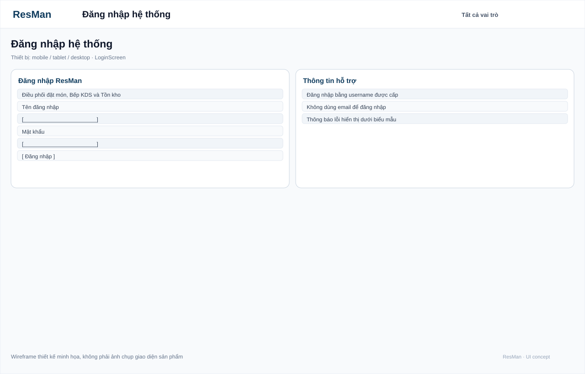
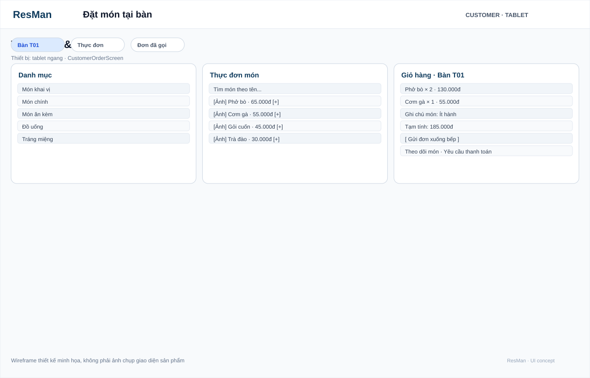
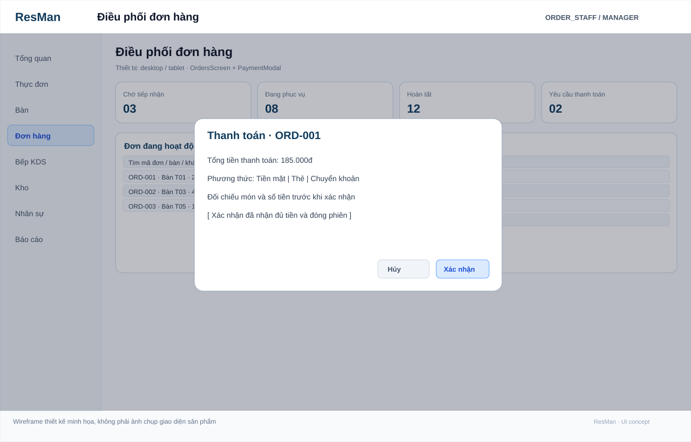
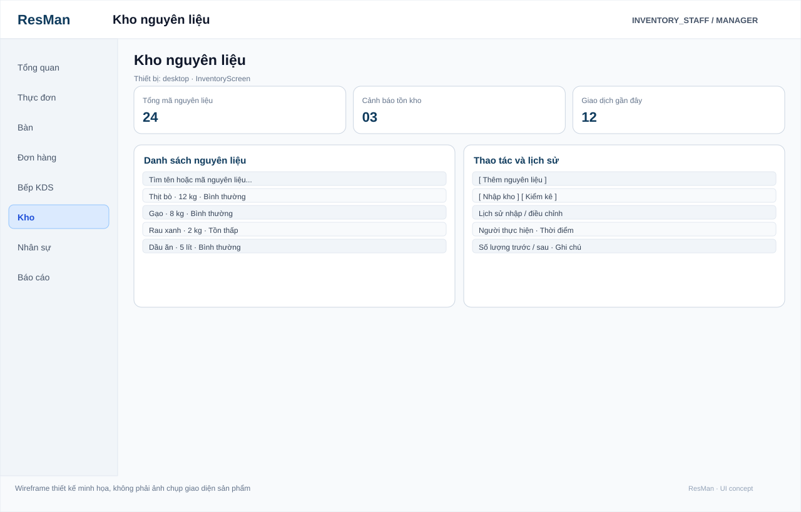
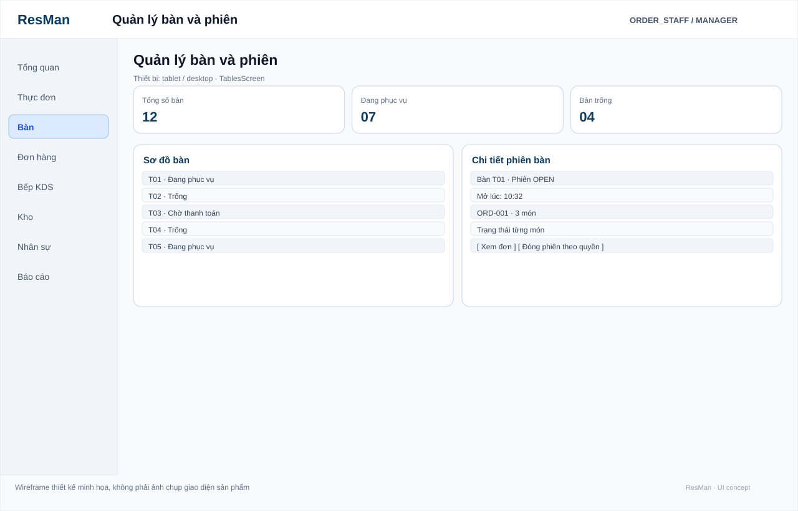

# CHƯƠNG 3. PHÂN TÍCH VÀ THIẾT KẾ HỆ THỐNG

> **Phạm vi khảo sát:** Nhánh nguồn `member/minhhuy` tại commit `8658704` của repository `NTMHuy/ResMan`. Nội dung kế thừa tác nhân, yêu cầu FR/NFR và Use Case trong [Chương 2](requirements-analysis.md), đồng thời đối chiếu với `docs/11-confirmed-business-rules.md`, mã nguồn frontend/backend và `prisma/schema.prisma`. Đây là kết quả khảo sát tĩnh; không thay thế kiểm thử tích hợp hoặc xác nhận vận hành trên môi trường thực tế.

> **Quy ước trạng thái:** **Đã triển khai** = có bằng chứng ở source code; **Triển khai một phần** = có thành phần nhưng chưa đáp ứng đầy đủ hợp đồng/yêu cầu; **Quy tắc nghiệp vụ** = yêu cầu đã xác nhận nhưng chưa được code thực hiện; **Đề xuất** = hướng cải thiện chưa được xem là chức năng hiện hành.

## 3.1. Phạm vi và nguyên tắc thiết kế

### 3.1.1. Phạm vi hệ thống

ResMan là hệ thống quản lý hoạt động nhà hàng theo mô hình phục vụ tại bàn. Phạm vi nghiệp vụ chính gồm: tài khoản và phân quyền; thực đơn; bàn và phiên phục vụ; gọi món; điều phối chế biến tại bếp (KDS); quản lý nguyên liệu và kiểm kê; ghi nhận thanh toán; báo cáo vận hành. Hệ thống có năm vai trò nghiệp vụ: Khách hàng (CUSTOMER), Nhân viên Order (ORDER_STAFF), Nhân viên Bếp (KITCHEN_STAFF), Nhân viên Kho (INVENTORY_STAFF) và Quản lý (MANAGER).

Khách hàng sử dụng tablet được gán trước với một bàn và đăng nhập bằng tài khoản CUSTOMER. Backend xác định bàn từ quan hệ User–TableDevice, không cho khách tự chọn bàn hoặc truyền mã phiên để truy cập bàn khác. Nhân viên Order có thể chọn bàn và mở phiên thay khách. Mỗi bàn có tối đa một phiên OPEN; mỗi phiên có tối đa một Order; các lần gọi món tiếp theo bổ sung OrderItem vào cùng Order.

Các nội dung không thuộc phạm vi MVP theo quyết định nghiệp vụ gồm: đặt bàn trước, chuyển bàn bằng phần mềm, modifier/biến thể món, công thức định mức nguyên liệu, tự động trừ kho theo doanh số, tự động hết món do tồn kho thấp, thanh toán chia nhỏ/nhiều lần và tích hợp cổng thanh toán trực tuyến. AI gợi ý món là hướng phát triển nâng cao, không được coi là điều kiện của luồng nghiệp vụ cốt lõi.

### 3.1.2. Nguyên tắc thiết kế

- **Theo vai trò và ngữ cảnh thiết bị:** trải nghiệm khách trên tablet khác giao diện vận hành của nhân viên và quản lý.
- **Một nguồn dữ liệu nghiệp vụ:** trạng thái phiên, đơn và món được lưu phía server; frontend không tự quyết định trạng thái có hiệu lực.
- **Kiểm tra ở backend:** JWT xác thực danh tính; permission và điều kiện nghiệp vụ được kiểm tra ở API/service, không dựa riêng vào ẩn/hiện nút trên giao diện.
- **Bảo toàn lịch sử:** OrderItem lưu snapshot tên món và giá; lịch sử trạng thái và AuditLog được ghi nhận ở các nghiệp vụ quan trọng.
- **Transaction cho nghiệp vụ nhiều bước:** gọi món, cập nhật trạng thái, nhập/kiểm kê kho và xác nhận thanh toán có thao tác transaction để hạn chế dữ liệu dở dang.
- **Tách hiện trạng và định hướng:** chỉ mô tả chức năng đã có bằng chứng; quy tắc chưa triển khai và khuyến nghị được gắn nhãn riêng.

### 3.1.3. Giả định và giới hạn khảo sát

Các mô hình được xây dựng từ branch source được nêu trong phạm vi. Không có quyền truy cập database đang chạy, log vận hành, cấu hình bí mật hoặc thiết bị thật trong lần khảo sát này; vì vậy không kết luận dữ liệu production đã migrate đầy đủ, thời gian phản hồi đạt một ngưỡng cụ thể, hoặc mọi thao tác UI đã được kiểm thử end-to-end. Số trang phần thân báo cáo vẫn là thông tin biên tập cần điền: **[ĐIỀN SỐ TRANG]**.

## 3.2. Thiết kế kiến trúc tổng thể

### 3.2.1. Kiến trúc logic

ResMan được tổ chức theo kiến trúc frontend – backend – database, triển khai theo hướng modular monolith ở backend. Frontend là ứng dụng React Native chạy trên Expo SDK 58, sử dụng Expo Router và các feature module. Lớp repository API đóng gói lời gọi HTTP; context quản lý trạng thái xác thực và điều hướng. Backend sử dụng NestJS, chia module theo nghiệp vụ; Controller tiếp nhận HTTP request, DTO kiểm tra dữ liệu đầu vào và Service thực hiện nghiệp vụ. Prisma Client cùng `PrismaService` truy cập PostgreSQL. Cloudinary là dịch vụ ngoài dùng cho ảnh món ăn.

Đường giao tiếp chính là REST API với global prefix `/api/v1`. Các API nội bộ sử dụng Bearer JWT. Backend dùng `JwtAuthGuard` và `PermissionsGuard` ở các controller/route được khai báo. API đọc thực đơn khách `GET /menu-items/customer/menu` được tách thành `GuestMenuController` không gắn guard ở controller; đây là endpoint đọc công khai trong code hiện tại, cần được đối chiếu với chính sách truy cập khi triển khai.

### 3.2.2. Thành phần và trách nhiệm

| Thành phần | Công nghệ / cấu phần | Trách nhiệm |
|---|---|---|
| Giao diện | React Native 0.88, Expo SDK 58, Expo Router | Hiển thị màn hình theo vai trò và thiết bị. |
| Trạng thái và điều hướng | `AuthContext`, `NavigationContext`, `FeatureRouteView`, `AppShell` | Khôi phục profile, điều hướng và giới hạn route theo role. |
| Repository frontend | `Api*Repository`, Axios API client | Chuyển đổi dữ liệu API sang kiểu dữ liệu giao diện và gọi endpoint. |
| HTTP/API | NestJS Controllers, DTO, Guards | Ánh xạ endpoint, xác thực và kiểm tra permission. |
| Nghiệp vụ | NestJS Services | Kiểm tra quy tắc, phối hợp truy vấn và transaction. |
| Truy cập dữ liệu | Prisma Client, `PrismaService`, `@prisma/adapter-pg`, `pg` | Truy vấn và quản lý kết nối PostgreSQL. |
| Lưu trữ | PostgreSQL | Lưu tài khoản, thực đơn, bàn, phiên, đơn, kho, thanh toán và audit. |
| Ảnh | Cloudinary | Lưu ảnh thực đơn; database lưu URL và public ID. |

### 3.2.3. Luồng dữ liệu tổng quát

**Hình 3.1. Kiến trúc logic tổng thể của ResMan.** Sơ đồ biểu diễn luồng gọi API và lưu trữ dữ liệu, không khẳng định số lượng máy chủ hay topology triển khai thực tế.

**Kiến trúc logic – mã nguồn:** [architecture.mmd](diagrams/architecture.mmd).

Frontend gọi API thông qua repository. Với API được bảo vệ, request mang Bearer JWT; backend xác minh token, tải lại user và permission từ database, sau đó kiểm tra permission được khai báo trên endpoint. Service thao tác với Prisma trong database; các nghiệp vụ có nhiều thay đổi liên quan được đóng gói trong transaction. Khi tải ảnh món, backend kiểm tra file, upload lên Cloudinary rồi lưu `imageUrl` và `imagePublicId` vào MenuItem.

### 3.2.4. Mô hình triển khai khái niệm

**Hình 3.2. Mô hình triển khai khái niệm.** Đây là mô hình logic dựa trên các thành phần trong repository; không thay thế sơ đồ hạ tầng triển khai production.

**Mô hình triển khai – mã nguồn:** [deployment.puml](diagrams/deployment.puml).

## 3.3. Thiết kế phân hệ và ranh giới module

### 3.3.1. Phân hệ nghiệp vụ

| Phân hệ | Trách nhiệm | Frontend | Backend / dữ liệu |
|---|---|---|---|
| Tài khoản và phân quyền | Đăng nhập, profile, quản lý user/role/permission | `features/auth`, `features/employees` | AuthModule, UsersModule; User, Role, Permission, RolePermission, Employee |
| Thực đơn | Danh mục, món, giá, trạng thái và ảnh | `features/menu` | MenuCategoriesModule, MenuItemsModule, CloudinaryModule; MenuCategory, MenuItem |
| Bàn và phiên | Quản lý bàn, mở/đóng và truy xuất phiên | `features/tables` | TablesModule, SessionsModule; DiningTable, TableDevice, DiningSession |
| Gọi món và Order | Thêm món, ghi chú, hủy món, theo dõi đơn | `features/customer-order`, `features/orders` | OrdersModule; Order, OrderItem, OrderItemStatusHistory |
| KDS | Hàng đợi bếp và cập nhật trạng thái món | `features/kds` | KitchenModule; OrderItem, OrderItemStatusHistory |
| Kho | Nguyên liệu, tồn, nhập kho, kiểm kê và lịch sử | `features/inventory` | InventoryModule; Ingredient, InventoryBalance, StockMovement, InventoryCountRecord |
| Thanh toán | Yêu cầu, tổng kết, xác nhận và đóng phiên | `features/orders` (PaymentModal) và customer order | PaymentsModule; PaymentRequest, Payment |
| Báo cáo | Tổng quan, doanh thu, best-sellers, đơn, tồn kho | `features/reports`, `features/dashboard` | ReportsModule; tổng hợp từ Payment, Order, OrderItem và inventory |
| Nhật ký | Ghi nhận thao tác nghiệp vụ quan trọng | Chưa thấy màn hình/API đọc audit | AuditLog được ghi bởi các service; chưa thấy controller đọc |

### 3.3.2. Ranh giới module backend

`AppModule` import ConfigModule, DatabaseModule và các module nghiệp vụ: Auth, Tables, Users, Sessions, Orders, Kitchen, Payments, Inventory, Reports, MenuCategories và MenuItems. DatabaseModule được khai báo global và export PrismaService. Các module Tables, Users, Sessions, Orders, Kitchen, Payments, Inventory và Reports khai báo import AuthModule trong module metadata. MenuCategoriesModule hiện không khai báo import; MenuItemsModule import CloudinaryModule. Sơ đồ dependency phải được hiểu đúng theo metadata `*.module.ts`, không suy diễn các module có dependency chỉ vì chúng cùng được AppModule import.

**Hình 3.3. Quan hệ phụ thuộc module NestJS theo khai báo hiện tại.**

**Module dependency – mã nguồn:** [module-dependencies.mmd](diagrams/module-dependencies.mmd).

### 3.3.3. Nguyên tắc phân tách trách nhiệm

Controller không nên chứa logic nghiệp vụ dài; DTO mô tả và xác thực dữ liệu request; Service quản lý quy tắc và transaction; Prisma model biểu diễn dữ liệu, không phải service. Frontend feature screen gọi repository thay vì tự xây dựng quy tắc dữ liệu nghiệp vụ. Backend hiện truy cập Prisma trực tiếp từ Service; chưa có bằng chứng về một lớp repository backend riêng.

## 3.4. Mô hình Use Case và truy vết yêu cầu

### 3.4.1. Tác nhân

| Tác nhân | Mục tiêu chính |
|---|---|
| Khách hàng (CUSTOMER) | Xem menu, bắt đầu/tiếp tục phiên được gán, gửi món, theo dõi/hủy món đủ điều kiện và yêu cầu thanh toán. |
| Nhân viên Order (ORDER_STAFF) | Xem bàn, mở phiên, theo dõi đơn, thêm món, sửa ghi chú/hủy món theo trạng thái và xác nhận thanh toán. |
| Nhân viên Bếp (KITCHEN_STAFF) | Theo dõi hàng đợi chung và cập nhật trạng thái từng món. |
| Nhân viên Kho (INVENTORY_STAFF) | Quản lý nguyên liệu, nhập kho, kiểm kê và xem biến động tồn. |
| Quản lý (MANAGER) | Quản trị tài khoản, thực đơn, bàn; tham gia nghiệp vụ và xem báo cáo. |

### 3.4.2. Danh sách Use Case

Danh sách giữ nguyên mã UC đã xác định trong Chương 2 để đảm bảo truy vết:

| Use Case | Tác nhân | Kết quả mong đợi | Mức triển khai theo Chương 2 |
|---|---|---|---|
| UC-01 Đăng nhập | Cả năm vai trò | Nhận JWT và thông tin role/permission | Đã triển khai |
| UC-02 Xem thực đơn | Khách hàng, Order, Quản lý | Xem danh mục/món theo API tương ứng | Đã triển khai |
| UC-03 Mở phiên | Khách hàng, Order | Tạo hoặc tái sử dụng phiên bàn và Order | Đã triển khai |
| UC-04 Gọi món | Khách hàng, Order | Tạo OrderItem mới trong phiên OPEN | Đã triển khai |
| UC-05 Theo dõi đơn/món | Khách hàng, Order | Xem món và trạng thái hiện tại | Đã triển khai |
| UC-06 Hủy món | Khách hàng, Order, Bếp, Quản lý | Hủy theo quyền và trạng thái | Triển khai một phần; có sai khác nghiệp vụ |
| UC-07 Quản lý bàn | Quản lý; Order (đọc) | Quản lý thông tin bàn và xem trạng thái | Đã triển khai |
| UC-08 Quản lý thực đơn | Quản lý | Quản lý danh mục, món, giá, ảnh | Đã triển khai |
| UC-09 Xử lý hàng đợi bếp | Bếp, Quản lý | Cập nhật trạng thái món | Triển khai một phần |
| UC-10 Quản lý kho | Kho, Quản lý | Quản lý nguyên liệu, nhập và kiểm kê | Đã triển khai |
| UC-11 Yêu cầu thanh toán | Khách hàng | Tạo PaymentRequest PENDING | Đã triển khai |
| UC-12 Xác nhận thanh toán | Order, Quản lý | Tạo Payment, đóng phiên, giải phóng bàn | Đã triển khai |
| UC-13 Quản lý tài khoản | Quản lý | Tạo/cập nhật user, role và trạng thái | Đã triển khai |
| UC-14 Xem báo cáo | Quản lý | Xem tổng quan, doanh thu, đơn, món bán chạy, kho | Đã triển khai |

### 3.4.3. Biểu đồ Use Case

**Hình 3.4. Use Case tổng quát theo năm tác nhân nghiệp vụ.**

**Use Case tổng quát – mã nguồn:** [use-cases.puml](diagrams/use-cases.puml).

### 3.4.4. Truy vết FR – UC – phân hệ

| Nhóm FR | Use Case liên quan | Phân hệ chính |
|---|---|---|
| FR-01 – FR-06 | UC-02 – UC-06, UC-11 | Customer Order, Sessions, Orders, Payments |
| FR-07 – FR-12 | UC-03 – UC-07, UC-12 | Tables, Sessions, Orders, Payments |
| FR-13 – FR-14 | UC-06, UC-09 | Kitchen / KDS |
| FR-15 – FR-18 | UC-10 | Inventory |
| FR-19 – FR-24 | UC-07, UC-08, UC-12 – UC-14 | Users, Menu, Tables, Reports, Audit |

**Nhận xét:** Mã FR và UC được kế thừa từ `docs/analysis/requirements-analysis.md`; bảng này chỉ ánh xạ phạm vi, không nâng trạng thái “triển khai một phần” thành “đã triển khai”. Các sai khác cụ thể giữa yêu cầu và source code được phân tích ở các mục 3.7, 3.9 và 3.13.

## 3.5. Thiết kế quy trình nghiệp vụ

### 3.5.1. Quy trình khách hàng gọi món

Khách hàng đăng nhập bằng tài khoản CUSTOMER đã gán với TableDevice. Khi mở chức năng gọi món, frontend tải menu và yêu cầu backend mở/tiếp tục phiên. `SessionsService.openForCustomer()` xác định bàn từ user; nếu có phiên OPEN thì sử dụng phiên hiện tại, nếu bàn AVAILABLE thì tạo DiningSession và Order. Khi gửi món, `OrdersService` xác định phiên từ tài khoản, kiểm tra trạng thái phiên, tính khả dụng và giá từ MenuItem, sau đó tạo OrderItem cùng OrderItemStatusHistory trong transaction. Giá do server xác định, không lấy giá do client gửi làm giá có hiệu lực.

**Hình 3.5. Activity – Khách hàng gọi món, thể hiện các lane theo vai trò và hệ thống.**

**Activity customer order – mã nguồn:** [activity-customer-order.mmd](diagrams/activity-customer-order.mmd).

### 3.5.2. Quy trình xử lý tại bếp

KDS truy vấn các OrderItem ở trạng thái AWAITING_ACCEPTANCE, ACCEPTED hoặc IN_PREPARATION thuộc phiên OPEN. Nhân viên Bếp chọn món và cập nhật trạng thái; backend kiểm tra trạng thái hiện tại, cập nhật có điều kiện, ghi lịch sử và AuditLog trong transaction. Theo code hiện tại, chuyển trạng thái bình thường là AWAITING_ACCEPTANCE → ACCEPTED → IN_PREPARATION → COMPLETED. Business Rules còn xác nhận khả năng quay lại IN_PREPARATION → ACCEPTED; chuyển trạng thái này chưa có trong bảng allowed của KitchenService và được đánh dấu là quy tắc chưa triển khai ở mục 3.7.

**Hình 3.6. Activity – Xử lý món tại KDS.**

**Activity kitchen – mã nguồn:** [activity-kitchen.mmd](diagrams/activity-kitchen.mmd).

### 3.5.3. Quy trình yêu cầu và xác nhận thanh toán

Khách hàng gửi yêu cầu thanh toán; backend tạo hoặc tái sử dụng PaymentRequest PENDING. Nhân viên Order xem yêu cầu và tổng kết phiên. Khi xác nhận, PaymentsService kiểm tra phiên OPEN, Order tồn tại, chưa có Payment và không còn món AWAITING_ACCEPTANCE. Tổng tiền loại trừ món CANCELLED; các món ACCEPTED, IN_PREPARATION và COMPLETED vẫn được tính. Trong transaction Serializable, backend tạo Payment PAID, chuyển PaymentRequest PENDING thành COMPLETED, đóng DiningSession, đưa DiningTable về AVAILABLE và ghi AuditLog.

**Hình 3.7. Activity – Xác nhận thanh toán và đóng phiên.**

**Activity payment – mã nguồn:** [activity-payment.mmd](diagrams/activity-payment.mmd).

## 3.6. Thiết kế tương tác – Sequence Diagram

### 3.6.1. Đăng nhập

**Hình 3.8. Sequence – Đăng nhập và tải quyền.** Login endpoint không gắn JwtAuthGuard vì đây là điểm cấp token. AuthService tìm user theo username, kiểm tra isActive và bcrypt password, cập nhật lastLoginAt, ký JWT thời hạn một ngày và trả role/permissions. JwtStrategy tải lại user và permission khi xác thực các request sau đó.

**Sequence login – mã nguồn:** [sequence-login.mmd](diagrams/sequence-login.mmd).

### 3.6.2. Khách hàng mở phiên và gửi món

**Hình 3.9. Sequence – Khách hàng xem menu, mở phiên và gửi món.** Menu GET hiện không gắn guard; các thao tác mở phiên, đọc phiên và gửi món yêu cầu JWT cùng permission CUSTOMER tương ứng. Customer API lấy bàn từ TableDevice, không nhận tableId/sessionCode từ client.

**Sequence customer – mã nguồn:** [sequence-customer-order.mmd](diagrams/sequence-customer-order.mmd).

### 3.6.3. Nhân viên xác nhận thanh toán

**Hình 3.10. Sequence – Xác nhận thanh toán.** Mọi thay đổi payment/session/table trong transaction; lỗi điều kiện hoặc xung đột dẫn đến rollback và trả lỗi nghiệp vụ.

**Sequence payment – mã nguồn:** [sequence-payment.mmd](diagrams/sequence-payment.mmd).

## 3.7. Thiết kế trạng thái và điều kiện chuyển đổi

### 3.7.1. Trạng thái OrderItem

Các trạng thái lưu trong `OrderItem.status` là String và được giới hạn bằng CHECK constraint trong migration. Bảng dưới đây phân biệt quy tắc nghiệp vụ và code:

| Trạng thái hiện tại | Trạng thái tiếp theo | Tác nhân / điều kiện | Trạng thái theo code |
|---|---|---|---|
| AWAITING_ACCEPTANCE | ACCEPTED | Nhân viên Bếp; món thuộc phiên OPEN | Đã triển khai |
| ACCEPTED | IN_PREPARATION | Nhân viên Bếp; món thuộc phiên OPEN | Đã triển khai |
| IN_PREPARATION | COMPLETED | Nhân viên Bếp; món thuộc phiên OPEN | Đã triển khai |
| IN_PREPARATION | ACCEPTED | Nhân viên Bếp; quy tắc quay lại bước tiếp nhận | **Quy tắc nghiệp vụ, chưa triển khai** |
| AWAITING_ACCEPTANCE | CANCELLED | Khách hàng; món thuộc phiên của chính tài khoản | Đã triển khai |
| AWAITING_ACCEPTANCE / ACCEPTED | CANCELLED | Nhân viên Order; phiên còn OPEN | Đã triển khai |
| AWAITING_ACCEPTANCE / ACCEPTED / IN_PREPARATION | CANCELLED | Nhân viên Bếp; code cho phép nhưng quy tắc nghiệp vụ chưa chốt đầy đủ trạng thái được hủy | Có trong code; cần xác nhận phạm vi nghiệp vụ |

**Hình 3.11. State/transition diagram – OrderItem.** Mũi tên nét đứt thể hiện chuyển trạng thái có trong quy tắc nghiệp vụ nhưng chưa có trong KitchenService.

**Order item state machine – mã nguồn:** [state-order-item.mmd](diagrams/state-order-item.mmd).

### 3.7.2. Sai khác liên quan đến hủy món

Mục 4.2 của `docs/11-confirmed-business-rules.md` xác nhận bếp không cần nhập lý do khi hủy món. Tuy nhiên, `KitchenService.updateStatus()` hiện từ chối CANCELLED nếu `reason` rỗng; KDS screen cũng hiển thị trường lý do bắt buộc. Đây là sai khác giữa nghiệp vụ đã xác nhận và triển khai. Báo cáo ghi nhận sai khác, không tự sửa backend/frontend trong phạm vi tài liệu.

### 3.7.3. Trạng thái phiên, bàn và yêu cầu thanh toán

| Đối tượng | Chuyển đổi chính | Tác nhân / guard | Bằng chứng |
|---|---|---|---|
| DiningTable | AVAILABLE → OCCUPIED | Khách bắt đầu phiên đã gán hoặc Order mở phiên; không có phiên OPEN khác | SessionsService + partial unique index |
| DiningTable | OCCUPIED → AVAILABLE | Payment được xác nhận và phiên đóng thành công | PaymentsService transaction |
| DiningSession | OPEN → CLOSED | Nhân viên có payments:confirm; Payment chưa tồn tại và không còn món AWAITING_ACCEPTANCE | PaymentsService |
| PaymentRequest | PENDING → COMPLETED | Xác nhận thanh toán cho phiên | PaymentsService.updateMany |
| Payment | tạo mới với PAID | Mỗi Order tối đa một Payment | unique Payment.orderId |

Không có bằng chứng về endpoint độc lập cho phép đóng phiên mà bỏ qua điều kiện thanh toán trong luồng nghiệp vụ chính. Trạng thái PaymentRequest là String; migration tạo cột và index nhưng không tạo CHECK constraint cho miền giá trị status.

## 3.8. Thiết kế cơ sở dữ liệu

### 3.8.1. Nguyên tắc và nhóm dữ liệu

Prisma schema dùng PostgreSQL. Phần lớn khóa chính là BigInt tự tăng; quan hệ khai báo bằng foreign key; nhiều quan hệ sử dụng onDelete Restrict. Các mã nghiệp vụ như username, email, role code, menu code, table code, sessionCode và orderCode có unique constraint. Một số trường giá trị tiền dùng Decimal; OrderItem lưu itemNameSnapshot, unitPrice và lineTotal để bảo toàn thông tin tại thời điểm đặt món.

### 3.8.2. ERD tổng quan

**Hình 3.12. ERD tổng quan.** Sơ đồ thể hiện các nhóm tài khoản, menu, phiên/đơn, kho và thanh toán; thuộc tính chi tiết được tách sang ba ERD nhóm để giữ khả năng đọc.

**ERD overview – mã nguồn:** [erd-overview.mmd](diagrams/erd-overview.mmd).

### 3.8.3. ERD tài khoản và RBAC

**Hình 3.13. ERD – Tài khoản, vai trò, quyền và thiết bị khách.**

**ERD account – mã nguồn:** [erd-account-rbac.mmd](diagrams/erd-account-rbac.mmd).

- Role – User: một Role có nhiều User; mỗi User có một roleId bắt buộc.
- Role – Permission: quan hệ nhiều-nhiều qua RolePermission với khóa chính ghép.
- User – Employee: một-một tùy chọn qua Employee.userId unique.
- User – TableDevice: userId nullable unique; mỗi tài khoản CUSTOMER gắn tối đa một thiết bị.
- DiningTable – TableDevice: diningTableId unique; mỗi bàn có tối đa một thiết bị gắn trong schema hiện tại.

### 3.8.4. ERD phiên, đơn và thanh toán

**Hình 3.14. ERD – Phiên phục vụ, Order, OrderItem và Payment.**

**ERD sessions orders – mã nguồn:** [erd-session-order-payment.mmd](diagrams/erd-session-order-payment.mmd).

DiningTable có nhiều DiningSession theo thời gian; Order.diningSessionId unique nên một phiên có tối đa một Order. Order có nhiều OrderItem và mỗi OrderItem tham chiếu MenuItem. OrderItemStatusHistory lưu trạng thái trước/sau, tác nhân, thời điểm và reason. PaymentRequest gắn một-một tùy chọn với DiningSession; Payment gắn một-một tùy chọn với Order.

### 3.8.5. ERD thực đơn và kho

**Hình 3.15. ERD – Danh mục, món ăn và dữ liệu tồn kho.**

**ERD menu inventory – mã nguồn:** [erd-menu-inventory.mmd](diagrams/erd-menu-inventory.mmd).

MenuCategory có nhiều MenuItem. Ingredient có tối đa một InventoryBalance, đồng thời có nhiều StockMovement và InventoryCountRecord. MVP không có quan hệ công thức/định mức nguyên liệu giữa MenuItem và Ingredient; không mô hình hóa tự động trừ kho theo đơn bán.

### 3.8.6. Ràng buộc và migration

Các migration bổ sung CHECK constraint cho trạng thái bàn, phiên, món, lịch sử trạng thái, giá, số lượng, tồn kho, loại movement, kiểm kê và Payment. Migration `20261117190000_one_open_session_per_table` tạo partial unique index giới hạn một phiên OPEN trên mỗi bàn. Migration `20261126170000_add_payment_requests` tạo bảng PaymentRequest, unique index theo dining_session_id và index theo status/requested_at nhưng **không tạo CHECK constraint cho PaymentRequest.status**. Vì vậy miền giá trị status hiện được kiểm soát chủ yếu ở tầng Service.

Migration khởi tạo mới có thao tác loại bỏ một số cấu trúc cũ; khi áp dụng lên database có dữ liệu cần sao lưu và đánh giá trước. Không kết luận database ở môi trường chạy đã đồng bộ nếu chưa kiểm tra migration status trực tiếp.

### 3.8.7. Class Diagram nhóm xử lý

**Hình 3.16. Class Diagram – Các thành phần điều phối nghiệp vụ cốt lõi.** DTO là cấu trúc request; Prisma model là cấu trúc dữ liệu; Controller và Service là các class xử lý của NestJS.

**Class diagram – mã nguồn:** [class-domain.puml](diagrams/class-domain.puml).

## 3.9. Thiết kế API và hợp đồng giao tiếp

### 3.9.1. Quy ước chung

Base path là `/api/v1` theo `backend/src/main.ts`. Request/response sử dụng JSON; upload ảnh thực đơn dùng multipart field `file`. Các endpoint được bảo vệ sử dụng `Authorization: Bearer <accessToken>`. Global ValidationPipe bật `whitelist`, `forbidNonWhitelisted` và `transform`. NestJS exception mapping trả các HTTP status phù hợp như 400 (dữ liệu không hợp lệ), 401 (chưa xác thực), 403 (thiếu quyền), 404 (không tìm thấy), 409 (xung đột/vi phạm điều kiện) và 5xx (lỗi máy chủ). Hình dạng response cụ thể phụ thuộc interceptor/filter hiện có; không áp đặt một envelope chưa được xác minh.

### 3.9.2. API theo phân hệ

Bảng sau tổng hợp route được khai báo trong Controller, không phải endpoint đề xuất từ tài liệu API cũ.

| Phân hệ | Method | Endpoint | Permission / xác thực |
|---|---|---|---|
| Auth | POST | `/auth/login` | Public |
| Auth | GET | `/auth/profile` | Bearer JWT |
| Users | GET / POST | `/users` | `users:read` / `users:create` |
| Users | PATCH | `/users/:id` | `users:update` |
| Users | PATCH / DELETE | `/users/:id/tablet` | `users:update` |
| Users | PATCH | `/users/:id/role`, `/users/:id/status` | `users:update` |
| Menu categories | GET / POST | `/menu-categories` | `menu.category.read/create` |
| Menu categories | GET / PATCH / DELETE | `/menu-categories/:id` | `menu.category.read/update/delete` |
| Menu items | GET / POST | `/menu-items` | `menu.item.read/create` |
| Menu items | GET / PATCH / DELETE | `/menu-items/:id` | `menu.item.read/update/delete` |
| Menu items | PATCH | `/menu-items/:id/status` | `menu.item.update` |
| Menu images | POST / DELETE | `/menu-items/:id/image` | `menu.item.update`; POST multipart `file` |
| Customer menu | GET | `/menu-items/customer/menu` | Public trong code hiện tại |
| Tables | GET / POST | `/tables` | `tables:read/manage` |
| Tables | GET / PATCH / DELETE | `/tables/:id` | `tables:read/manage` |
| Sessions | POST | `/sessions` | `sessions:open` |
| Sessions | GET / POST | `/sessions/customer/active`, `/sessions/customer/open` | `customer:session:start` |
| Sessions | GET | `/sessions/table/:tableId/active` | `tables:read` |
| Sessions | GET / PATCH | `/sessions/:id`, `/sessions/:id/close` | `orders:read` / `sessions:close` |
| Customer orders | GET | `/customer/session` | `customer:session:read` |
| Customer orders | POST | `/customer/session/items` | `customer:order:create-item` |
| Customer orders | DELETE | `/customer/session/items/:itemId` | `customer:order:cancel-item` |
| Staff orders | GET | `/orders/active` | `orders:read` |
| Staff orders | POST | `/orders/:orderId/items` | `orders:create-item` |
| Staff orders | PATCH / DELETE | `/orders/items/:itemId/note`, `/orders/items/:itemId` | `orders:manage-item` |
| Kitchen | GET | `/kitchen/queue` | `kitchen:read` |
| Kitchen | PATCH | `/kitchen/items/:itemId/status` | `kitchen:update-item` |
| Payments | POST | `/payments/customer/request` | `payments:request` |
| Payments | GET | `/payments/requests` | `payments:read` |
| Payments | GET / POST | `/payments/sessions/:sessionId/summary`, `/confirm` | `payments:read/confirm` |
| Inventory | GET / POST | `/inventory/ingredients` | `inventory:read/manage` |
| Inventory | PATCH | `/inventory/ingredients/:ingredientId` | `inventory:manage` |
| Inventory | POST | `/inventory/ingredients/:ingredientId/stock-in` | `inventory:manage` |
| Inventory | POST | `/inventory/ingredients/:ingredientId/count` | `inventory:count` |
| Inventory | GET | `/inventory/movements`, `/inventory/counts` | `inventory:read` |
| Reports | GET | `/reports/overview`, `/revenue`, `/best-sellers`, `/orders`, `/inventory` | `reports:read` |

### 3.9.3. Request validation và ranh giới tin cậy

- ID BigInt được parse tại boundary; DTO được dùng cho request body và query có kiểu dữ liệu.
- Giá món gọi được lấy từ database; client không được quyết định giá cuối cùng.
- Customer session/order API xác định bàn từ JWT principal và TableDevice; không nhận tableId/sessionCode từ client.
- Upload ảnh chỉ nhận JPG/JPEG/PNG/WEBP, tối đa 5 MB theo cấu hình controller.
- Không đưa `PATCH /orders/:id/items/status` vào API hợp lệ: frontend ApiOrderRepository đang gọi route này nhưng StaffOrdersController không khai báo. Đây là sai khác hợp đồng, chi tiết ở TD-01.

## 3.10. Thiết kế phân quyền RBAC

### 3.10.1. Mô hình

RBAC được triển khai bằng Role, Permission và RolePermission. Một User có một Role; Role liên kết nhiều Permission qua bảng nối. AuthService trả permission codes lúc đăng nhập. Với request được bảo vệ, JwtStrategy xác minh chữ ký/hạn JWT, tải lại user đang active cùng role/permission từ database; PermissionsGuard kiểm tra toàn bộ permission được khai báo bằng decorator `@Permissions`. Do đó thay đổi role/permission trong database có hiệu lực ở request tiếp theo sau khi JWT được xác minh.

### 3.10.2. Ma trận permission theo role

| Nhóm permission | CUSTOMER | ORDER_STAFF | KITCHEN_STAFF | INVENTORY_STAFF | MANAGER |
|---|---:|---:|---:|---:|---:|
| Menu category/item read | Có | Có | Không | Không | Có |
| Menu create/update/delete | Không | Không | Không | Không | Có |
| Customer session start/read | Có | Không | Không | Không | Có* |
| Customer order create/cancel | Có | Không | Không | Không | Có* |
| Tables read | Không | Có | Không | Không | Có |
| Tables manage | Không | Không | Không | Không | Có |
| Sessions open/close | Không | Có | Không | Không | Có |
| Orders read/create/manage item | Không | Có | Không | Không | Có |
| Kitchen read/update item | Không | Không | Có | Không | Có |
| Inventory read/manage/count | Không | Không | Không | Có | Có |
| Payments request | Có | Không | Không | Không | Có |
| Payments read/confirm | Không | Có | Không | Không | Có |
| Reports read | Không | Không | Không | Không | Có |
| Users read/create/update | Không | Không | Không | Không | Có |

* MANAGER được seed toàn bộ permission nghiệp vụ nội bộ, bao gồm permission customer; điều này phản ánh cấu hình seed, không có nghĩa Quản lý phải dùng giao diện tablet khách.

### 3.10.3. Phân quyền frontend và backend

Frontend có `ROLE_ALLOWED_ROUTES`, `BACKEND_PERMISSION_MAP` và ánh xạ role `CUSTOMER` sang alias giao diện `GUEST`. Alias GUEST không phải role thứ sáu trong database. Frontend dùng permission để điều khiển điều hướng và hiển thị thao tác; backend vẫn là ranh giới bảo mật có thẩm quyền. Không xem việc ẩn nút hoặc chặn route frontend là thay thế cho guard phía server.

## 3.11. Thiết kế giao diện và điều hướng

### 3.11.1. Nguyên tắc theo vai trò và thiết bị

| Màn hình | Người dùng / thiết bị đích | Thành phần được đối chiếu trong source |
|---|---|---|
| Login | Mọi vai trò; mobile/tablet/desktop | `LoginScreen`: username, password, nút đăng nhập |
| Customer Order | Khách hàng; tablet ngang | `CustomerOrderScreen`: danh mục, món, giỏ, theo dõi món, yêu cầu thanh toán |
| Orders + PaymentModal | Order/Manager; tablet hoặc desktop | `OrdersScreen`, `OrderModals.PaymentModal`: KPI, lọc đơn, chi tiết, xác nhận thu tiền |
| KDS | Bếp/Manager; desktop display | `KitchenScreen`: toolbar, filter trạng thái, thẻ món, thao tác trạng thái |
| Inventory | Kho/Manager; desktop | `InventoryScreen`: KPI nguyên liệu, tìm kiếm, bộ lọc, nhập kho, kiểm kê, lịch sử |
| Reports | Manager; desktop | `ReportsScreen`: kỳ báo cáo, KPI, biểu đồ doanh thu, cảnh báo tồn, đơn |
| Tables / Sessions | Order/Manager; tablet hoặc desktop | `TablesScreen`: lưới bàn, trạng thái, mở phiên, chi tiết phiên |
| Menu | Manager; desktop | `MenuScreen`: KPI món, lọc danh mục/trạng thái, danh sách món, preview, form |
| Employees | Manager; desktop | `EmployeesScreen`, `CustomerTabletAccountsPanel`: nhân viên và tài khoản tablet |

### 3.11.2. Điều hướng

Expo Router đưa người dùng chưa đăng nhập tới `/login`; nhóm `(main)` được điều khiển bởi AuthContext/AppShell. `FeatureRouteView` ánh xạ route dashboard, menu, customer-order, tables, orders, kitchen, inventory, employees và reports tới màn hình tương ứng. Role-based route gating ở frontend là lớp hỗ trợ UX; backend guard vẫn kiểm tra quyền tại API.

### 3.11.3. Wireframe thiết kế minh họa

Các wireframe dưới đây được dựng từ cấu trúc component và thao tác thực tế của feature screens; đây là bố cục minh họa, không phải ảnh chụp runtime. Kích thước chỉ mang tính bố cục, không khẳng định pixel-perfect với mọi breakpoint.

**Hình 3.17. Login – mobile/tablet responsive.**

**Hình 3.18. Customer Order – tablet ngang.**

**Hình 3.19. Orders và PaymentModal – desktop/tablet.**

**Hình 3.20. KDS – màn hình bếp desktop.**

**Hình 3.21. Inventory – desktop.**

**Hình 3.22. Reports – desktop.**

**Hình 3.23. Tables / Sessions – tablet hoặc desktop (phụ lục).**

**Hình 3.24. Menu Management – desktop (phụ lục).**

**Hình 3.25. Employees – desktop (phụ lục).**

> Chú thích áp dụng cho toàn bộ wireframe: **Wireframe thiết kế minh họa, không phải ảnh chụp giao diện sản phẩm**.

## 3.12. Thiết kế yêu cầu phi chức năng

| Mã | Yêu cầu | Thiết kế / bằng chứng hiện có | Cách kiểm chứng cần thực hiện |
|---|---|---|---|
| NFR-01 | Bảo mật và xác thực | bcrypt hash; JWT Bearer; tài khoản inactive bị từ chối; Helmet | Kiểm thử token sai/hết hạn, user bị khóa, kiểm tra secrets và HTTPS khi triển khai |
| NFR-02 | Phân quyền | Role–Permission–RolePermission; JwtAuthGuard và PermissionsGuard | Kiểm thử ma trận 5 role trên toàn bộ endpoint |
| NFR-03 | Validation | Global ValidationPipe whitelist, forbidNonWhitelisted, transform; DTO | Kiểm thử dữ liệu thiếu/sai kiểu, trường ngoài DTO, giới hạn file |
| NFR-04 | Hiệu năng | Có index và giới hạn/phân trang ở một số API; chưa có SLO/thời gian phản hồi được xác nhận | Benchmark với dữ liệu đại diện và tải đồng thời |
| NFR-05 | Nhất quán dữ liệu | Transaction; một số luồng Serializable; conditional update để tránh ghi đè trạng thái | Kiểm thử cạnh tranh, retry, rollback và duplicate requests |
| NFR-06 | Truy vết | OrderItemStatusHistory và AuditLog | Đối chiếu lịch sử và audit; bổ sung API đọc audit nếu yêu cầu |
| NFR-07 | Khả dụng | Feature screen theo role, loading/empty/error state và toast | Kiểm thử tác vụ với người dùng đại diện; chưa có usability study |
| NFR-08 | Tương thích nền tảng | Expo cấu hình Android/iOS/Web | Build và kiểm thử luồng trên thiết bị thật/emulator/browser |
| NFR-09 | Bảo trì | NestJS modules; frontend features/repositories; Prisma schema | Review dependency, API contract và độ phủ test |
| NFR-10 | Vận hành an toàn | CORS allowlist qua FRONTEND_ORIGIN, Helmet, global prefix, static upload | Kiểm tra CORS production, HTTPS, rate limit, log/monitoring và secret rotation |

Không đặt chỉ tiêu hiệu năng hoặc availability dạng số vì tài liệu yêu cầu hiện tại chưa xác nhận các ngưỡng này. Các cơ chế được nhìn thấy trong code không đồng nghĩa đã đạt yêu cầu khi chưa chạy kiểm thử.

## 3.13. Đánh giá tồn tại và hướng hoàn thiện

Bảng dưới đây là đánh giá kỹ thuật dựa trên khác biệt giữa Business Rules, frontend, backend và migration. Cột ưu tiên là **Ưu tiên đề xuất**, không phải mức độ nghiêm trọng đã được chủ dự án phê duyệt.

| Mã | Tồn tại / bằng chứng | Ảnh hưởng | Hướng xử lý đề xuất | Ưu tiên đề xuất |
|---|---|---|---|---|
| TD-01 | ApiOrderRepository gọi `PATCH /orders/:id/items/status`; StaffOrdersController không khai báo route này | Một số thao tác accept/reject/update order từ màn hình Order không khớp API hiện tại | Chốt contract; đổi frontend gọi API từng item hiện có hoặc thiết kế endpoint mới có kiểm soát trạng thái và quyền | Cao |
| TD-02 | Business Rules 4.1 cho phép `IN_PREPARATION → ACCEPTED`; KitchenService.allowed chưa có chuyển đổi này | Không thực hiện được thao tác trả món về bước đã tiếp nhận | Bổ sung transition sau khi thống nhất test case và cập nhật state history | Cao |
| TD-03 | Business Rules 4.2 nói bếp không cần lý do hủy; KitchenService yêu cầu reason và KDS UI cũng đánh dấu bắt buộc | Hành vi sản phẩm khác quy tắc đã xác nhận | Đồng bộ DTO, service và UI theo quy tắc không bắt buộc reason; vẫn cho lưu reason tùy chọn nếu cần | Cao |
| TD-04 | Backend cho bếp hủy từ AWAITING_ACCEPTANCE, ACCEPTED và IN_PREPARATION; Business Rules chưa xác nhận đầy đủ trạng thái được phép hủy | Có nguy cơ cho phép hủy sai giai đoạn nghiệp vụ | Chủ dự án xác nhận ma trận trạng thái bếp được hủy; sau đó cập nhật guard và test | Trung bình |
| TD-05 | Không tìm thấy Throttler/RateLimit implementation trong repository; AuthController login chưa có throttle | Endpoint đăng nhập có thể bị thử mật khẩu lặp lại | Bổ sung rate limit theo IP/tài khoản, backoff và audit; tránh khóa tài khoản gây DoS | Cao |
| TD-06 | Auth không có endpoint logout/refresh/revoke; frontend logout chỉ xóa token local; JWT hết hạn sau một ngày | Token đã phát hành vẫn dùng được đến hết hạn nếu không khóa user | Xác định threat model; cân nhắc refresh rotation, token revocation hoặc session version | Trung bình |
| TD-07 | Migration tạo PaymentRequest không có CHECK constraint cho status; schema khai báo String | Giá trị trạng thái sai có thể được ghi nếu service mới không kiểm tra | Chốt enum status và thêm CHECK constraint/migration an toàn | Trung bình |
| TD-08 | findGuestTables() tạo cố định T01–T20 và connectGuestTable() chỉ xuất hiện ở định nghĩa service; không có route controller gọi hai hàm trong source search | Mã legacy không phù hợp quyết định không giới hạn 20 bàn và không cho khách tự chọn/kết nối bàn | Xóa/di chuyển helper sau khi xác nhận không có consumer ngoài repository; không expose thành public API | Trung bình |
| TD-09 | GET `/menu-items/customer/menu` không gắn JwtAuthGuard; customer tablet theo Business Rules vẫn đăng nhập tài khoản CUSTOMER | Chưa rõ thực đơn có chủ ý public cho mọi client hay chỉ dành cho tablet đã xác thực | Xác nhận chính sách public read; nếu cần giới hạn, thêm guard và kiểm thử customer access | Trung bình |
| TD-10 | CORS vẫn cho phép header `X-Session-Code`, trong khi customer flow hiện dùng Bearer JWT và không gửi sessionCode | Cấu hình dư thừa có thể gây nhầm lẫn về cơ chế xác thực cũ | Loại bỏ header khi xác nhận không còn client cũ sử dụng | Thấp |
| TD-11 | AuditLog được ghi ở service nhưng chưa tìm thấy API/controller đọc audit | FR-24 mới đáp ứng phần lưu, chưa đáp ứng truy vấn/xem nhật ký | Xác định phạm vi audit read và bổ sung endpoint/UI nếu còn thuộc MVP | Trung bình |
| TD-12 | ReportsService.bestSellers gom nhóm theo itemNameSnapshot | Món trùng tên hoặc đổi tên có thể gộp/tách không đúng định danh menu | Nếu báo cáo cần định danh ổn định, nhóm theo menuItemId và giữ snapshot để hiển thị lịch sử | Thấp |
| TD-13 | `backend/.env.example` chứa merge conflict markers và các biến trùng; `INITIAL_ADMIN_PASSWORD` có giá trị không giống placeholder. Root `.env.example` hiện rỗng | Người triển khai có thể hiểu nhầm template và tái sử dụng credential mẫu | Làm sạch template, dùng placeholder rõ ràng, không commit secret; rotate credential nếu từng được dùng thật | Cao |

### 3.13.1. Các điểm đã kiểm tra riêng

- **PaymentRequest.status CHECK:** không có CHECK trong migration `20261126170000_add_payment_requests`; chỉ có cột VARCHAR, unique index theo session và index theo status/requested_at.
- **Login throttling:** không tìm thấy `Throttler` hoặc `RateLimit` trong repository; AuthController không khai báo throttle.
- **Guest menu public:** GuestMenuController chỉ khai báo GET route, không gắn guard; Business Rules yêu cầu tablet đăng nhập CUSTOMER nhưng không nói rõ menu read phải private. Đây là điểm cần chốt chính sách, không tự kết luận là lỗi bảo mật.
- **findGuestTables/connectGuestTable:** hai method còn trong OrdersService; GitHub code search chỉ tìm thấy định nghĩa trong service, không có route/controller sử dụng.
- **.env.example:** phát hiện conflict markers và credential bootstrap không phải placeholder rõ ràng; giá trị không được sao chép vào tài liệu. Cần kiểm tra/rotate ở môi trường sử dụng thật.
- **SD-04:** không ghi nhận issue rollback arrow vì sơ đồ hiện tại không có sai sót ở mũi tên này.

## 3.14. Tổng kết chương

Chương 3 đã trình bày phạm vi và nguyên tắc thiết kế, kiến trúc frontend–backend–database, ranh giới module, Use Case, quy trình nghiệp vụ, Sequence, state transition, mô hình dữ liệu, API, RBAC, điều hướng và wireframe theo vai trò/thiết bị. Thiết kế phản ánh source code ở nhánh khảo sát và đối chiếu các quyết định nghiệp vụ đã xác nhận. Những điểm chưa đồng nhất được tách thành tồn tại kỹ thuật và hướng hoàn thiện, không mô tả như chức năng đã hoàn thành. Các sơ đồ Mermaid/PlantUML là nguồn có thể chỉnh sửa; wireframe SVG là minh họa vector, không phải ảnh chụp ứng dụng runtime.
