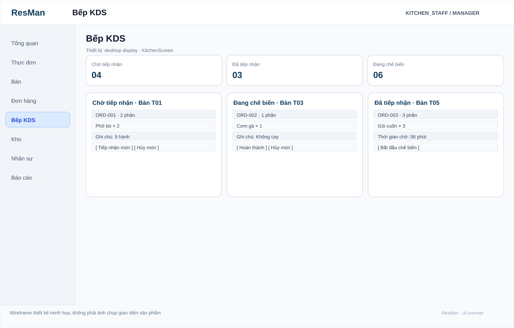
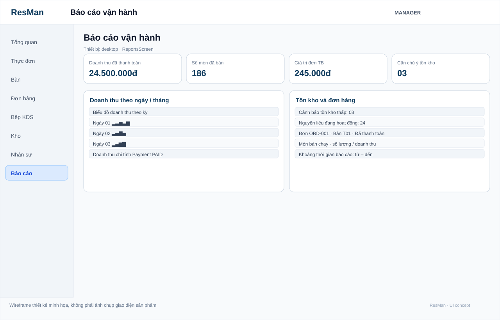
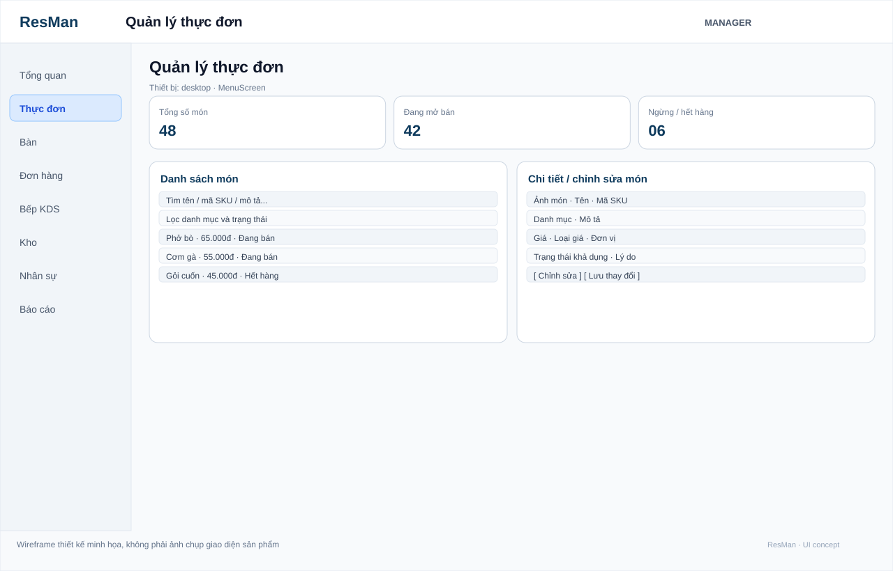
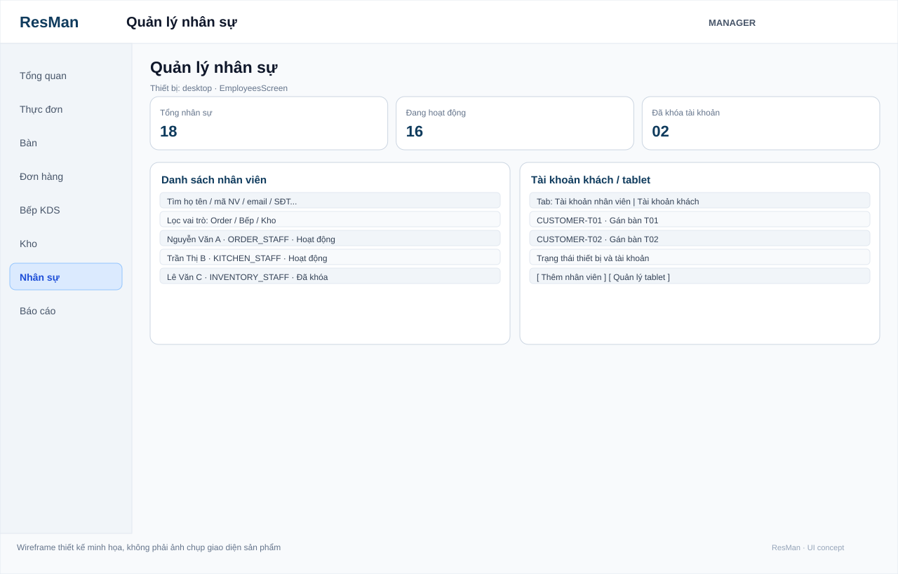

# CHƯƠNG 3. PHÂN TÍCH VÀ THIẾT KẾ HỆ THỐNG

> **Phạm vi và thời điểm kiểm tra:** Rà soát ngày **2026-11-28** trên nhánh nguồn `member/minhhuy`, commit đầy đủ `865870498670c3b828caa71d01031be429571197` (`8658704`). Tài liệu đối chiếu Chương 2, `docs/11-confirmed-business-rules.md`, source frontend/backend và schema chuẩn tại **`prisma/schema.prisma` (thư mục gốc repository)**. Đây là kiểm tra tĩnh; không thay thế kiểm thử tích hợp hoặc xác nhận trạng thái database production.

> **Quy ước trạng thái:** **Đã triển khai** = có bằng chứng ở source code; **Triển khai một phần** = có thành phần nhưng chưa đáp ứng đầy đủ hợp đồng/yêu cầu; **Quy tắc nghiệp vụ** = yêu cầu đã xác nhận nhưng chưa được code thực hiện; **Đề xuất** = hướng cải thiện chưa được xem là chức năng hiện hành.

## 3.1. Phạm vi và nguyên tắc thiết kế

### 3.1.1. Phạm vi hệ thống

ResMan là hệ thống quản lý hoạt động nhà hàng theo mô hình phục vụ tại bàn. Phạm vi nghiệp vụ chính gồm: tài khoản và phân quyền; thực đơn; bàn và phiên phục vụ; gọi món; điều phối chế biến tại bếp (KDS); quản lý nguyên liệu và kiểm kê; ghi nhận thanh toán; báo cáo vận hành. Hệ thống có năm vai trò nghiệp vụ: Khách hàng (CUSTOMER), Nhân viên Order (ORDER_STAFF), Nhân viên Bếp (KITCHEN_STAFF), Nhân viên Kho (INVENTORY_STAFF) và Quản lý (MANAGER).

Khách hàng sử dụng tablet được gán trước với một bàn và đăng nhập bằng tài khoản CUSTOMER. Backend xác định bàn từ quan hệ User–TableDevice, không cho khách tự chọn bàn hoặc truyền mã phiên để truy cập bàn khác. Nhân viên Order có thể chọn bàn và mở phiên thay khách. Mỗi bàn có tối đa một phiên OPEN; mỗi phiên có tối đa một Order; các lần gọi món tiếp theo bổ sung OrderItem vào cùng Order.

Các nội dung không thuộc phạm vi MVP theo quyết định nghiệp vụ gồm: đặt bàn trước, chuyển bàn bằng phần mềm, modifier/biến thể món, công thức định mức nguyên liệu, tự động trừ kho theo doanh số, tự động hết món do tồn kho thấp, thanh toán chia nhỏ/nhiều lần và tích hợp cổng thanh toán trực tuyến. AI gợi ý món là hướng phát triển nâng cao, không được coi là điều kiện của luồng nghiệp vụ cốt lõi.

**Căn cứ:** `docs/analysis/requirements-analysis.md:7–9,342`; `docs/11-confirmed-business-rules.md:20–54,200–215`; `backend/src/seed.ts:16–57`.

### 3.1.2. Nguyên tắc thiết kế

- **Theo vai trò và ngữ cảnh thiết bị:** trải nghiệm khách trên tablet khác giao diện vận hành của nhân viên và quản lý.
- **Một nguồn dữ liệu nghiệp vụ:** trạng thái phiên, đơn và món được lưu phía server; frontend không tự quyết định trạng thái có hiệu lực.
- **Kiểm tra ở backend:** JWT xác thực danh tính; permission và điều kiện nghiệp vụ được kiểm tra ở API/service, không dựa riêng vào ẩn/hiện nút trên giao diện.
- **Bảo toàn lịch sử:** OrderItem lưu snapshot tên món và giá; lịch sử trạng thái và AuditLog được ghi nhận ở các nghiệp vụ quan trọng.
- **Transaction cho nghiệp vụ nhiều bước:** gọi món, cập nhật trạng thái, nhập/kiểm kê kho và xác nhận thanh toán có thao tác transaction để hạn chế dữ liệu dở dang.
- **Tách hiện trạng và định hướng:** chỉ mô tả chức năng đã có bằng chứng; quy tắc chưa triển khai và khuyến nghị được gắn nhãn riêng.

**Căn cứ:** `prisma/schema.prisma:190–208,210–326`; `backend/src/auth/guards/permissions.guard.ts:13–24`; `backend/src/orders/orders.service.ts:165–290,328–374`; `backend/src/kitchen/kitchen.service.ts:44–93`; `backend/src/inventory/inventory.service.ts:162–267`; `backend/src/payments/payments.service.ts:85–211`.

### 3.1.3. Giả định và giới hạn khảo sát

Các mô hình được xây dựng từ branch source được nêu trong phạm vi. Không có quyền truy cập database đang chạy, log vận hành, cấu hình bí mật hoặc thiết bị thật trong lần khảo sát này; vì vậy không kết luận dữ liệu production đã migrate đầy đủ, thời gian phản hồi đạt một ngưỡng cụ thể, hoặc mọi thao tác UI đã được kiểm thử end-to-end. Số trang được xác định sau khi dàn trang bản báo cáo cuối cùng.

## 3.2. Thiết kế kiến trúc tổng thể

### 3.2.1. Kiến trúc logic

ResMan được tổ chức theo kiến trúc frontend – backend – database, triển khai theo hướng modular monolith ở backend. Frontend là ứng dụng React Native chạy trên Expo SDK 58, sử dụng Expo Router và các feature module. Lớp repository API đóng gói lời gọi HTTP; context quản lý trạng thái xác thực và điều hướng. Backend sử dụng NestJS, chia module theo nghiệp vụ; Controller tiếp nhận HTTP request, DTO kiểm tra dữ liệu đầu vào và Service thực hiện nghiệp vụ. Prisma Client cùng `PrismaService` truy cập PostgreSQL. Cloudinary là dịch vụ ngoài dùng cho ảnh món ăn.

Đường giao tiếp chính là REST API với global prefix `/api/v1`. Các API nội bộ sử dụng Bearer JWT. Backend dùng `JwtAuthGuard` và `PermissionsGuard` ở các controller/route được khai báo. API đọc thực đơn khách `GET /menu-items/customer/menu` được tách thành `GuestMenuController` không gắn guard ở controller; comment của controller xác định đây là public read-only menu. Thiết kế cho phép khách xem catalog trước khi mở phiên, trong khi mở phiên và gọi món vẫn bắt buộc JWT CUSTOMER cùng permission. Endpoint public không cấp quyền truy cập phiên, đơn hoặc thao tác nghiệp vụ.

**Căn cứ:** `backend/src/menu-items/guest-menu.controller.ts:1–17`; `backend/src/sessions/sessions.controller.ts:20–29`; `backend/src/orders/orders.controller.ts:23–45`; `backend/src/auth/guards/permissions.guard.ts:13–24`.

### 3.2.2. Thành phần và trách nhiệm

| Thành phần | Công nghệ / cấu phần | Trách nhiệm |
|---|---|---|
| Giao diện | React Native 0.88, Expo SDK 58, Expo Router | Hiển thị màn hình theo vai trò và thiết bị. |
| Trạng thái và điều hướng | `AuthContext`, `NavigationContext`, `FeatureRouteView`, `AppShell` | Khôi phục profile, điều hướng và giới hạn route theo role. |
| Repository frontend | `Api*Repository`, Axios API client | Chuyển đổi dữ liệu API sang kiểu dữ liệu giao diện và gọi endpoint. |
| HTTP/API | NestJS Controllers, DTO, Guards | Ánh xạ endpoint, xác thực và kiểm tra permission. |
| Nghiệp vụ | NestJS Services | Kiểm tra quy tắc, phối hợp truy vấn và transaction. |
| Truy cập dữ liệu | Prisma Client, `PrismaService`, `@prisma/adapter-pg`, `pg` | Truy vấn và quản lý kết nối PostgreSQL. |
| Lưu trữ | PostgreSQL | Lưu tài khoản, thực đơn, bàn, phiên, đơn, kho, thanh toán và audit. |
| Ảnh | Cloudinary | Lưu ảnh thực đơn; database lưu URL và public ID. |

### 3.2.3. Luồng dữ liệu tổng quát

**Hình 3.1. Kiến trúc logic tổng thể của ResMan.** Sơ đồ biểu diễn luồng gọi API và lưu trữ dữ liệu, không khẳng định số lượng máy chủ hay topology triển khai thực tế.

**Kiến trúc logic – mã nguồn:** [architecture.mmd](diagrams/architecture.mmd).

Frontend gọi API thông qua repository. Với API được bảo vệ, request mang Bearer JWT; backend xác minh token, tải lại user và permission từ database, sau đó kiểm tra permission được khai báo trên endpoint. Service thao tác với Prisma trong database; các nghiệp vụ có nhiều thay đổi liên quan được đóng gói trong transaction. Khi tải ảnh món, backend kiểm tra file, upload lên Cloudinary rồi lưu `imageUrl` và `imagePublicId` vào MenuItem.

### 3.2.4. Mô hình triển khai khái niệm

**Hình 3.2. Mô hình triển khai khái niệm.** Đây là mô hình logic dựa trên các thành phần trong repository; không thay thế sơ đồ hạ tầng triển khai production.

**Mô hình triển khai – mã nguồn:** [deployment.puml](diagrams/deployment.puml).

### 3.2.5. Quyết định kiến trúc và đánh đổi

| Quyết định | Phương án thay thế | Lý do lựa chọn theo hiện trạng | Hệ quả / đánh đổi |
|---|---|---|---|
| Modular monolith trên NestJS | Microservices hoặc nhiều backend deployable độc lập | Động lực dự án: phạm vi MVP cho một nhà hàng, số phân hệ có ranh giới rõ nhưng cùng chia sẻ Order/Session/Payment/Inventory; thời gian và nguồn lực đồ án có hạn. Microservices bị loại ở giai đoạn này vì chưa có nhu cầu scale/deploy từng miền độc lập, trong khi phải bổ sung service discovery, observability và distributed transaction. | Đơn giản hóa build, triển khai và transaction; module chưa thể scale/deploy độc lập và có thể phụ thuộc lẫn nhau qua database dùng chung. |
| REST API qua HTTP/JSON | GraphQL, WebSocket hoặc RPC làm giao thức chính | Frontend hiện cần các thao tác CRUD/command theo tài nguyên và gọi qua Axios; REST dễ kiểm thử theo Controller/DTO. GraphQL bị loại vì chưa có truy vấn tổng hợp phức tạp từ nhiều client; WebSocket/RPC không thay thế REST cho CRUD, còn nhu cầu push hiện chưa đủ để tăng độ phức tạp vận hành. | Hợp đồng đơn giản, dễ tích hợp; polling tạo độ trễ và request định kỳ, không có server push. |
| JWT Bearer thời hạn 1 ngày | Session server-side hoặc access token ngắn hạn kết hợp refresh token | Với tablet cố định tại bàn, thời hạn 1 ngày là thỏa hiệp MVP để hạn chế đăng nhập lặp lại trong ca phục vụ; session server-side/refresh rotation bị hoãn vì cần thêm lưu trữ phiên, endpoint, thu hồi và quy trình quản lý thiết bị. Đây là động lực thiết kế, không phải khuyến nghị bảo mật tối ưu cho mọi môi trường. | Không cần lưu session truy cập trên server; token bị lộ có thể dùng đến hết hạn nếu user chưa bị khóa. Chưa có refresh/revoke endpoint. **Đề xuất:** khi token hết hạn, tablet đưa người dùng về màn hình đăng nhập và yêu cầu xác thực lại; nếu cần trải nghiệm liên tục, bổ sung refresh token có rotation, thu hồi theo thiết bị và lưu trữ an toàn. Không tự động gia hạn access token hiện tại vì backend chưa có endpoint refresh. |
| PostgreSQL + Prisma | NoSQL document store hoặc ORM khác | MVP có quan hệ chặt giữa User–Role, Table–Session–Order–Payment và Ingredient–Movement; cần FK, unique, transaction và truy vấn báo cáo. NoSQL bị loại vì phải tự tái tạo nhiều ràng buộc liên bảng; Prisma phù hợp TypeScript/NestJS và schema-first. | Hỗ trợ ràng buộc quan hệ và transaction; cần quản lý schema/migration đồng bộ, một số CHECK/partial index chỉ hiện trong SQL migration. |
| Một Order cho một DiningSession | Nhiều Order trong một phiên hoặc tách hóa đơn | MVP xác định một lượt phục vụ tại một bàn tương ứng một hóa đơn; các lần gọi thêm chỉ bổ sung OrderItem. Mô hình nhiều Order bị loại vì chưa có yêu cầu tách bill, split payment hoặc quản lý nhiều đợt phục vụ độc lập. | Đơn giản hóa tổng kết và thanh toán theo phiên; không hỗ trợ tách hóa đơn hoặc nhiều Order trong một phiên. |
| Cloudinary lưu ảnh thực đơn | Lưu file trên backend hoặc tự vận hành object storage | Thời gian MVP không dành cho xây dựng pipeline lưu trữ, CDN, backup và dọn file; Cloudinary cung cấp upload/URL/public ID sẵn có. Tự vận hành bị loại vì tăng chi phí triển khai/vận hành mà không tạo lợi thế nghiệp vụ cho một nhà hàng. | Giảm trách nhiệm lưu file và phân phối ảnh tại backend; phụ thuộc dịch vụ ngoài, credential, mạng và chính sách chi phí. |
| Tablet khách gán cố định với bàn | Khách tự chọn bàn, nhập mã bàn hoặc dùng session code | Mô hình phục vụ tại bàn dùng tablet cố định; gán trước loại bỏ bước khách nhập/chọn bàn và giảm nguy cơ gửi món nhầm bàn. Luồng khách tự chọn bàn bị loại vì cần thêm xác minh vị trí/QR/session code và xử lý nhầm bàn ngoài phạm vi MVP. | Giảm nguy cơ khách truy cập nhầm bàn; cần quy trình quản trị gán/đổi tablet, và thiết bị không tự chuyển bàn theo khách. |

**Căn cứ source:** `backend/src/app.module.ts:19–37`; `backend/src/auth/auth.module.ts:15–26`; `backend/src/main.ts:19–52`; `prisma/schema.prisma:147–190`; `backend/src/cloudinary/cloudinary.service.ts:56–105`; `backend/src/sessions/sessions.service.ts:93–118`; `backend/src/orders/orders.service.ts:14–35`; `docs/11-confirmed-business-rules.md:22–26,38–40`.

## 3.3. Thiết kế phân hệ và ranh giới module

### 3.3.1. Phân hệ nghiệp vụ

| Phân hệ | Trách nhiệm | Frontend | Backend / dữ liệu |
|---|---|---|---|
| Tài khoản và phân quyền | Đăng nhập, profile, quản lý user/role/permission | `features/auth`, `features/employees` | AuthModule, UsersModule; User, Role, Permission, RolePermission, Employee |
| Thực đơn | Danh mục, món, giá, trạng thái và ảnh | `features/menu` | MenuCategoriesModule, MenuItemsModule, CloudinaryModule; MenuCategory, MenuItem |
| Bàn và phiên | Quản lý bàn, mở/đóng và truy xuất phiên | `features/tables` | TablesModule, SessionsModule; DiningTable, TableDevice, DiningSession |
| Gọi món và Order | Thêm món, ghi chú, hủy món, theo dõi đơn | `features/customer-order`, `features/orders` | OrdersModule; Order, OrderItem, OrderItemStatusHistory |
| KDS | Hàng đợi bếp và cập nhật trạng thái món | `features/kds` | KitchenModule; OrderItem, OrderItemStatusHistory |
| Kho | Nguyên liệu, tồn, nhập kho, kiểm kê và lịch sử | `features/inventory` | InventoryModule; Ingredient, InventoryBalance, StockMovement, InventoryCountRecord |
| Thanh toán | Yêu cầu, tổng kết, xác nhận và đóng phiên | `features/orders` (PaymentModal) và customer order | PaymentsModule; PaymentRequest, Payment |
| Báo cáo | Tổng quan, doanh thu, best-sellers, đơn, tồn kho | `features/reports`, `features/dashboard` | ReportsModule; tổng hợp từ Payment, Order, OrderItem và inventory |
| Nhật ký | Ghi nhận thao tác nghiệp vụ quan trọng | Chưa thấy màn hình/API đọc audit | AuditLog được ghi bởi các service; chưa thấy controller đọc |

### 3.3.2. Ranh giới module backend

`AppModule` import ConfigModule, DatabaseModule và các module nghiệp vụ: Auth, Tables, Users, Sessions, Orders, Kitchen, Payments, Inventory, Reports, MenuCategories và MenuItems. DatabaseModule được khai báo global và export PrismaService. Các module Tables, Users, Sessions, Orders, Kitchen, Payments, Inventory và Reports khai báo import AuthModule trong module metadata. MenuCategoriesModule hiện không khai báo import; MenuItemsModule import CloudinaryModule. Sơ đồ dependency phải được hiểu đúng theo metadata `*.module.ts`, không suy diễn các module có dependency chỉ vì chúng cùng được AppModule import.

**Hình 3.3. Quan hệ phụ thuộc module NestJS theo khai báo hiện tại.**

**Module dependency – mã nguồn:** [module-dependencies.mmd](diagrams/module-dependencies.mmd).

**Căn cứ:** `backend/src/app.module.ts:19–37`; `backend/src/database/database.module.ts:1–10`; `backend/src/tables/tables.module.ts:1–8`; `backend/src/users/users.module.ts:1–13`; `backend/src/sessions/sessions.module.ts:1–13`; `backend/src/orders/orders.module.ts:1–14`; `backend/src/kitchen/kitchen.module.ts:1–12`; `backend/src/payments/payments.module.ts:1–12`; `backend/src/inventory/inventory.module.ts:1–12`; `backend/src/reports/reports.module.ts:1–12`; `backend/src/menu-categories/menu-categories.module.ts:1–12`; `backend/src/menu-items/menu-items.module.ts:1–14`.

### 3.3.3. Nguyên tắc phân tách trách nhiệm

Controller không nên chứa logic nghiệp vụ dài; DTO mô tả và xác thực dữ liệu request; Service quản lý quy tắc và transaction; Prisma model biểu diễn dữ liệu, không phải service. Frontend feature screen gọi repository thay vì tự xây dựng quy tắc dữ liệu nghiệp vụ. Backend hiện truy cập Prisma trực tiếp từ Service; chưa có bằng chứng về một lớp repository backend riêng.

## 3.4. Mô hình Use Case và truy vết yêu cầu

### 3.4.1. Tác nhân

| Tác nhân | Mục tiêu chính |
|---|---|
| Khách hàng (CUSTOMER) | Xem menu, bắt đầu/tiếp tục phiên được gán, gửi món, theo dõi/hủy món đủ điều kiện và yêu cầu thanh toán. |
| Nhân viên Order (ORDER_STAFF) | Xem bàn, mở phiên, theo dõi đơn, thêm món, sửa ghi chú/hủy món theo trạng thái và xác nhận thanh toán. |
| Nhân viên Bếp (KITCHEN_STAFF) | Theo dõi hàng đợi chung và cập nhật trạng thái từng món. |
| Nhân viên Kho (INVENTORY_STAFF) | Quản lý nguyên liệu, nhập kho, kiểm kê và xem biến động tồn. |
| Quản lý (MANAGER) | Quản trị tài khoản, thực đơn, bàn; tham gia nghiệp vụ và xem báo cáo. |

### 3.4.2. Danh sách Use Case

Danh sách giữ nguyên mã UC đã xác định trong Chương 2 để đảm bảo truy vết:

| Use Case | Tác nhân | Kết quả mong đợi | Mức triển khai theo Chương 2 |
|---|---|---|---|
| UC-01 Đăng nhập | Cả năm vai trò | Nhận JWT và thông tin role/permission | Đã triển khai |
| UC-02 Xem thực đơn | Khách hàng, Order, Quản lý | Xem danh mục/món theo API tương ứng | Đã triển khai |
| UC-03 Mở phiên | Khách hàng, Order, Quản lý (permission được seed) | Tạo hoặc tái sử dụng phiên bàn và Order | Đã triển khai |
| UC-04 Gọi món | Khách hàng, Order, Quản lý (permission được seed) | Tạo OrderItem mới trong phiên OPEN | Đã triển khai |
| UC-05 Theo dõi đơn/món | Khách hàng, Order, Quản lý (permission được seed) | Xem món và trạng thái hiện tại | Đã triển khai |
| UC-06 Hủy món | Khách hàng, Order, Bếp, Quản lý | Hủy theo quyền và trạng thái | Triển khai một phần; có sai khác nghiệp vụ |
| UC-07 Quản lý bàn | Quản lý; Order (đọc) | Quản lý thông tin bàn và xem trạng thái | Đã triển khai |
| UC-08 Quản lý thực đơn | Quản lý | Quản lý danh mục, món, giá, ảnh | Đã triển khai |
| UC-09 Xử lý hàng đợi bếp | Bếp, Quản lý | Cập nhật trạng thái món | Triển khai một phần |
| UC-10 Quản lý kho | Kho, Quản lý | Quản lý nguyên liệu, nhập và kiểm kê | Đã triển khai |
| UC-11 Yêu cầu thanh toán | Khách hàng | Tạo PaymentRequest PENDING | Đã triển khai |
| UC-12 Xác nhận thanh toán | Order, Quản lý | Tạo Payment, đóng phiên, giải phóng bàn | Đã triển khai |
| UC-13 Quản lý tài khoản | Quản lý | Tạo/cập nhật user, role và trạng thái | Đã triển khai |
| UC-14 Xem báo cáo | Quản lý | Xem tổng quan, doanh thu, đơn, món bán chạy, kho | Đã triển khai |
| UC-15 Tra cứu nhật ký kiểm toán | Quản lý | Xem AuditLog theo thời gian, tác nhân và entity; đây là UC đề xuất để truy vết FR-24, chưa có endpoint/controller đọc | Đề xuất |

**Căn cứ UC:** `docs/analysis/requirements-analysis.md:144–178`; quyền role thực tế được seed tại `backend/src/seed.ts:16–57`. UC-15 không có trong Chương 2 và được đánh dấu Đề xuất vì backend hiện chưa có route đọc AuditLog.

### 3.4.3. Biểu đồ Use Case

**Hình 3.4. Use Case tổng quát theo năm tác nhân nghiệp vụ.**

**Use Case tổng quát – mã nguồn:** [use-cases.puml](diagrams/use-cases.puml). UC-15 là use case đề xuất gắn với FR-24; sơ đồ phân biệt rõ đây chưa phải chức năng đã triển khai.

### 3.4.4. Ma trận truy vết FR – UC – màn hình – API – dữ liệu

Mã FR, UC và trạng thái được kế thừa từ docs/analysis/requirements-analysis.md. FR-21 trong Chương 2 lặp lại nghiệp vụ quản lý bàn đã có ở FR-07; giữ nguyên cả hai mã để bảo toàn traceability nhưng không tính FR-21 là chức năng độc lập. FR-24 hiện chỉ có phần ghi AuditLog; UC-15 được bổ sung ở Chương 3 dưới dạng Use Case đề xuất để biểu diễn khoảng trống tra cứu. Endpoint dưới đây là route backend thực sự khai báo; route frontend gọi nhưng backend chưa khai báo được ghi rõ là sai khác.

| FR | UC | Màn hình | Endpoint backend liên quan | Bảng / model dữ liệu | Trạng thái |
|---|---|---|---|---|---|
| FR-01 | UC-02 | CustomerOrderScreen | GET /menu-items/customer/menu | MenuCategory, MenuItem | Đã triển khai |
| FR-02 | UC-03 | CustomerOrderScreen | GET /sessions/customer/active; POST /sessions/customer/open | User, TableDevice, DiningTable, DiningSession, Order | Đã triển khai |
| FR-03 | UC-04 | CustomerOrderScreen | POST /customer/session/items | DiningSession, Order, MenuItem, OrderItem, OrderItemStatusHistory, AuditLog | Đã triển khai |
| FR-04 | UC-05 | CustomerOrderScreen | GET /customer/session; GET /sessions/customer/active | DiningSession, DiningTable, Order, OrderItem | Đã triển khai |
| FR-05 | UC-06 | CustomerOrderScreen | DELETE /customer/session/items/:itemId | DiningSession, Order, OrderItem, OrderItemStatusHistory, AuditLog | Đã triển khai |
| FR-06 | UC-11 | CustomerOrderScreen | POST /payments/customer/request | TableDevice, DiningSession, PaymentRequest, Payment | Đã triển khai |
| FR-07 | UC-07 | TablesScreen | GET /tables; GET /tables/:id; POST /tables; PATCH /tables/:id; DELETE /tables/:id | DiningTable, DiningSession | Đã triển khai |
| FR-08 | UC-03, UC-07 | TablesScreen | POST /sessions; PATCH /sessions/:id/close; POST /sessions/customer/open | DiningTable, DiningSession, Order, AuditLog | Đã triển khai |
| FR-09 | UC-05 | OrdersScreen | GET /orders/active | DiningSession, DiningTable, Order, OrderItem | Đã triển khai |
| FR-10 | UC-04 | OrdersScreen | POST /orders/:orderId/items | Order, MenuItem, OrderItem, OrderItemStatusHistory, AuditLog | Đã triển khai |
| FR-11 | UC-06 | OrdersScreen | PATCH /orders/items/:itemId/note; DELETE /orders/items/:itemId. Frontend còn gọi PATCH /orders/:id/items/status nhưng backend chưa khai báo | Order, OrderItem, OrderItemStatusHistory, AuditLog | Triển khai một phần |
| FR-12 | UC-12 | OrdersScreen / Payment modal | GET /payments/requests; GET /payments/sessions/:sessionId/summary; POST /payments/sessions/:sessionId/confirm | PaymentRequest, Payment, Order, OrderItem, DiningSession, DiningTable, AuditLog | Đã triển khai |
| FR-13 | UC-09 | KitchenScreen | GET /kitchen/queue | DiningSession, DiningTable, Order, OrderItem | Đã triển khai |
| FR-14 | UC-09 | KitchenScreen | PATCH /kitchen/items/:itemId/status | OrderItem, OrderItemStatusHistory, AuditLog | Triển khai một phần |
| FR-15 | UC-10 | InventoryScreen | GET /inventory/ingredients; POST /inventory/ingredients; PATCH /inventory/ingredients/:ingredientId | Ingredient, InventoryBalance, AuditLog | Đã triển khai |
| FR-16 | UC-10 | InventoryScreen | POST /inventory/ingredients/:ingredientId/stock-in | Ingredient, InventoryBalance, StockMovement, AuditLog | Đã triển khai |
| FR-17 | UC-10 | InventoryScreen | POST /inventory/ingredients/:ingredientId/count | Ingredient, InventoryBalance, InventoryCountRecord, StockMovement, AuditLog | Đã triển khai |
| FR-18 | UC-10 | InventoryScreen | GET /inventory/ingredients; GET /inventory/movements; GET /inventory/counts | Ingredient, InventoryBalance, StockMovement, InventoryCountRecord | Đã triển khai |
| FR-19 | UC-13 | EmployeesScreen | GET /users; POST /users; PATCH /users/:id; PATCH /users/:id/role; PATCH /users/:id/status; PATCH/DELETE /users/:id/tablet | User, Role, Employee, TableDevice | Đã triển khai |
| FR-20 | UC-08 | MenuScreen | CRUD /menu-categories; CRUD /menu-items; PATCH /menu-items/:id/status; POST/DELETE /menu-items/:id/image | MenuCategory, MenuItem; Cloudinary là dịch vụ ảnh ngoài | Đã triển khai |
| FR-21 | UC-07 | TablesScreen | GET /tables; GET /tables/:id; POST /tables; PATCH /tables/:id; DELETE /tables/:id | DiningTable, DiningSession, TableDevice | Đã triển khai (nội dung trùng FR-07) |
| FR-22 | UC-05, UC-09, UC-10, UC-12 | DashboardScreen, OrdersScreen, KitchenScreen, InventoryScreen | GET /orders/active; GET /kitchen/queue; GET /inventory/ingredients; GET /payments/requests và API summary | Order, OrderItem, DiningSession, InventoryBalance, PaymentRequest, Payment | Đã triển khai |
| FR-23 | UC-14 | ReportsScreen, DashboardScreen | GET /reports/overview; /reports/revenue; /reports/best-sellers; /reports/orders; /reports/inventory | Payment, Order, OrderItem, Ingredient, InventoryBalance | Đã triển khai |
| FR-24 | UC-15 (đề xuất; chưa có trong danh sách UC Chương 2) | Chưa thấy màn hình tra cứu AuditLog | Chưa có endpoint đọc AuditLog trong controller hiện tại | AuditLog | Triển khai một phần; thiếu chức năng đọc |

**Căn cứ:** `docs/analysis/requirements-analysis.md:45–107`; `frontend/src/navigation/FeatureRouteView.tsx:24–72`; `frontend/src/repositories/api/ApiOrderRepository.ts:130–167`; `backend/src/orders/orders.controller.ts:18–45`; `backend/src/orders/staff-orders.controller.ts:10–48`; `backend/src/kitchen/kitchen.controller.ts:9–21`; `prisma/schema.prisma:147–208`.

## 3.5. Thiết kế quy trình nghiệp vụ

### 3.5.1. Quy trình khách hàng gọi món

Khách hàng đăng nhập bằng tài khoản CUSTOMER đã gán với TableDevice. Khi mở chức năng gọi món, frontend tải menu và yêu cầu backend mở/tiếp tục phiên. `SessionsService.openForCustomer()` xác định bàn từ user; nếu có phiên OPEN thì sử dụng phiên hiện tại, nếu bàn AVAILABLE thì tạo DiningSession và Order. Khi gửi món, `OrdersService` xác định phiên từ tài khoản, kiểm tra trạng thái phiên, tính khả dụng và giá từ MenuItem, sau đó tạo OrderItem cùng OrderItemStatusHistory trong transaction. Giá do server xác định, không lấy giá do client gửi làm giá có hiệu lực.

**Hình 3.5. Activity – Khách hàng gọi món, thể hiện các lane theo vai trò và hệ thống.**

**Activity customer order – mã nguồn:** [activity-customer-order.mmd](diagrams/activity-customer-order.mmd).

### 3.5.2. Quy trình xử lý tại bếp

KDS truy vấn các OrderItem ở trạng thái AWAITING_ACCEPTANCE, ACCEPTED hoặc IN_PREPARATION thuộc phiên OPEN. Nhân viên Bếp chọn món và cập nhật trạng thái; backend kiểm tra trạng thái hiện tại, cập nhật có điều kiện, ghi lịch sử và AuditLog trong transaction. Theo code hiện tại, chuyển trạng thái bình thường là AWAITING_ACCEPTANCE → ACCEPTED → IN_PREPARATION → COMPLETED. Business Rules còn xác nhận khả năng quay lại IN_PREPARATION → ACCEPTED; chuyển trạng thái này chưa có trong bảng allowed của KitchenService và được đánh dấu là quy tắc chưa triển khai ở mục 3.7.

**Hình 3.6. Activity – Xử lý món tại KDS.**

**Activity kitchen – mã nguồn:** [activity-kitchen.mmd](diagrams/activity-kitchen.mmd).

### 3.5.3. Quy trình yêu cầu và xác nhận thanh toán

Khách hàng gửi yêu cầu thanh toán; backend tạo hoặc tái sử dụng PaymentRequest PENDING. Nhân viên Order xem yêu cầu và tổng kết phiên. Khi xác nhận, PaymentsService kiểm tra phiên OPEN, Order tồn tại, chưa có Payment và không còn món AWAITING_ACCEPTANCE. Tổng tiền loại trừ món CANCELLED; các món ACCEPTED, IN_PREPARATION và COMPLETED vẫn được tính. Trong transaction Serializable, backend tạo Payment PAID, chuyển PaymentRequest PENDING thành COMPLETED, đóng DiningSession, đưa DiningTable về AVAILABLE và ghi AuditLog.

**Hình 3.7. Activity – Xác nhận thanh toán và đóng phiên.**

**Activity payment – mã nguồn:** [activity-payment.mmd](diagrams/activity-payment.mmd).

**Căn cứ activity:** `backend/src/sessions/sessions.service.ts:10–52,93–118`; `backend/src/orders/orders.service.ts:137–290,328–374,448–500`; `backend/src/kitchen/kitchen.service.ts:44–93`; `backend/src/payments/payments.service.ts:11–45,85–211`.

### 3.5.4. Thiết kế cập nhật thời gian thực

**Cơ chế hiện hành – polling, chưa phải push realtime:**

| Client | API được gọi | Chu kỳ | Hành vi sau thao tác |
|---|---|---:|---|
| KDS | GET /kitchen/queue | 8 giây khi autoRefresh bật | Sau khi cập nhật trạng thái món, hook gọi fetchQueue(true) ngay để đồng bộ queue |
| Tablet khách | GET /sessions/customer/active, GET /customer/session, GET /menu-items/customer/menu (public) và recent table orders | 5 giây | Mỗi chu kỳ gọi loadCustomerData(true) để tải lại menu/dữ liệu bàn; đồng thời kiểm tra active session, giữ giỏ hàng local |

KDS còn có timer 1 giây để cập nhật thời gian chờ/SLA trên giao diện; timer này không gọi backend. Không có bằng chứng về WebSocket, Socket.IO hoặc SSE trong các luồng cập nhật trạng thái hiện tại.

**Giới hạn:** dữ liệu có thể trễ gần bằng chu kỳ polling cộng thời gian mạng/xử lý request; mỗi client tạo request định kỳ kể cả khi không có thay đổi; khi số tablet/KDS tăng, tải đọc tăng tuyến tính theo số client. Polling cũng không đảm bảo sự kiện được nhận ngay khi server commit.

**Đề xuất – chuyển sang push event:** giữ REST cho thao tác ghi, bổ sung SSE cho luồng server-to-client nếu chỉ cần đẩy trạng thái đơn/KDS tới giao diện; cân nhắc WebSocket nếu cần giao tiếp hai chiều, presence hoặc tương tác nhiều loại event. Sự kiện chỉ phát sau khi transaction commit; client vẫn cần cơ chế reconnect và tải snapshot REST để phục hồi sau mất kết nối. Đây là hướng đề xuất, chưa có trong code.

**Căn cứ source:** `frontend/src/features/kds/hooks/useKds.ts:19–50,108–120`; `frontend/src/features/customer-order/hooks/useCustomerOrder.ts:45–60,151–183`; `frontend/src/repositories/api/ApiKDSRepository.ts:1–80`; `frontend/src/repositories/api/ApiCustomerOrderRepository.ts:1–100`.

## 3.6. Thiết kế tương tác – Sequence Diagram

### 3.6.1. Đăng nhập

**Hình 3.8. Sequence – Đăng nhập và tải quyền.** Login endpoint không gắn JwtAuthGuard vì đây là điểm cấp token. AuthService tìm user theo username, kiểm tra isActive và bcrypt password, cập nhật lastLoginAt, ký JWT thời hạn một ngày và trả role/permissions. JwtStrategy tải lại user và permission khi xác thực các request sau đó.

**Sequence login – mã nguồn:** [sequence-login.mmd](diagrams/sequence-login.mmd).

### 3.6.2. Khách hàng mở phiên và gửi món

**Hình 3.9. Sequence – Khách hàng xem menu, mở phiên và gửi món.** Menu GET hiện không gắn guard; các thao tác mở phiên, đọc phiên và gửi món yêu cầu JWT cùng permission CUSTOMER tương ứng. Customer API lấy bàn từ TableDevice, không nhận tableId/sessionCode từ client. Menu được tải công khai; hook customer polling tải lại menu và recent orders mỗi 5 giây.

**Sequence customer – mã nguồn:** [sequence-customer-order.mmd](diagrams/sequence-customer-order.mmd).

### 3.6.3. Nhân viên xác nhận thanh toán

**Hình 3.10. Sequence – Xác nhận thanh toán.** Mọi thay đổi payment/session/table trong transaction; lỗi điều kiện hoặc xung đột dẫn đến rollback và trả lỗi nghiệp vụ.

**Sequence payment – mã nguồn:** [sequence-payment.mmd](diagrams/sequence-payment.mmd).

### 3.6.4. Hủy món theo vai trò

**Hình 3.11. Sequence – Hủy món bởi khách hàng, nhân viên Order và bếp.**

**Mã nguồn sơ đồ:** [sequence-cancel-item.mmd](diagrams/sequence-cancel-item.mmd).

Khách hàng chỉ hủy món AWAITING_ACCEPTANCE thuộc phiên được gán cho tài khoản. Nhân viên Order hủy món AWAITING_ACCEPTANCE hoặc ACCEPTED. Bếp gửi PATCH trạng thái CANCELLED và hiện phải cung cấp reason. Cả ba nhánh đều cập nhật trạng thái món sang CANCELLED, không xóa vật lý OrderItem; các nhánh có ghi OrderItemStatusHistory và AuditLog trong transaction. Dù endpoint khách và nhân viên dùng HTTP DELETE, hành vi thực tế là soft-cancel theo trạng thái. **Đề xuất:** bổ sung PATCH `.../items/:itemId/cancel` để thể hiện rõ lệnh chuyển trạng thái; duy trì DELETE hiện tại như alias tương thích cho đến khi client được nâng cấp.

### 3.6.5. Bếp cập nhật trạng thái món

**Hình 3.12. Sequence – Bếp cập nhật trạng thái và xử lý cạnh tranh.**

**Mã nguồn sơ đồ:** [sequence-kitchen-status.mmd](diagrams/sequence-kitchen-status.mmd).

KitchenService đọc trạng thái hiện tại và phiên, kiểm tra transition, sau đó dùng updateMany với điều kiện status cũ. Chỉ khi cập nhật đúng một dòng mới ghi history và audit rồi commit. Nếu có request khác cập nhật trước, transaction bị từ chối và trả conflict; frontend tải lại queue.

### 3.6.6. Khách yêu cầu thanh toán

**Hình 3.13. Sequence – Tạo hoặc tái sử dụng PaymentRequest.**

**Mã nguồn sơ đồ:** [sequence-payment-request.mmd](diagrams/sequence-payment-request.mmd).

PaymentsService xác định bàn qua TableDevice, tìm phiên OPEN và kiểm tra Payment đã tồn tại. Nếu request đang PENDING thì trả lại request đó; nếu chưa có hoặc đã được xử lý thì upsert về PENDING. Đường xử lý này không dùng transaction Serializable nhiều bước; upsert là thao tác ghi chính.

### 3.6.7. Nhập kho và kiểm kê

**Hình 3.14. Sequence – Nhập kho và điều chỉnh tồn theo kiểm kê.**

**Mã nguồn sơ đồ:** [sequence-inventory-operations.mmd](diagrams/sequence-inventory-operations.mmd).

Nhập kho cộng số lượng vào InventoryBalance, tạo StockMovement loại IN và AuditLog trong transaction Serializable. Kiểm kê đọc số dư cũ, tính delta, cập nhật số dư bằng số thực tế, tạo InventoryCountRecord, tạo StockMovement loại ADJUSTMENT nếu delta khác 0 và ghi AuditLog trong cùng transaction.

**Căn cứ:** `backend/src/orders/orders.service.ts:137–290,328–374,448–500,714–755`; `backend/src/kitchen/kitchen.service.ts:44–93`; `backend/src/payments/payments.service.ts:11–45,85–211`; `backend/src/inventory/inventory.service.ts:162–198,208–267`.

## 3.7. Thiết kế trạng thái và điều kiện chuyển đổi

### 3.7.1. Trạng thái OrderItem

Các trạng thái lưu trong `OrderItem.status` là String và được giới hạn bằng CHECK constraint trong migration. Bảng dưới đây phân biệt quy tắc nghiệp vụ và code:

| Trạng thái hiện tại | Trạng thái tiếp theo | Tác nhân / điều kiện | Trạng thái theo code |
|---|---|---|---|
| AWAITING_ACCEPTANCE | ACCEPTED | Nhân viên Bếp; món thuộc phiên OPEN | Đã triển khai |
| ACCEPTED | IN_PREPARATION | Nhân viên Bếp; món thuộc phiên OPEN | Đã triển khai |
| IN_PREPARATION | COMPLETED | Nhân viên Bếp; món thuộc phiên OPEN | Đã triển khai |
| IN_PREPARATION | ACCEPTED | Nhân viên Bếp; quy tắc quay lại bước tiếp nhận | **Quy tắc nghiệp vụ, chưa triển khai** |
| AWAITING_ACCEPTANCE | CANCELLED | Khách hàng; món thuộc phiên của chính tài khoản | Đã triển khai |
| AWAITING_ACCEPTANCE / ACCEPTED | CANCELLED | Nhân viên Order; phiên còn OPEN | Đã triển khai |
| AWAITING_ACCEPTANCE / ACCEPTED / IN_PREPARATION | CANCELLED | Nhân viên Bếp; code cho phép nhưng quy tắc nghiệp vụ chưa chốt đầy đủ trạng thái được hủy | Có trong code; cần xác nhận phạm vi nghiệp vụ |

**Sơ đồ transition OrderItem – mã nguồn:** [state-order-item.mmd](diagrams/state-order-item.mmd); nét đứt biểu diễn IN_PREPARATION → ACCEPTED là Quy tắc nghiệp vụ chưa có trong KitchenService.

### 3.7.2. Sai khác liên quan đến hủy món

Quy tắc nghiệp vụ 4.2 quy định lý do hủy món do bếp là không bắt buộc. Trên triển khai hiện tại, KitchenService.updateStatus() từ chối CANCELLED nếu reason rỗng; KitchenScreen cũng kiểm tra lý do trước khi gửi request. Vì vậy, giao diện và backend hiện thực thi điều kiện chặt hơn quy tắc nghiệp vụ. Thiết kế mục tiêu là cho phép hủy không có lý do, đồng thời lưu reason nếu người dùng chủ động nhập. Trạng thái hiện tại: Triển khai một phần; điều chỉnh code là công việc cần thực hiện.

### 3.7.3. Trạng thái phiên, bàn và yêu cầu thanh toán

| Đối tượng | Chuyển đổi chính | Tác nhân / guard | Bằng chứng |
|---|---|---|---|
| DiningTable | AVAILABLE → OCCUPIED | Khách bắt đầu phiên đã gán hoặc Order mở phiên; không có phiên OPEN khác | SessionsService + partial unique index |
| DiningTable | OCCUPIED → AVAILABLE | Payment được xác nhận và phiên đóng thành công | PaymentsService transaction |
| DiningSession | OPEN → CLOSED | Nhân viên có payments:confirm; Payment chưa tồn tại và không còn món AWAITING_ACCEPTANCE | PaymentsService |
| PaymentRequest | PENDING → COMPLETED | Xác nhận thanh toán cho phiên | PaymentsService.updateMany |
| Payment | tạo mới với PAID | Mỗi Order tối đa một Payment | unique Payment.orderId |

Không có bằng chứng về endpoint độc lập cho phép đóng phiên mà bỏ qua điều kiện thanh toán trong luồng nghiệp vụ chính. Trạng thái PaymentRequest là String; migration tạo cột và index nhưng không tạo CHECK constraint cho miền giá trị status.

**Căn cứ:** `backend/src/kitchen/kitchen.service.ts:44–93`; `backend/src/orders/orders.service.ts:328–374,714–755`; `backend/src/sessions/sessions.service.ts:10–52,139–186`; `backend/src/tables/tables.service.ts:62–143`; `backend/src/payments/payments.service.ts:11–45,85–211`; `prisma/schema.prisma:147–190,297–312`.

**Hình 3.15. State diagram – DiningSession, DiningTable và PaymentRequest.** DiningSession chuyển OPEN → CLOSED; SessionsService.close() yêu cầu Payment.status=PAID, và PaymentsService.confirmForSession() thực hiện đóng phiên trong cùng transaction với ghi Payment. DiningTable chuyển AVAILABLE → OCCUPIED khi mở phiên và OCCUPIED → AVAILABLE khi đóng phiên đã thanh toán. PaymentRequest được tạo/upsert ở PENDING; khi xác nhận thanh toán, request PENDING được chuyển COMPLETED. Request đang PENDING được trả lại như thao tác idempotent, không tạo thêm bản ghi. OrderItem giữ các transition ở bảng 3.7.1; sơ đồ phụ trợ `state-order-item.mmd` dùng nét đứt cho IN_PREPARATION → ACCEPTED, là Quy tắc nghiệp vụ chưa triển khai.

**State lifecycle – mã nguồn:** [state-lifecycle.mmd](diagrams/state-lifecycle.mmd).

## 3.8. Thiết kế cơ sở dữ liệu

### 3.8.1. Nguyên tắc và nhóm dữ liệu

Prisma schema dùng PostgreSQL. Phần lớn khóa chính là BigInt tự tăng; quan hệ khai báo bằng foreign key; nhiều quan hệ sử dụng onDelete Restrict. Các mã nghiệp vụ như username, email, role code, menu code, table code, sessionCode và orderCode có unique constraint. Một số trường giá trị tiền dùng Decimal; OrderItem lưu itemNameSnapshot, unitPrice và lineTotal để bảo toàn thông tin tại thời điểm đặt món.

### 3.8.2. ERD tổng quan

**Hình 3.16. ERD tổng quan.** Sơ đồ thể hiện các nhóm tài khoản, menu, phiên/đơn, kho và thanh toán; thuộc tính chi tiết được tách sang ba ERD nhóm để giữ khả năng đọc.

**ERD overview – mã nguồn:** [erd-overview.mmd](diagrams/erd-overview.mmd).

### 3.8.3. ERD tài khoản và RBAC

**Hình 3.17. ERD – Tài khoản, vai trò, quyền và thiết bị khách.**

**ERD account – mã nguồn:** [erd-account-rbac.mmd](diagrams/erd-account-rbac.mmd).

- Role – User: một Role có nhiều User; mỗi User có một roleId bắt buộc.
- Role – Permission: quan hệ nhiều-nhiều qua RolePermission với khóa chính ghép.
- User – Employee: một-một tùy chọn qua Employee.userId unique.
- User – TableDevice: userId nullable unique; mỗi tài khoản CUSTOMER gắn tối đa một thiết bị.
- DiningTable – TableDevice: diningTableId unique; mỗi bàn có tối đa một thiết bị gắn trong schema hiện tại.

### 3.8.4. ERD phiên, đơn và thanh toán

**Hình 3.18. ERD – Phiên phục vụ, Order, OrderItem và Payment.**

**ERD sessions orders – mã nguồn:** [erd-session-order-payment.mmd](diagrams/erd-session-order-payment.mmd).

DiningTable có nhiều DiningSession theo thời gian; Order.diningSessionId unique nên một phiên có tối đa một Order. Order có nhiều OrderItem và mỗi OrderItem tham chiếu MenuItem. OrderItemStatusHistory lưu trạng thái trước/sau, tác nhân, thời điểm và reason. PaymentRequest gắn một-một tùy chọn với DiningSession; Payment gắn một-một tùy chọn với Order.

### 3.8.5. ERD thực đơn và kho

**Hình 3.19. ERD – Danh mục, món ăn và dữ liệu tồn kho.**

**ERD menu inventory – mã nguồn:** [erd-menu-inventory.mmd](diagrams/erd-menu-inventory.mmd).

MenuCategory có nhiều MenuItem. Ingredient có tối đa một InventoryBalance, đồng thời có nhiều StockMovement và InventoryCountRecord. MVP không có quan hệ công thức/định mức nguyên liệu giữa MenuItem và Ingredient; không mô hình hóa tự động trừ kho theo đơn bán.

### 3.8.6. Ràng buộc và migration

Các migration bổ sung CHECK constraint cho trạng thái bàn, phiên, món, lịch sử trạng thái, giá, số lượng, tồn kho, loại movement, kiểm kê và Payment. Migration `20261117190000_one_open_session_per_table` tạo partial unique index giới hạn một phiên OPEN trên mỗi bàn. Migration `20261126170000_add_payment_requests` tạo bảng PaymentRequest, unique index theo dining_session_id và index theo status/requested_at nhưng **không tạo CHECK constraint cho PaymentRequest.status**. Vì vậy miền giá trị status hiện được kiểm soát chủ yếu ở tầng Service.

Migration khởi tạo mới có thao tác loại bỏ một số cấu trúc cũ; khi áp dụng lên database có dữ liệu cần sao lưu và đánh giá trước. Không kết luận database ở môi trường chạy đã đồng bộ nếu chưa kiểm tra migration status trực tiếp.

### 3.8.7. Class Diagram nhóm xử lý

**Hình 3.20. Class Diagram – Các thành phần điều phối nghiệp vụ cốt lõi.** DTO là cấu trúc request; Prisma model là cấu trúc dữ liệu; Controller và Service là các class xử lý của NestJS.

**Class diagram – mã nguồn:** [class-domain.puml](diagrams/class-domain.puml).

### 3.8.8. Metadata bảng và từ điển dữ liệu

Bảng dưới đây tổng hợp metadata khai báo trong Prisma schema. Các trường thời gian tạo thường có default now(); updatedAt dùng @updatedAt do Prisma quản lý. Mọi quan hệ FK trong schema hiện tại dùng onDelete: Restrict. Những CHECK constraint và partial unique index bổ sung bằng migration được nêu riêng ở cuối mục.

**Bảng metadata (1/2) – tài khoản, nhân sự, menu, bàn, phiên và Order**

| Model / bảng | Cột và kiểu dữ liệu | Null / default chính | Unique và index | FK / onDelete |
|---|---|---|---|---|
| Role / roles | id BigInt; code VarChar(40); name VarChar(100); description String; createdAt Timestamptz(6) | description nullable; createdAt now(); id autoincrement | code unique | Không có |
| Permission / permissions | id BigInt; code VarChar(80); name VarChar(120); module VarChar(50); description String | description nullable; id autoincrement | code unique | Không có |
| RolePermission / role_permissions | roleId BigInt; permissionId BigInt | Hai cột bắt buộc | PK ghép (roleId, permissionId) | roleId → Role; permissionId → Permission; Restrict |
| User / users | id BigInt; roleId BigInt; username VarChar(80); email VarChar(255); passwordHash VarChar(255); isActive Boolean; lastLoginAt Timestamptz(6); createdAt/updatedAt Timestamptz(6) | email, lastLoginAt nullable; isActive true; createdAt now(); updatedAt @updatedAt | username unique; email unique | roleId → Role; Restrict |
| Employee / employees | id BigInt; userId BigInt; employeeCode VarChar(30); fullName VarChar(150); phone VarChar(20); employmentStatus VarChar(20); hiredAt Date; createdAt/updatedAt Timestamptz(6) | phone, hiredAt nullable; employmentStatus ACTIVE; createdAt now(); updatedAt @updatedAt | userId, employeeCode unique | userId → User; Restrict |
| MenuCategory / menu_categories | id BigInt; code VarChar(40); name VarChar(100); description String; isActive Boolean; createdAt/updatedAt Timestamptz(6) | description nullable; isActive true; createdAt now(); updatedAt @updatedAt | code unique | Không có |
| MenuItem / menu_items | id BigInt; categoryId BigInt; code VarChar(40); name VarChar(150); description String; price Decimal(14,2); pricingType MenuPricingType; priceUnit VarChar(30); imageUrl VarChar(1000); imagePublicId VarChar(255); availabilityStatus VarChar(30); availabilityReason String; isActive Boolean; createdAt/updatedAt Timestamptz(6) | description, price, priceUnit, imageUrl, imagePublicId, availabilityReason nullable; pricingType FIXED; availabilityStatus AVAILABLE; isActive true; createdAt now(); updatedAt @updatedAt | code unique; indexes (availabilityStatus, categoryId), (isActive, categoryId), (pricingType, categoryId) | categoryId → MenuCategory; Restrict |
| DiningTable / dining_tables | id BigInt; code VarChar(30); name VarChar(80); capacity Int; status VarChar(20); createdAt/updatedAt Timestamptz(6) | capacity nullable; status AVAILABLE; createdAt now(); updatedAt @updatedAt | code unique | Không có |
| DiningSession / dining_sessions | id BigInt; tableId BigInt; sessionCode VarChar(80); status VarChar(20); openedBy/closedBy BigInt; openedAt/closedAt Timestamptz(6) | openedBy, closedBy, closedAt nullable; status OPEN; openedAt now() | sessionCode unique; index (tableId, status); partial unique index một phiên OPEN/bàn trong migration | tableId → DiningTable; openedBy/closedBy → User; Restrict |
| TableDevice / table_devices | id BigInt; diningTableId BigInt; userId BigInt; deviceCode VarChar(100); deviceName VarChar(120); isActive Boolean; createdAt/updatedAt Timestamptz(6) | userId nullable; isActive true; createdAt now(); updatedAt @updatedAt | diningTableId, userId, deviceCode unique; index (diningTableId, isActive) | diningTableId → DiningTable; userId → User; Restrict |

**Bảng metadata (2/2) – lịch sử món, kho, thanh toán và audit**

| Model / bảng | Cột và kiểu dữ liệu | Null / default chính | Unique và index | FK / onDelete |
|---|---|---|---|---|
| Order / orders | id BigInt; orderCode VarChar(40); diningSessionId BigInt; note String; createdAt/updatedAt Timestamptz(6) | note nullable; createdAt now(); updatedAt @updatedAt | orderCode, diningSessionId unique | diningSessionId → DiningSession; Restrict |
| OrderItem / order_items | id BigInt; orderId/menuItemId BigInt; itemNameSnapshot VarChar(150); quantity Int; unitPrice/lineTotal Decimal(14,2); note String; status VarChar(30); createdAt/updatedAt Timestamptz(6) | note nullable; status AWAITING_ACCEPTANCE; createdAt now(); updatedAt @updatedAt | indexes (orderId, status), (status, createdAt) | orderId → Order; menuItemId → MenuItem; Restrict |
| OrderItemStatusHistory / order_item_status_history | id BigInt; orderItemId BigInt; fromStatus/toStatus VarChar(30); reason String; actorId BigInt; changedAt Timestamptz(6) | fromStatus, reason, actorId nullable; changedAt now() | index (orderItemId, changedAt DESC) | orderItemId → OrderItem; actorId → User; Restrict |
| Ingredient / ingredients | id BigInt; code VarChar(40); name VarChar(120); category VarChar(80); unit VarChar(30); lowStockThreshold Decimal(14,3); note String; isActive Boolean; createdAt/updatedAt Timestamptz(6) | category, lowStockThreshold, note nullable; isActive true; createdAt now(); updatedAt @updatedAt | code unique | Không có |
| InventoryBalance / inventory_balances | ingredientId BigInt; quantityOnHand Decimal(14,3); updatedAt Timestamptz(6) | quantityOnHand 0; updatedAt @updatedAt | ingredientId là PK | ingredientId → Ingredient; Restrict |
| StockMovement / stock_movements | id BigInt; ingredientId BigInt; movementType VarChar(20); quantityDelta Decimal(14,3); reason String; referenceCode VarChar(80); createdBy BigInt; createdAt Timestamptz(6) | referenceCode nullable; createdAt now() | index (ingredientId, createdAt DESC) | ingredientId → Ingredient; createdBy → User; Restrict |
| InventoryCountRecord / inventory_count_records | id BigInt; ingredientId BigInt; actualQuantity Decimal(14,3); countType VarChar(20); countedAt Timestamptz(6); countedBy BigInt; note String | note nullable; countType GENERAL trong schema; countedAt now() | indexes (ingredientId, countedAt DESC), (countedAt DESC) | ingredientId → Ingredient; countedBy → User; Restrict |
| PaymentRequest / payment_requests | id BigInt; diningSessionId BigInt; status VarChar(20); requestedAt/resolvedAt Timestamptz(6) | status PENDING; requestedAt now(); resolvedAt nullable | diningSessionId unique; index (status, requestedAt) | diningSessionId → DiningSession; Restrict |
| Payment / payments | id BigInt; orderId BigInt; amount Decimal(14,2); paymentMethod VarChar(40); status VarChar(20); transactionRef VarChar(120); paidAt Timestamptz(6); recordedBy BigInt | paymentMethod, transactionRef nullable; status PAID; paidAt now() | orderId unique; index (paidAt DESC) | orderId → Order; recordedBy → User; Restrict |
| AuditLog / audit_logs | id BigInt; actorId BigInt; action VarChar(100); entityType VarChar(80); entityId VarChar(100); metadata Json; occurredAt Timestamptz(6) | actorId, metadata nullable; occurredAt now() | indexes (entityType, entityId, occurredAt DESC), (actorId, occurredAt DESC) | actorId → User; Restrict |

#### Từ điển dữ liệu chi tiết cho các bảng nghiệp vụ trọng yếu

**User – users**

| Cột | Kiểu | Null / default / ràng buộc | Mô tả |
|---|---|---|---|
| id | BigInt | PK, autoincrement | Định danh tài khoản |
| roleId | BigInt | NOT NULL, FK Role.id, Restrict | Vai trò hiện hành |
| username | VarChar(80) | NOT NULL, UNIQUE | Tên đăng nhập |
| email | VarChar(255) | NULL, UNIQUE | Email tùy chọn |
| passwordHash | VarChar(255) | NOT NULL | Mật khẩu đã băm |
| isActive | Boolean | NOT NULL, default true | Trạng thái tài khoản |
| lastLoginAt | Timestamptz(6) | NULL | Thời điểm đăng nhập gần nhất |
| createdAt | Timestamptz(6) | NOT NULL, default now() | Thời điểm tạo |
| updatedAt | Timestamptz(6) | NOT NULL, @updatedAt | Thời điểm cập nhật |

**TableDevice – table_devices**

| Cột | Kiểu | Null / default / ràng buộc | Mô tả |
|---|---|---|---|
| id | BigInt | PK, autoincrement | Định danh thiết bị |
| diningTableId | BigInt | NOT NULL, UNIQUE, FK DiningTable.id, Restrict | Bàn được gán; một bàn tối đa một TableDevice |
| userId | BigInt | NULL, UNIQUE, FK User.id, Restrict | Tài khoản CUSTOMER được gán |
| deviceCode | VarChar(100) | NOT NULL, UNIQUE | Mã thiết bị |
| deviceName | VarChar(120) | NOT NULL | Tên hiển thị thiết bị |
| isActive | Boolean | NOT NULL, default true | Trạng thái gán thiết bị |
| createdAt | Timestamptz(6) | NOT NULL, default now() | Thời điểm tạo |
| updatedAt | Timestamptz(6) | NOT NULL, @updatedAt | Thời điểm cập nhật |

**DiningSession – dining_sessions**

| Cột | Kiểu | Null / default / ràng buộc | Mô tả |
|---|---|---|---|
| id | BigInt | PK, autoincrement | Định danh phiên |
| tableId | BigInt | NOT NULL, FK DiningTable.id, Restrict | Bàn phục vụ |
| sessionCode | VarChar(80) | NOT NULL, UNIQUE | Mã phiên nội bộ |
| status | VarChar(20) | NOT NULL, default OPEN | OPEN hoặc CLOSED theo nghiệp vụ |
| openedBy | BigInt | NULL, FK User.id, Restrict | Tài khoản mở phiên |
| closedBy | BigInt | NULL, FK User.id, Restrict | Tài khoản đóng phiên |
| openedAt | Timestamptz(6) | NOT NULL, default now() | Thời điểm mở |
| closedAt | Timestamptz(6) | NULL | Thời điểm đóng |

**Order – orders**

| Cột | Kiểu | Null / default / ràng buộc | Mô tả |
|---|---|---|---|
| id | BigInt | PK, autoincrement | Định danh đơn |
| orderCode | VarChar(40) | NOT NULL, UNIQUE | Mã đơn nghiệp vụ |
| diningSessionId | BigInt | NOT NULL, UNIQUE, FK DiningSession.id, Restrict | Phiên sở hữu đơn; một phiên tối đa một Order |
| note | Text | NULL | Ghi chú đơn |
| createdAt | Timestamptz(6) | NOT NULL, default now() | Thời điểm tạo |
| updatedAt | Timestamptz(6) | NOT NULL, @updatedAt | Thời điểm cập nhật |

**OrderItem – order_items**

| Cột | Kiểu | Null / default / ràng buộc | Mô tả |
|---|---|---|---|
| id | BigInt | PK, autoincrement | Định danh dòng món |
| orderId | BigInt | NOT NULL, FK Order.id, Restrict | Đơn chứa món |
| menuItemId | BigInt | NOT NULL, FK MenuItem.id, Restrict | Món thực đơn gốc |
| itemNameSnapshot | VarChar(150) | NOT NULL | Tên món tại thời điểm gọi |
| quantity | Int | NOT NULL; API DTO IsInt, Min(1), Max(99) | Số lượng nguyên của món; với pricingType=PER_UNIT, quantity là số đơn vị nguyên (ví dụ số lạng) nhân với unitPrice. Không hỗ trợ số lượng phân số ở DTO hiện tại. |
| unitPrice | Decimal(14,2) | NOT NULL | Đơn giá snapshot |
| lineTotal | Decimal(14,2) | NOT NULL | Thành tiền snapshot |
| note | Text | NULL | Ghi chú món |
| status | VarChar(30) | NOT NULL, default AWAITING_ACCEPTANCE | Trạng thái chế biến/hủy |
| createdAt | Timestamptz(6) | NOT NULL, default now() | Thời điểm gọi |
| updatedAt | Timestamptz(6) | NOT NULL, @updatedAt | Thời điểm cập nhật |

**OrderItemStatusHistory – order_item_status_history**

| Cột | Kiểu | Null / default / ràng buộc | Mô tả |
|---|---|---|---|
| id | BigInt | PK, autoincrement | Định danh lịch sử |
| orderItemId | BigInt | NOT NULL, FK OrderItem.id, Restrict | Dòng món được thay đổi |
| fromStatus | VarChar(30) | NULL | Trạng thái trước; NULL khi tạo món |
| toStatus | VarChar(30) | NOT NULL | Trạng thái sau |
| reason | Text | NULL | Lý do hoặc ghi chú chuyển trạng thái |
| actorId | BigInt | NULL, FK User.id, Restrict | Tài khoản thực hiện; NULL ở một số thao tác khách |
| changedAt | Timestamptz(6) | NOT NULL, default now() | Thời điểm thay đổi |

**PaymentRequest – payment_requests**

| Cột | Kiểu | Null / default / ràng buộc | Mô tả |
|---|---|---|---|
| id | BigInt | PK, autoincrement | Định danh yêu cầu |
| diningSessionId | BigInt | NOT NULL, UNIQUE, FK DiningSession.id, Restrict | Phiên yêu cầu thanh toán |
| status | VarChar(20) | NOT NULL, default PENDING | Trạng thái yêu cầu; chưa có CHECK constraint trong migration |
| requestedAt | Timestamptz(6) | NOT NULL, default now() | Thời điểm gửi yêu cầu |
| resolvedAt | Timestamptz(6) | NULL | Thời điểm xử lý |

**Payment – payments**

| Cột | Kiểu | Null / default / ràng buộc | Mô tả |
|---|---|---|---|
| id | BigInt | PK, autoincrement | Định danh thanh toán |
| orderId | BigInt | NOT NULL, UNIQUE, FK Order.id, Restrict | Đơn được thanh toán; tối đa một Payment/Order |
| amount | Decimal(14,2) | NOT NULL | Số tiền hệ thống ghi nhận |
| paymentMethod | VarChar(40) | NULL | CASH, CARD hoặc BANK_TRANSFER theo DTO |
| status | VarChar(20) | NOT NULL, default PAID | Trạng thái ghi nhận thanh toán |
| transactionRef | VarChar(120) | NULL | Mã tham chiếu giao dịch tùy chọn |
| paidAt | Timestamptz(6) | NOT NULL, default now() | Thời điểm ghi nhận đã thu |
| recordedBy | BigInt | NOT NULL, FK User.id, Restrict | Nhân viên xác nhận |

**InventoryBalance – inventory_balances**

| Cột | Kiểu | Null / default / ràng buộc | Mô tả |
|---|---|---|---|
| ingredientId | BigInt | PK đồng thời FK Ingredient.id, Restrict | Nguyên liệu có số dư |
| quantityOnHand | Decimal(14,3) | NOT NULL, default 0 | Số lượng tồn hiện tại |
| updatedAt | Timestamptz(6) | NOT NULL, @updatedAt | Thời điểm cập nhật số dư |

**StockMovement – stock_movements**

| Cột | Kiểu | Null / default / ràng buộc | Mô tả |
|---|---|---|---|
| id | BigInt | PK, autoincrement | Định danh biến động |
| ingredientId | BigInt | NOT NULL, FK Ingredient.id, Restrict | Nguyên liệu biến động |
| movementType | VarChar(20) | NOT NULL | IN hoặc ADJUSTMENT theo luồng hiện có |
| quantityDelta | Decimal(14,3) | NOT NULL | Lượng thay đổi; có thể âm/dương theo loại movement |
| reason | Text | NOT NULL | Lý do biến động |
| referenceCode | VarChar(80) | NULL | Mã tham chiếu, ví dụ COUNT-... |
| createdBy | BigInt | NOT NULL, FK User.id, Restrict | Người ghi nhận |
| createdAt | Timestamptz(6) | NOT NULL, default now() | Thời điểm ghi nhận |

**MenuItem – menu_items**

| Cột | Kiểu | Null / default / ràng buộc | Mô tả |
|---|---|---|---|
| id | BigInt | PK, autoincrement | Định danh món |
| categoryId | BigInt | NOT NULL, FK MenuCategory.id, Restrict | Danh mục món |
| code | VarChar(40) | NOT NULL, UNIQUE | Mã món |
| name | VarChar(150) | NOT NULL | Tên món hiện hành |
| description | Text | NULL | Mô tả món |
| price | Decimal(14,2) | NULL | Giá; null với loại giá không cố định |
| pricingType | MenuPricingType | NOT NULL, default FIXED | FIXED, PER_UNIT, MARKET_PRICE hoặc UNSET |
| priceUnit | VarChar(30) | NULL | Đơn vị giá; bắt buộc ở tầng service khi PER_UNIT |
| imageUrl | VarChar(1000) | NULL | URL ảnh Cloudinary |
| imagePublicId | VarChar(255) | NULL | Public ID dùng quản lý ảnh |
| availabilityStatus | VarChar(30) | NOT NULL, default AVAILABLE | Tình trạng có thể bán |
| availabilityReason | Text | NULL | Lý do tạm hết/ngừng bán |
| isActive | Boolean | NOT NULL, default true | Bật/tắt bản ghi món |
| createdAt / updatedAt | Timestamptz(6) | createdAt default now(); updatedAt @updatedAt | Thời điểm tạo/cập nhật |

**DiningTable – dining_tables**

| Cột | Kiểu | Null / default / ràng buộc | Mô tả |
|---|---|---|---|
| id | BigInt | PK, autoincrement | Định danh bàn |
| code | VarChar(30) | NOT NULL, UNIQUE | Mã bàn |
| name | VarChar(80) | NOT NULL | Tên hiển thị |
| capacity | Int | NULL | Sức chứa |
| status | VarChar(20) | NOT NULL, default AVAILABLE | Trạng thái bàn; code dùng AVAILABLE/OCCUPIED |
| createdAt / updatedAt | Timestamptz(6) | createdAt default now(); updatedAt @updatedAt | Thời điểm tạo/cập nhật |

**Ingredient – ingredients**

| Cột | Kiểu | Null / default / ràng buộc | Mô tả |
|---|---|---|---|
| id | BigInt | PK, autoincrement | Định danh nguyên liệu |
| code | VarChar(40) | NOT NULL, UNIQUE | Mã nguyên liệu |
| name | VarChar(120) | NOT NULL | Tên nguyên liệu |
| category | VarChar(80) | NULL | Nhóm nguyên liệu |
| unit | VarChar(30) | NOT NULL | Đơn vị tồn kho |
| lowStockThreshold | Decimal(14,3) | NULL | Ngưỡng cảnh báo tồn thấp |
| note | Text | NULL | Ghi chú |
| isActive | Boolean | NOT NULL, default true | Trạng thái sử dụng |
| createdAt / updatedAt | Timestamptz(6) | createdAt default now(); updatedAt @updatedAt | Thời điểm tạo/cập nhật |

**InventoryCountRecord – inventory_count_records**

| Cột | Kiểu | Null / default / ràng buộc | Mô tả |
|---|---|---|---|
| id | BigInt | PK, autoincrement | Định danh lần kiểm kê |
| ingredientId | BigInt | NOT NULL, FK Ingredient.id, Restrict | Nguyên liệu được kiểm kê |
| actualQuantity | Decimal(14,3) | NOT NULL | Số lượng thực tế |
| countType | VarChar(20) | NOT NULL, default GENERAL | Loại kiểm kê; API DTO hiện chỉ nhận OPENING/CLOSING |
| countedAt | Timestamptz(6) | NOT NULL, default now() | Thời điểm kiểm kê |
| countedBy | BigInt | NOT NULL, FK User.id, Restrict | Người thực hiện |
| note | Text | NULL | Ghi chú kiểm kê |
| Index | — | (ingredientId, countedAt DESC), (countedAt DESC) | Truy vấn lịch sử theo nguyên liệu/thời gian |

**AuditLog – audit_logs**

| Cột | Kiểu | Null / default / ràng buộc | Mô tả |
|---|---|---|---|
| id | BigInt | PK, autoincrement | Định danh sự kiện audit |
| actorId | BigInt | NULL, FK User.id, Restrict | Tài khoản thực hiện; null cho một số luồng khách |
| action | VarChar(100) | NOT NULL | Mã hành động |
| entityType | VarChar(80) | NOT NULL | Loại thực thể |
| entityId | VarChar(100) | NOT NULL | ID thực thể dạng chuỗi |
| metadata | Json | NULL | Dữ liệu bổ sung theo hành động |
| occurredAt | Timestamptz(6) | NOT NULL, default now() | Thời điểm phát sinh |
| Index | — | (entityType, entityId, occurredAt DESC), (actorId, occurredAt DESC) | Truy vấn audit theo entity hoặc actor |

**Căn cứ schema:** `prisma/schema.prisma:1–326` (đường dẫn duy nhất tại thư mục gốc repository); `backend/src/orders/dto/create-guest-order-items.dto.ts:1–30` (quantity là số nguyên 1–99). **Căn cứ migration:** `prisma/migrations/20261117190000_one_open_session_per_table/migration.sql:1–6`; `prisma/migrations/20261126170000_add_payment_requests/migration.sql:1–20`; các migration trạng thái/quantity liên quan trong `prisma/migrations/`.

## 3.9. Thiết kế API và hợp đồng giao tiếp

### 3.9.1. Quy ước chung

Base path là `/api/v1` theo `backend/src/main.ts`. Request/response sử dụng JSON; upload ảnh thực đơn dùng multipart field `file`. Các endpoint được bảo vệ sử dụng `Authorization: Bearer <accessToken>`. Global ValidationPipe bật `whitelist`, `forbidNonWhitelisted` và `transform`. NestJS exception mapping trả các HTTP status phù hợp như 400 (dữ liệu không hợp lệ), 401 (chưa xác thực), 403 (thiếu quyền), 404 (không tìm thấy), 409 (xung đột/vi phạm điều kiện) và 5xx (lỗi máy chủ). Hình dạng response cụ thể phụ thuộc interceptor/filter hiện có; không áp đặt một envelope chưa được xác minh.

**Căn cứ:** `backend/src/main.ts:19–67`; `backend/src/auth/auth.controller.ts:7–16`; `backend/src/orders/orders.controller.ts:18–45`; `backend/src/payments/payments.controller.ts:9–46`; `backend/src/inventory/inventory.controller.ts:12–67`.

### 3.9.2. Danh mục route backend theo Controller

Bảng liệt kê route được khai báo trong Controller. Tiền tố toàn cục /api/v1 được cấu hình tại backend/src/main.ts. Route không được khai báo ở backend không được coi là API hợp lệ dù frontend repository có gọi.

| Controller / phân hệ | Method | Endpoint | Xác thực / permission |
|---|---|---|---|
| App | GET | /health | Public |
| Auth | POST | /auth/login | Public; NestJS POST mặc định HTTP 201 |
| Auth | GET | /auth/profile | Bearer JWT |
| Users | GET, POST | /users | users:read; users:create |
| Users | PATCH | /users/:id | users:update |
| Users | PATCH, DELETE | /users/:id/tablet | users:update |
| Users | PATCH | /users/:id/role; /users/:id/status | users:update |
| MenuCategories | GET, POST | /menu-categories | menu.category.read; menu.category.create |
| MenuCategories | GET, PATCH, DELETE | /menu-categories/:id | menu.category.read; menu.category.update; menu.category.delete |
| MenuItems | GET, POST | /menu-items | menu.item.read; menu.item.create |
| MenuItems | GET, PATCH, DELETE | /menu-items/:id | menu.item.read; menu.item.update; menu.item.delete |
| MenuItems | PATCH | /menu-items/:id/status | menu.item.update |
| MenuItems | POST, DELETE | /menu-items/:id/image | menu.item.update; POST multipart field file |
| GuestMenu | GET | /menu-items/customer/menu | Public, không có JwtAuthGuard |
| Tables | GET, POST | /tables | tables:read; tables:manage |
| Tables | GET, PATCH, DELETE | /tables/:id | tables:read; tables:manage |
| Sessions | POST | /sessions | sessions:open |
| Sessions | GET | /sessions/customer/active | customer:session:start (permission đang dùng theo code) |
| Sessions | POST | /sessions/customer/open | customer:session:start |
| Sessions | GET | /sessions/table/:tableId/active | tables:read |
| Sessions | PATCH | /sessions/:id/close | sessions:close |
| Sessions | GET | /sessions/:id | orders:read |
| Customer Orders | GET | /customer/session | customer:session:read |
| Customer Orders | POST | /customer/session/items | customer:order:create-item |
| Customer Orders | DELETE | /customer/session/items/:itemId | customer:order:cancel-item |
| Staff Orders | GET | /orders/active | orders:read |
| Staff Orders | POST | /orders/:orderId/items | orders:create-item |
| Staff Orders | PATCH | /orders/items/:itemId/note | orders:manage-item |
| Staff Orders | DELETE | /orders/items/:itemId | orders:manage-item |
| Kitchen | GET | /kitchen/queue | kitchen:read |
| Kitchen | PATCH | /kitchen/items/:itemId/status | kitchen:update-item |
| Payments | POST | /payments/customer/request | payments:request |
| Payments | GET | /payments/requests | payments:read |
| Payments | GET | /payments/sessions/:sessionId/summary | payments:read |
| Payments | POST | /payments/sessions/:sessionId/confirm | payments:confirm |
| Inventory | GET, POST | /inventory/ingredients | inventory:read; inventory:manage |
| Inventory | PATCH | /inventory/ingredients/:ingredientId | inventory:manage |
| Inventory | POST | /inventory/ingredients/:ingredientId/stock-in | inventory:manage |
| Inventory | POST | /inventory/ingredients/:ingredientId/count | inventory:count |
| Inventory | GET | /inventory/movements; /inventory/counts | inventory:read |
| Reports | GET | /reports/overview; /reports/revenue; /reports/best-sellers; /reports/orders; /reports/inventory | reports:read (class-level decorator) |

**Đối chiếu route với Controller và handler:**

| Phân hệ | File nguồn | Route / handler được khai báo |
|---|---|---|
| App | backend/src/app.controller.ts | GET health – getHealth() |
| Auth | backend/src/auth/auth.controller.ts | POST login – login(); GET profile – profile() |
| Users | backend/src/users/users.controller.ts | GET/POST users; PATCH users/:id; PATCH/DELETE users/:id/tablet; PATCH users/:id/role; PATCH users/:id/status |
| Menu categories | backend/src/menu-categories/menu-categories.controller.ts | GET/POST menu-categories; GET/PATCH/DELETE menu-categories/:id |
| Menu items | backend/src/menu-items/menu-items.controller.ts | GET/POST menu-items; GET/PATCH/DELETE menu-items/:id; PATCH status; POST/DELETE image |
| Customer menu | backend/src/menu-items/guest-menu.controller.ts | GET menu-items/customer/menu – findCustomerMenu() |
| Tables | backend/src/tables/tables.controller.ts | GET/POST tables; GET/PATCH/DELETE tables/:id |
| Sessions | backend/src/sessions/sessions.controller.ts | POST sessions; GET customer/active; POST customer/open; GET table/:tableId/active; PATCH :id/close; GET :id |
| Customer orders | backend/src/orders/orders.controller.ts | GET customer/session; POST customer/session/items; DELETE customer/session/items/:itemId |
| Staff orders | backend/src/orders/staff-orders.controller.ts | GET orders/active; POST :orderId/items; PATCH items/:itemId/note; DELETE items/:itemId |
| Kitchen | backend/src/kitchen/kitchen.controller.ts | GET kitchen/queue; PATCH kitchen/items/:itemId/status |
| Payments | backend/src/payments/payments.controller.ts | POST customer/request; GET requests; GET sessions/:sessionId/summary; POST sessions/:sessionId/confirm |
| Inventory | backend/src/inventory/inventory.controller.ts | GET/POST ingredients; PATCH ingredient; POST stock-in; POST count; GET movements/counts |
| Reports | backend/src/reports/reports.controller.ts | GET overview, revenue, best-sellers, orders, inventory |

**Giải thích quyền đọc menu của CUSTOMER:** `GET /menu-items/customer/menu` được cố ý tách thành GuestMenuController chỉ khai báo `@Get("menu")` và không gắn JwtAuthGuard/PermissionsGuard; comment trong controller mô tả đây là public read-only menu. Endpoint chỉ trả danh mục/món có thể hiển thị, không mở phiên hoặc đọc/ghi OrderItem. Các thao tác mang ngữ cảnh bàn vẫn yêu cầu JWT CUSTOMER: `POST /sessions/customer/open` dùng `customer:session:start`, `GET /customer/session` dùng `customer:session:read` và `POST /customer/session/items` dùng `customer:order:create-item`. Vì vậy, public menu là ngoại lệ đọc dữ liệu catalog, không phải luồng đặt món ẩn danh.

Các route trên tương ứng 60 thao tác HTTP. Endpoint cập nhật trạng thái tổng đơn PATCH /orders/:id/items/status không nằm trong danh sách vì StaffOrdersController không khai báo route này; frontend ApiOrderRepository vẫn gọi endpoint đó tại các hàm update/reject/cancel order. Đây là lỗi hợp đồng frontend–backend, không phải endpoint backend đang hoạt động.

**Căn cứ:** `backend/src/app.controller.ts:4–10`; `backend/src/auth/auth.controller.ts:7–16`; `backend/src/users/users.controller.ts:12–55`; `backend/src/menu-categories/menu-categories.controller.ts:25–60`; `backend/src/menu-items/menu-items.controller.ts:40–177`; `backend/src/menu-items/guest-menu.controller.ts:8–14`; `backend/src/tables/tables.controller.ts:9–28`; `backend/src/sessions/sessions.controller.ts:9–46`; `backend/src/orders/orders.controller.ts:18–45`; `backend/src/orders/staff-orders.controller.ts:10–47`; `backend/src/kitchen/kitchen.controller.ts:9–21`; `backend/src/payments/payments.controller.ts:9–44`; `backend/src/inventory/inventory.controller.ts:12–66`; `backend/src/reports/reports.controller.ts:7–46`; `frontend/src/repositories/api/ApiOrderRepository.ts:130–167`.

### 3.9.3. Request validation và ranh giới tin cậy

- ID BigInt được parse tại boundary; DTO được dùng cho request body và query có kiểu dữ liệu.
- Giá món gọi được lấy từ database; client không được quyết định giá cuối cùng.
- Customer session/order API xác định bàn từ JWT principal và TableDevice; không nhận tableId/sessionCode từ client.
- Upload ảnh chỉ nhận JPG/JPEG/PNG/WEBP, tối đa 5 MB theo cấu hình controller.
- Không đưa `PATCH /orders/:id/items/status` vào API hợp lệ: frontend ApiOrderRepository đang gọi route này nhưng StaffOrdersController không khai báo. Đây là sai khác hợp đồng, chi tiết ở TD-01.

**Căn cứ:** `backend/src/main.ts:19–67`; `backend/src/orders/dto/create-guest-order-items.dto.ts:1–30`; `backend/src/orders/orders.service.ts:14–35,137–224`; `backend/src/orders/staff-orders.controller.ts:10–47`; `frontend/src/repositories/api/ApiOrderRepository.ts:130–167`.

### 3.9.4. Thiết kế thanh toán theo mô hình hiện tại

Luồng hiện tại là ghi nhận nhân viên đã thu tiền, không phải xử lý thanh toán trực tuyến. Payment lưu amount, paymentMethod tùy chọn, transactionRef tùy chọn, status, paidAt và recordedBy. ConfirmPaymentDto chỉ chấp nhận CASH, CARD hoặc BANK_TRANSFER; không có API/SDK cổng thanh toán được tìm thấy trong PaymentsService.

Công thức hiện tại:

- Thành tiền từng dòng được tạo từ giá MenuItem trong database nhân với quantity; giá được snapshot vào OrderItem.unitPrice và OrderItem.lineTotal.
- Tổng phiên là tổng lineTotal của các món có trạng thái ACCEPTED, IN_PREPARATION hoặc COMPLETED; CANCELLED không tính.
- PaymentsService.confirmForSession() từ chối xác nhận nếu còn món AWAITING_ACCEPTANCE, rồi tính lại tổng các món không CANCELLED trước khi tạo Payment.
- Phép tính dùng Prisma.Decimal. Schema khai báo Decimal(14,2); không thấy quy tắc làm tròn nghiệp vụ riêng hoặc bước round/toFixed trong service. `paymentMethod` là nullable trong Prisma (`String?`) và optional trong ConfirmPaymentDto; controller chuyển tiếp giá trị có thể undefined/null, PaymentsService lưu `paymentMethod ?? null`. Vì vậy API hiện chấp nhận xác nhận thanh toán không chỉ định phương thức.

**Đề xuất – đơn vị tiền và làm tròn:** thống nhất đơn vị tiền của MVP là VND; API hiển thị amount/price theo VND và không diễn giải số Decimal thành ngoại tệ. Do VND không có đơn vị lẻ trong nghiệp vụ thanh toán tiền mặt, đề xuất dùng Decimal/integer arithmetic (không dùng JavaScript floating point), làm tròn từng `lineTotal` đến 1 VND theo HALF_UP rồi cộng các lineTotal đã làm tròn; không làm tròn lại tổng lần hai. Schema hiện chỉ có Decimal(14,2), không có currencyCode và service chưa áp dụng quy tắc làm tròn này, nên đây là **Đề xuất**, không phải hành vi hiện tại.

**Không có trong schema hiện tại:** discount amount/percent, VAT/tax rate và amount, service fee, cash received, change due, payment split hoặc nhiều Payment cho một Order. Payment.orderId unique giới hạn một Payment/Order. Nếu đồ án cần các nghiệp vụ này, cần chốt yêu cầu và thiết kế migration riêng; không suy diễn các trường này từ amount hiện tại.

**Căn cứ:** `prisma/schema.prisma:190–208,297–312`; `backend/src/orders/orders.service.ts:245–270,448–500`; `backend/src/payments/payments.service.ts:85–211,222–281`; `backend/src/payments/dto/confirm-payment.dto.ts:1–13`.

### 3.9.5. Ví dụ request/response và mã lỗi

Các JSON dưới đây là body/giá trị trả trực tiếp từ controller/service; không giả định response envelope riêng. NestJS mặc định trả HTTP 201 cho POST nếu controller không khai báo @HttpCode; GET/PATCH/DELETE mặc định 200.

**Đăng nhập – POST /api/v1/auth/login**

Request:

    {
      "username": "manager",
      "password": "********"
    }

Response HTTP 201 (token minh họa):

    {
      "accessToken": "<JWT>",
      "tokenType": "Bearer",
      "expiresIn": 86400,
      "user": {
        "id": "1",
        "username": "manager",
        "email": null,
        "isActive": true,
        "role": { "id": "1", "code": "MANAGER", "name": "Quản lý" },
        "employee": null,
        "permissions": ["users:read", "orders:read", "reports:read"]
      }
    }

**Gửi món – POST /api/v1/customer/session/items**

Header: Authorization: Bearer `<JWT>`

Request:

    {
      "items": [
        { "menuItemId": 12, "quantity": 2, "note": "Ít cay" }
      ]
    }

Response HTTP 201:

    {
      "orderCode": "ORD-...",
      "items": [
        {
          "id": "101",
          "itemName": "Món minh họa",
          "quantity": 2,
          "unitPrice": "50000",
          "lineTotal": "100000",
          "note": "Ít cay",
          "status": "AWAITING_ACCEPTANCE",
          "createdAt": "2026-11-28T02:00:00.000Z"
        }
      ]
    }

**Lưu ý tên trường:** response API dùng `itemName`; `OrdersService.addGuestItems()` ánh xạ giá trị này từ Prisma field `itemNameSnapshot` (`backend/src/orders/orders.service.ts:245–270`). `itemNameSnapshot` là tên field lưu trong database, không phải key JSON trả về của endpoint này.

**Hủy món khách – DELETE /api/v1/customer/session/items/101**

Header: Authorization: Bearer `<JWT>`

Response HTTP 200:

    { "id": "101", "status": "CANCELLED" }

**Bếp cập nhật trạng thái – PATCH /api/v1/kitchen/items/101/status**

Header: Authorization: Bearer `<JWT>`

Request:

    { "status": "IN_PREPARATION" }

Response HTTP 200:

    { "id": "101", "status": "IN_PREPARATION" }

Khi hủy bởi bếp, body hiện tại cần có reason vì KitchenService kiểm tra reason không rỗng:

    { "status": "CANCELLED", "reason": "Thiếu nguyên liệu" }

**Xác nhận thanh toán – POST /api/v1/payments/sessions/55/confirm**

Header: Authorization: Bearer `<JWT>`

Request:

    { "paymentMethod": "CASH", "transactionRef": "POS-20261128-001" }

Response HTTP 201:

    {
      "session": {
        "id": "55",
        "status": "CLOSED",
        "closedAt": "2026-11-28T02:00:00.000Z",
        "table": {
          "id": "8",
          "code": "T08",
          "name": "Bàn 08",
          "status": "AVAILABLE"
        }
      },
      "payment": {
        "id": "77",
        "orderId": "90",
        "amount": "100000",
        "paymentMethod": "CASH",
        "transactionRef": "POS-20261128-001",
        "status": "PAID",
        "paidAt": "2026-11-28T02:00:00.000Z"
      }
    }

| HTTP status | Ngữ cảnh thường gặp | Nguồn phát sinh |
|---|---|---|
| 400 | DTO sai kiểu, thiếu trường, trường ngoài whitelist, ID không parse được | Global ValidationPipe, DTO, ParseIntPipe/ParseBigIntPipe |
| 401 | Username/password sai; token thiếu, sai, hết hạn; user bị khóa | AuthService.login(), JwtStrategy.validate() |
| 403 | JWT hợp lệ nhưng thiếu permission | PermissionsGuard.canActivate() |
| 404 | Không có user/table/session/order/item/ingredient hoặc TableDevice hợp lệ | Các Service ném NotFoundException |
| 409 | Trạng thái nghiệp vụ không hợp lệ, món vừa bị cập nhật, thanh toán trùng, transaction conflict | ConflictException; Prisma P2002/P2034 được một số service ánh xạ |
| 500 | Lỗi không dự kiến hoặc lỗi tích hợp ngoài | NestJS exception handling |

Frontend apiClient.normalizeApiError() còn ánh xạ timeout thành REQUEST_TIMEOUT (408), mất kết nối thành NETWORK_ERROR (503), và chuẩn hóa 401/403/404/400 thành mã UI riêng; các mã này không phải permission code hoặc mã lỗi nghiệp vụ do backend định nghĩa.

**Căn cứ:** `backend/src/auth/auth.controller.ts:7–16`; `backend/src/auth/auth.service.ts:11–60`; `backend/src/auth/auth.module.ts:15–26`; `backend/src/orders/orders.controller.ts:18–45`; `backend/src/kitchen/kitchen.controller.ts:9–21`; `backend/src/kitchen/kitchen.service.ts:44–93`; `backend/src/payments/payments.controller.ts:9–44`; `backend/src/payments/payments.service.ts:85–211`; `frontend/src/services/api/apiClient.ts:1–165`.

## 3.10. Thiết kế phân quyền RBAC

### 3.10.1. Mô hình

RBAC được triển khai bằng Role, Permission và RolePermission. Một User có một Role; Role liên kết nhiều Permission qua bảng nối. AuthService trả permission codes lúc đăng nhập. Với request được bảo vệ, JwtStrategy xác minh chữ ký/hạn JWT, tải lại user đang active cùng role/permission từ database; PermissionsGuard kiểm tra toàn bộ permission được khai báo bằng decorator `@Permissions`. Do đó thay đổi role/permission trong database có hiệu lực ở request tiếp theo sau khi JWT được xác minh.

**Căn cứ:** `backend/src/auth/auth.service.ts:11–60`; `backend/src/auth/strategies/jwt.strategy.ts:19–39`; `backend/src/auth/guards/permissions.guard.ts:13–24`; `prisma/schema.prisma:1–57`.

### 3.10.2. Ma trận permission theo role

| Nhóm permission | CUSTOMER | ORDER_STAFF | KITCHEN_STAFF | INVENTORY_STAFF | MANAGER |
|---|---:|---:|---:|---:|---:|
| Menu category/item read | Có | Có | Không | Không | Có |
| Menu create/update/delete | Không | Không | Không | Không | Có |
| Customer session start/read | Có | Không | Không | Không | Có* |
| Customer order create/cancel | Có | Không | Không | Không | Có* |
| Tables read | Không | Có | Không | Không | Có |
| Tables manage | Không | Không | Không | Không | Có |
| Sessions open/close | Không | Có | Không | Không | Có |
| Orders read/create/manage item | Không | Có | Không | Không | Có |
| Kitchen read/update item | Không | Không | Có | Không | Có |
| Inventory read/manage/count | Không | Không | Không | Có | Có |
| Payments request | Có | Không | Không | Không | Có* |
| Payments read/confirm | Không | Có | Không | Không | Có |
| Reports read | Không | Không | Không | Không | Có |
| Users read/create/update | Không | Không | Không | Không | Có |

* Dấu `Có*` biểu thị quyền được cấp gián tiếp do seed gán toàn bộ `permissionDefinitions` cho MANAGER. Danh sách bao gồm `customer:session:start`, `customer:session:read`, `customer:order:create-item`, `customer:order:cancel-item` **và `payments:request`**. Đây là cấu hình seed, không có nghĩa Quản lý phải dùng giao diện tablet khách.

### 3.10.3. Phân quyền frontend và backend

Frontend có `ROLE_ALLOWED_ROUTES`, `BACKEND_PERMISSION_MAP` và ánh xạ role `CUSTOMER` sang alias giao diện `GUEST`. Alias GUEST không phải role thứ sáu trong database. Frontend dùng permission để điều khiển điều hướng và hiển thị thao tác; backend vẫn là ranh giới bảo mật có thẩm quyền. Không xem việc ẩn nút hoặc chặn route frontend là thay thế cho guard phía server.

### 3.10.4. Least privilege và quyền customer của MANAGER

Trong seed hiện tại, MANAGER được gán toàn bộ permissionDefinitions bằng rolePermissions.MANAGER = permissionDefinitions.map(...). Vì vậy MANAGER nhận cả customer:session:start, customer:session:read, customer:order:create-item, customer:order:cancel-item và payments:request. Đây là hệ quả của cách seed toàn quyền, không phải yêu cầu để Quản lý vận hành màn hình khách; ROLE_ALLOWED_ROUTES phía frontend cũng không đưa customer-order vào route của MANAGER.

Rủi ro least-privilege: nếu tài khoản quản lý được gán TableDevice hoặc một endpoint tương lai chỉ kiểm tra permission mà không ràng buộc ngữ cảnh thiết bị, tài khoản này có thể thực hiện các thao tác vốn dành cho tablet khách. Đồng thời quyền dư thừa làm tăng phạm vi ảnh hưởng khi credential quản lý bị lộ.

**Đề xuất:** thay vì cấp toàn bộ permission cho MANAGER theo mặc định, định nghĩa allowlist theo nhiệm vụ quản lý; chỉ cấp customer permissions cho tài khoản thử nghiệm/đặc thù khi có yêu cầu rõ ràng. Nếu vẫn giữ quyền customer cho MANAGER để hỗ trợ vận hành hoặc test, cần ghi nhận đây là ngoại lệ được phê duyệt và kiểm tra TableDevice ownership ở service. Việc thay đổi seed cần migration/sync quyền có kiểm soát để không làm sai lệch quyền đã tồn tại trong database.

**Căn cứ:** `backend/src/seed.ts:16–57`; `backend/src/sessions/sessions.controller.ts:20–29`; `backend/src/orders/orders.controller.ts:23–45`; `backend/src/payments/payments.controller.ts:14–18`; `frontend/src/constants/rbac.ts:111–122`.

### 3.10.5. Quy ước đặt tên permission

**Quy ước chuẩn đề xuất:** dùng dấu hai chấm để phân tách module và hành động theo mẫu module:resource:action hoặc module:action; tên permission mới phải thống nhất trong seed, decorator @Permissions và frontend BACKEND_PERMISSION_MAP.

**Ngoại lệ đang tồn tại trong source:** menu.category.* và menu.item.* dùng dấu chấm; hai mã menu:read và menu:manage là mã tổng quát cũ vẫn còn trong seed nhưng route menu hiện dùng mã chi tiết dạng dấu chấm. Không tự đổi các mã đã lưu trong database khi chưa có migration cập nhật đồng bộ role_permissions và mọi consumer.

**Trạng thái:** Triển khai một phần về tính nhất quán naming; TD-14. **Căn cứ:** `backend/src/seed.ts:16–53`; `backend/src/sync-order-staff-permissions.ts:7–10`; `frontend/src/constants/rbac.ts:1–122`; `backend/src/menu-categories/menu-categories.controller.ts:25–60`; `backend/src/menu-items/menu-items.controller.ts:40–177`.

## 3.11. Thiết kế giao diện và điều hướng

### 3.11.1. Nguyên tắc theo vai trò và thiết bị

| Màn hình | Người dùng / thiết bị đích | Thành phần được đối chiếu trong source |
|---|---|---|
| Login | Mọi vai trò; mobile/tablet/desktop | `LoginScreen`: username, password, nút đăng nhập |
| Customer Order | Khách hàng; tablet ngang | `CustomerOrderScreen`: danh mục, món, giỏ, theo dõi món, yêu cầu thanh toán |
| Orders + PaymentModal | Order/Manager; tablet hoặc desktop | `OrdersScreen`, `OrderModals.PaymentModal`: KPI, lọc đơn, chi tiết, xác nhận thu tiền |
| KDS | Bếp/Manager; desktop display | `KitchenScreen`: toolbar, filter trạng thái, thẻ món, thao tác trạng thái |
| Inventory | Kho/Manager; desktop | `InventoryScreen`: KPI nguyên liệu, tìm kiếm, bộ lọc, nhập kho, kiểm kê, lịch sử |
| Reports | Manager; desktop | `ReportsScreen`: kỳ báo cáo, KPI, biểu đồ doanh thu, cảnh báo tồn, đơn |
| Tables / Sessions | Order/Manager; tablet hoặc desktop | `TablesScreen`: lưới bàn, trạng thái, mở phiên, chi tiết phiên |
| Menu | Manager; desktop | `MenuScreen`: KPI món, lọc danh mục/trạng thái, danh sách món, preview, form |
| Employees | Manager; desktop | `EmployeesScreen`, `CustomerTabletAccountsPanel`: nhân viên và tài khoản tablet |

### 3.11.2. Điều hướng

Expo Router đưa người dùng chưa đăng nhập tới `/login`; nhóm `(main)` được điều khiển bởi AuthContext/AppShell. `FeatureRouteView` ánh xạ route dashboard, menu, customer-order, tables, orders, kitchen, inventory, employees và reports tới màn hình tương ứng. Role-based route gating ở frontend là lớp hỗ trợ UX; backend guard vẫn kiểm tra quyền tại API.

**Căn cứ:** `frontend/src/contexts/AuthContext.tsx:1–223`; `frontend/src/components/layout/AppShell.tsx:1–682`; `frontend/src/contexts/NavigationContext.tsx:1–135`; `frontend/src/navigation/FeatureRouteView.tsx:24–72`.

### 3.11.3. Wireframe thiết kế minh họa

Các wireframe dưới đây được dựng từ cấu trúc component và thao tác thực tế của feature screens; đây là bố cục minh họa, không phải ảnh chụp runtime. Kích thước chỉ mang tính bố cục, không khẳng định pixel-perfect với mọi breakpoint.

**Hình 3.21. Login – mobile/tablet responsive.**

**Hình 3.22. Customer Order – tablet ngang.**

**Hình 3.23. Orders và PaymentModal – desktop/tablet.**

**Hình 3.24. KDS – màn hình bếp desktop.**

**Hình 3.25. Inventory – desktop.**

**Hình 3.26. Reports – desktop.**

**Hình 3.27. Tables / Sessions – tablet hoặc desktop (phụ lục).**

**Hình 3.28. Menu Management – desktop (phụ lục).**

**Hình 3.29. Employees – desktop (phụ lục).**

> Chú thích áp dụng cho toàn bộ wireframe: **Wireframe thiết kế minh họa, không phải ảnh chụp giao diện sản phẩm**.

**Căn cứ cấu trúc UI:** `frontend/src/features/auth/screens/LoginScreen.tsx:1–349`; `frontend/src/features/customer-order/screens/CustomerOrderScreen.tsx:1–1168`; `frontend/src/features/orders/screens/OrdersScreen.tsx:1–733`; `frontend/src/features/kds/screens/KitchenScreen.tsx:1–607`; `frontend/src/features/inventory/screens/InventoryScreen.tsx:1–589`; `frontend/src/features/reports/screens/ReportsScreen.tsx:1–135`; `frontend/src/features/tables/screens/TablesScreen.tsx:1–502`; `frontend/src/features/menu/screens/MenuScreen.tsx:1–688`; `frontend/src/features/employees/screens/EmployeesScreen.tsx:1–419`.

## 3.12. Thiết kế yêu cầu phi chức năng

| Mã | Yêu cầu | Thiết kế / bằng chứng hiện có | Cách kiểm chứng cần thực hiện |
|---|---|---|---|
| NFR-01 | Bảo mật và xác thực | bcrypt hash; JWT Bearer; tài khoản inactive bị từ chối; Helmet | Kiểm thử token sai/hết hạn, user bị khóa, kiểm tra secrets và HTTPS khi triển khai |
| NFR-02 | Phân quyền | Role–Permission–RolePermission; JwtAuthGuard và PermissionsGuard | Kiểm thử ma trận 5 role trên toàn bộ endpoint |
| NFR-03 | Validation | Global ValidationPipe whitelist, forbidNonWhitelisted, transform; DTO | Kiểm thử dữ liệu thiếu/sai kiểu, trường ngoài DTO, giới hạn file |
| NFR-04 | Hiệu năng | Có index và giới hạn/phân trang ở một số API; chưa có SLO/thời gian phản hồi được xác nhận | Benchmark với dữ liệu đại diện và tải đồng thời |
| NFR-05 | Nhất quán dữ liệu | Transaction; một số luồng Serializable; conditional update để tránh ghi đè trạng thái | Kiểm thử cạnh tranh, retry, rollback và duplicate requests |
| NFR-06 | Truy vết | OrderItemStatusHistory và AuditLog | Đối chiếu lịch sử và audit; bổ sung API đọc audit nếu yêu cầu |
| NFR-07 | Khả dụng | Feature screen theo role, loading/empty/error state và toast | Kiểm thử tác vụ với người dùng đại diện; chưa có usability study |
| NFR-08 | Tương thích nền tảng | Expo cấu hình Android/iOS/Web | Build và kiểm thử luồng trên thiết bị thật/emulator/browser |
| NFR-09 | Bảo trì | NestJS modules; frontend features/repositories; Prisma schema | Review dependency, API contract và độ phủ test |
| NFR-10 | Vận hành an toàn | CORS allowlist qua FRONTEND_ORIGIN, Helmet, global prefix, static upload | Kiểm tra CORS production, HTTPS, rate limit, log/monitoring và secret rotation |

Không đặt chỉ tiêu hiệu năng hoặc availability dạng số vì tài liệu yêu cầu hiện tại chưa xác nhận các ngưỡng này. Các cơ chế được nhìn thấy trong code không đồng nghĩa đã đạt yêu cầu khi chưa chạy kiểm thử.

**Căn cứ:** `backend/src/main.ts:19–67`; `backend/src/auth/auth.service.ts:11–60`; `backend/src/auth/guards/permissions.guard.ts:13–24`; `prisma/schema.prisma:1–326`; `backend/src/orders/orders.service.ts:165–290,328–374`; `backend/src/payments/payments.service.ts:85–211`; `backend/src/inventory/inventory.service.ts:162–267`.

### 3.12.1. Chỉ tiêu đo lường – Mục tiêu đề xuất

Các ngưỡng dưới đây là mục tiêu để nghiệm thu/benchmark, không phải kết quả đã đo được từ source code. Cần chốt lại sau khi có dữ liệu tải và cấu hình môi trường triển khai.

| Thuộc tính | Mục tiêu đề xuất | Kịch bản đo | Công cụ |
|---|---|---|---|
| API đọc | p95 ≤ 500 ms với 50 virtual users; loại trừ upload ảnh | GET menu, active orders, KDS queue, inventory và reports trên bộ dữ liệu đại diện | k6; PostgreSQL pg_stat_statements |
| API ghi | p95 ≤ 800 ms với 30 virtual users; loại trừ upload Cloudinary | Gửi món, hủy món, đổi trạng thái bếp, nhập kho, kiểm kê | k6, Jest/Supertest |
| Độ trễ hiển thị KDS | ≤ 8 giây + thời gian request trong điều kiện mạng ổn định | Một client tạo/đổi trạng thái món; đo thời điểm KDS nhận snapshot mới | Playwright hoặc thiết bị test có timestamp |
| Độ trễ tablet khách | ≤ 5 giây + thời gian request trong điều kiện mạng ổn định | Cập nhật trạng thái món ở bếp; đo thời gian tablet hiển thị trạng thái mới | Playwright |
| Tỷ lệ lỗi ở tải mục tiêu | < 1% request lỗi ngoài lỗi nghiệp vụ dự kiến trong bài test 30 phút | 50 virtual users với mix read/write đã định nghĩa | k6 |
| Phân quyền | 100% ca kiểm thử âm của role không được cấp quyền phải nhận 401/403 phù hợp | Ma trận 5 role × toàn bộ endpoint được bảo vệ | Jest/Supertest |
| Nhất quán thanh toán | Với 20 request xác nhận đồng thời cho cùng một session, chỉ có đúng 1 Payment và 1 session CLOSED | Bắn đồng thời confirm cùng sessionId | Jest integration test + PostgreSQL thực |

### 3.12.2. Chiến lược kiểm thử

1. **Kiểm thử unit:** kiểm tra hàm tính tổng tiền, quy tắc transition OrderItem, kiểm tra số lượng/decimal kho, kiểm tra điều kiện session và permission mapping.
2. **Kiểm thử integration:** dùng PostgreSQL test database; kiểm tra FK/unique/CHECK, transaction rollback, migration deploy, history và audit được ghi cùng nghiệp vụ.
3. **Ma trận role × endpoint:** với mỗi route có guard, chạy request bằng CUSTOMER, ORDER_STAFF, KITCHEN_STAFF, INVENTORY_STAFF và MANAGER. Kiểm tra cả ca được phép và ca bị từ chối; không chỉ kiểm tra ẩn/hiện nút frontend.

| Nhóm endpoint | CUSTOMER | ORDER_STAFF | KITCHEN_STAFF | INVENTORY_STAFF | MANAGER |
|---|---|---|---|---|---|
| Auth login | Public | Public | Public | Public | Public |
| Customer session/order | Có theo customer permissions | Không | Không | Không | Có trong seed hiện tại; cần xem xét least-privilege |
| Tables | Không | Read | Không | Không | Read/manage |
| Sessions | Customer start/read | Open/close và đọc phiên theo permission | Không | Không | Được seed toàn quyền |
| Staff orders | Không | Read/create/manage item | Không | Không | Được seed toàn quyền |
| Kitchen | Không | Không | Read/update item | Không | Được seed toàn quyền |
| Inventory | Không | Không | Không | Read/manage/count | Được seed toàn quyền |
| Payments | Request | Read/confirm | Không | Không | Được seed toàn quyền |
| Menu | Public customer menu; category/item read theo seed | Category/item read | Không | Không | Read/manage |
| Users / Reports | Không | Không | Không | Không | Read/create/update users; reports read |

4. **Kiểm thử cạnh tranh thanh toán Serializable:** tạo một DiningSession OPEN với Order đủ điều kiện, gửi đồng thời nhiều POST /payments/sessions/:sessionId/confirm. Xác nhận chỉ một Payment được tạo do unique Payment.orderId; session chỉ chuyển CLOSED một lần; bàn chỉ về AVAILABLE; request thua phải nhận conflict do P2002/P2034 hoặc điều kiện session đã thay đổi. Kiểm tra rollback để không tồn tại Payment mà session chưa đóng hoặc ngược lại.
5. **Kiểm thử cạnh tranh kho và trạng thái món:** chạy đồng thời stock-in/count trên cùng ingredient và hai cập nhật cùng OrderItem; xác nhận balance, movement, history, audit nhất quán.
6. **Kiểm thử end-to-end:** login, customer order, kitchen update, payment, inventory stock-in/count trên từng nền tảng frontend được hỗ trợ.

**Tình trạng test hiện có:** workflow CI backend hiện chỉ validate schema, generate Prisma Client và build NestJS; workflow frontend chỉ typecheck. Chưa thấy bước chạy unit/integration/e2e test trong hai workflow này.

**Căn cứ:** `.github/workflows/backend-validation.yml:1–46`; `.github/workflows/frontend-validation.yml:1–38`; `backend/package.json:1–63`.

### 3.12.3. Triển khai và vận hành

**Môi trường và cấu hình**

- Backend yêu cầu Node.js >= 24 theo backend/package.json; PostgreSQL được kết nối qua DATABASE_URL.
- Biến cấu hình backend được đọc từ backend/.env: DATABASE_URL, PORT, FRONTEND_ORIGIN, JWT_SECRET, CLOUDINARY_CLOUD_NAME, CLOUDINARY_API_KEY, CLOUDINARY_API_SECRET.
- Seed tài khoản quản lý đầu tiên sử dụng INITIAL_ADMIN_USERNAME, INITIAL_ADMIN_PASSWORD, INITIAL_ADMIN_FULL_NAME, INITIAL_ADMIN_EMPLOYEE_CODE. Password phải tối thiểu 12 ký tự; chỉ dùng cho bootstrap và không đưa secret thật vào Git.
- frontend API base URL được cấu hình bằng EXPO_PUBLIC_API_URL tại frontend/src/constants/config.ts; biến này bắt buộc ở production build. Các cờ EXPO_PUBLIC_USE_MOCK_DATA, EXPO_PUBLIC_USE_MOCK_ORDERS, EXPO_PUBLIC_USE_MOCK_AUTH, EXPO_PUBLIC_USE_MOCK_MENU và EXPO_PUBLIC_USE_MOCK_CUSTOMER_ORDER phục vụ chế độ mock/dev, mặc định false khi không khai báo. Cần đặt URL phù hợp môi trường, không dùng localhost từ thiết bị thật.
- backend/.env.example hiện còn merge conflict markers và biến Cloudinary lặp; không dùng file này làm template triển khai trước khi làm sạch.

**Migration và khởi tạo dữ liệu**

- Phát triển migration: npm run prisma:migrate (Prisma migrate dev).
- Triển khai migration đã tạo: npm run prisma:migrate:deploy.
- Validate schema: npm run prisma:validate.
- Generate client: npm run prisma:generate.
- Seed: npm run db:seed; script yêu cầu các biến INITIAL_ADMIN_* và DATABASE_URL.
- Trước migration production phải backup database, review SQL migration có thao tác DROP/ALTER, triển khai theo cửa sổ bảo trì và kiểm tra migration status sau khi chạy.

**Backup và phục hồi**

Chưa tìm thấy script hoặc workflow backup/restore PostgreSQL được định nghĩa trong repository. **Đề xuất:** backup định kỳ bằng pg_dump, mã hóa và lưu ngoài máy chủ ứng dụng; giữ retention theo chính sách dữ liệu; kiểm tra restore định kỳ vào database riêng và ghi nhận RPO/RTO. Không xem việc có backup file là hoàn tất nếu chưa diễn tập phục hồi.

**CI/CD**

- .github/workflows/backend-validation.yml: Node 24, npm install, Prisma validate, generate và NestJS build; push trigger giới hạn các nhánh member/minhhuy và member/quocthang, đồng thời chạy theo pull_request khi path phù hợp.
- .github/workflows/frontend-validation.yml: Node 24, npm ci và npm run typecheck.
- Chưa thấy workflow deploy tự động hoặc release pipeline trong hai workflow validation này. Vì vậy CD hiện được ghi là chưa có bằng chứng trong code; triển khai production cần quy trình phê duyệt, migration, deploy, health check và rollback riêng.

**Căn cứ:** `backend/package.json:1–63`; `backend/prisma.config.ts:1–13`; `backend/src/main.ts:19–67`; `backend/src/seed.ts:1–100`; `backend/.env.example:1–24`; `frontend/src/constants/config.ts:1–55`; `.github/workflows/backend-validation.yml:1–46`; `.github/workflows/frontend-validation.yml:1–38`.

## 3.13. Đánh giá tồn tại và hướng hoàn thiện

Bảng dưới đây là đánh giá kỹ thuật dựa trên khác biệt giữa Business Rules, frontend, backend và migration. Cột ưu tiên là **Ưu tiên đề xuất**, không phải mức độ nghiêm trọng đã được chủ dự án phê duyệt.

| Mã | Tồn tại / bằng chứng (file:dòng) | Ảnh hưởng | Hướng xử lý đề xuất | Trạng thái khảo sát | Ưu tiên đề xuất |
|---|---|---|---|---|---|
| TD-01 | frontend/src/repositories/api/ApiOrderRepository.ts:130,135,146,167 gọi PATCH /orders/:id/items/status; backend/src/orders/staff-orders.controller.ts:15–45 không khai báo route này | Thao tác tổng đơn trên màn hình Order không khớp API backend | Đồng bộ frontend theo API từng item hoặc thiết kế endpoint có kiểm soát trạng thái | Còn tồn tại | Cao |
| TD-02 | backend/src/kitchen/kitchen.service.ts:56–60; KitchenService.allowed không có IN_PREPARATION → ACCEPTED | Không thể quay món về bước đã tiếp nhận | Bổ sung transition sau khi thống nhất test case | Còn tồn tại | Cao |
| TD-03 | backend/src/kitchen/kitchen.service.ts:64; frontend/src/features/kds/screens/KitchenScreen.tsx:403–423 | Backend và UI bắt buộc reason dù docs/11-confirmed-business-rules.md:91–96 quy định không bắt buộc | Đồng bộ DTO, service và UI; reason là tùy chọn | Còn tồn tại | Cao |
| TD-04 | backend/src/kitchen/kitchen.service.ts:56–60; docs/11-confirmed-business-rules.md:91–101 | Bếp được hủy từ ba trạng thái; phạm vi trạng thái được phép chưa được chốt đầy đủ | Chủ dự án xác nhận ma trận hủy và bổ sung test | Chưa xác nhận quy tắc | Trung bình |
| TD-05 | backend/src/auth/auth.controller.ts:7–16; backend/package.json:20–55 | AuthController không khai báo throttle/rate limit và backend không khai báo package Throttler trong dependency; login có thể bị thử mật khẩu lặp lại | Thêm rate limit theo IP/tài khoản và audit an toàn | Còn tồn tại | Cao |
| TD-06 | backend/src/auth/auth.controller.ts:8–18; backend/src/auth/auth.module.ts:20; frontend/src/contexts/AuthContext.tsx:155–164 | Không có endpoint logout/refresh/revoke; token có hiệu lực đến hết hạn nếu chưa khóa user | Xem xét refresh rotation, revoke hoặc session version | Còn tồn tại | Trung bình |
| TD-07 | prisma/migrations/20261126170000_add_payment_requests/migration.sql:1–20; prisma/schema.prisma:285–295 | PaymentRequest.status là VARCHAR không có CHECK constraint trong migration | Chốt miền trạng thái và thêm CHECK/migration an toàn | Còn tồn tại | Trung bình |
| TD-08 | backend/src/orders/orders.service.ts:45–86; backend/src/orders/orders.controller.ts:18–45; backend/src/orders/staff-orders.controller.ts:10–47 | Helper legacy T01–T20 không phù hợp mô hình tablet gán cố định, không cho khách chọn bàn | Xác nhận không có consumer ngoài repository rồi loại bỏ helper | Còn tồn tại | Trung bình |
| TD-09 | backend/src/menu-items/guest-menu.controller.ts:1–14; GuestMenuController không gắn guard | Chưa rõ menu read được chủ ý public hay phải yêu cầu CUSTOMER JWT | Chốt chính sách truy cập; nếu private thì thêm guard và test | Cần quyết định chính sách | Trung bình |
| TD-10 | backend/src/main.ts:52–57; frontend/src/repositories/api/ApiCustomerOrderRepository.ts:1–207 | Header CORS dư thừa có thể gây nhầm với cơ chế xác thực cũ | Loại bỏ sau khi xác nhận không còn client legacy | Còn tồn tại | Thấp |
| TD-11 | prisma/schema.prisma:313–326; backend/src/orders/orders.service.ts:245–290,328–374; backend/src/kitchen/kitchen.service.ts:44–93; backend/src/payments/payments.service.ts:85–211; danh mục controller tại mục 3.9.2 không có route đọc AuditLog | FR-24 mới đáp ứng phần ghi, chưa có API đọc | Bổ sung endpoint và màn hình tra cứu nếu thuộc MVP | Còn tồn tại | Trung bình |
| TD-12 | backend/src/reports/reports.service.ts:119–157; bestSellers dùng itemNameSnapshot làm key | Món trùng tên hoặc đổi tên có thể bị gộp/tách sai định danh | Nhóm theo menuItemId, vẫn giữ snapshot để hiển thị | Còn tồn tại | Thấp |
| TD-13 | backend/.env.example:12–20; .env.example root rỗng | Template cấu hình chứa conflict marker và biến lặp | Làm sạch template; dùng placeholder; không commit secret | Còn tồn tại | Cao |
| TD-14 | backend/src/seed.ts:16–53; backend/src/sync-order-staff-permissions.ts:7–10; backend/src/menu-categories/menu-categories.controller.ts:25–60; backend/src/menu-items/menu-items.controller.ts:40–177 | Permission namespace trộn dấu chấm và dấu hai chấm; menu:read/menu:manage là mã tổng quát còn sót | Chuẩn hóa naming cho permission mới; migration/sync mọi consumer trước khi đổi mã cũ | Mới phát hiện | Trung bình |
| TD-15 | backend/src/sessions/sessions.controller.ts:20–21; backend/src/seed.ts:26–27 | GET /sessions/customer/active dùng customer:session:start thay vì customer:session:read | Đổi decorator sang quyền đọc phù hợp và kiểm thử role CUSTOMER | Mới phát hiện | Thấp |
| TD-16 | backend/src/seed.ts:57; frontend/src/constants/rbac.ts:111–122 | MANAGER nhận toàn bộ customer permissions dù frontend không mở route customer-order cho role này | Áp dụng least-privilege; giữ quyền customer chỉ khi có ngoại lệ được phê duyệt | Mới phát hiện | Trung bình |
| TD-17 | frontend/src/features/kds/hooks/useKds.ts:36–50; frontend/src/features/customer-order/hooks/useCustomerOrder.ts:45–60,151–183 | KDS polling 8 giây; tablet khách mỗi 5 giây gọi loadCustomerData(true), tải lại menu, recent orders và kiểm tra active session. Polling gây trễ và tải đọc định kỳ; không có push realtime | Cân nhắc SSE/WebSocket sau khi có yêu cầu tải và realtime rõ ràng | Mới phát hiện | Thấp |
| TD-18 | prisma/schema.prisma:190–208, 297–312; backend/src/payments/payments.service.ts:85–211 | Payment không có discount, VAT, cash received hoặc change due; chưa hỗ trợ chia nhiều lần | Chỉ mở rộng khi requirement nghiệp vụ yêu cầu; thiết kế migration và quy tắc tính tiền | Mới phát hiện / cần xác nhận phạm vi | Trung bình |
| TD-19 | .github/workflows/backend-validation.yml:1–46; .github/workflows/frontend-validation.yml:1–38; backend/package.json:6–20 | CI hiện validate/build/typecheck, chưa có test tự động; chưa thấy CD workflow | Bổ sung unit/integration/e2e và pipeline deploy có approval/rollback | Mới phát hiện | Trung bình |
| TD-20 | prisma/schema.prisma:269–276; backend/src/inventory/dto/inventory-count.dto.ts:3–8; backend/src/inventory/inventory.service.ts:208–228; prisma/migrations/20261126180000_add_inventory_count_type/migration.sql:1–7 | Prisma model mặc định countType=GENERAL, DTO API chỉ nhận OPENING/CLOSING; migration cho phép cả ba giá trị. API hiện yêu cầu countType nên default GENERAL chỉ có thể xuất hiện ở thao tác ghi trực tiếp không qua DTO | Thống nhất miền giá trị và default theo hợp đồng API; giữ GENERAL chỉ khi có luồng khởi tạo dữ liệu cần dùng | Mới phát hiện | Thấp |
| TD-21 | backend/src/auth/auth.module.ts:15–26; frontend/src/contexts/AuthContext.tsx:1–223; backend/src/auth/auth.controller.ts:7–16; docs/11-confirmed-business-rules.md:22–26 | JWT sống 1 ngày; tablet gán cố định không có refresh/revoke endpoint. Khi token hết hạn, luồng tái xác thực/đăng nhập lại theo thiết bị chưa được thiết kế thành quy trình rõ ràng | Thiết kế màn hình hết phiên và đăng nhập lại; nếu yêu cầu phiên dài, bổ sung refresh rotation, revoke theo TableDevice và lưu token an toàn | Mới phát hiện | Trung bình |
| TD-22 | backend/src/orders/orders.controller.ts:29–36; backend/src/orders/staff-orders.controller.ts:41–48; backend/src/orders/orders.service.ts:328–374,714–755 | DELETE customer/staff được dùng như lệnh hủy nhưng không xóa vật lý; service cập nhật status=CANCELLED và ghi history/audit. Verb DELETE dễ bị hiểu nhầm là xóa resource | **Đề xuất:** bổ sung PATCH /.../items/:itemId/cancel (kèm reason tùy vai trò); giữ DELETE hiện tại như alias tương thích trong giai đoạn chuyển đổi | Mới phát hiện | Thấp |
| TD-23 | prisma/schema.prisma:297–312; backend/src/payments/dto/confirm-payment.dto.ts:3–12; backend/src/payments/payments.controller.ts:32–44; backend/src/payments/payments.service.ts:85–151 | paymentMethod nullable ở schema và optional ở DTO; service vẫn tạo Payment PAID khi trường này không được gửi, làm giảm khả năng truy vết phương thức thu tiền | Chốt có bắt buộc paymentMethod hay không; nếu bắt buộc, validate DTO và migrate dữ liệu hiện có trước khi đổi nullability | Mới phát hiện | Trung bình |
| TD-24 | prisma/schema.prisma:100–112,190–208,297–312; backend/src/orders/orders.service.ts:245–270; backend/src/payments/payments.service.ts:222–281 | Dữ liệu tiền dùng Decimal(14,2), không có currencyCode; service nhân Decimal nhưng chưa có quy tắc làm tròn VND tường minh | **Đề xuất:** chuẩn hóa VND, tính bằng Decimal/integer, quy định HALF_UP ở cấp lineTotal và kiểm thử biên; thêm currencyCode chỉ khi mở rộng đa tiền tệ | Mới phát hiện | Trung bình |

### 3.13.1. Các điểm đã kiểm tra riêng

- **Permission naming:** seed có cả dấu chấm và dấu hai chấm; hai mã menu:read/menu:manage còn trong seed nhưng route menu dùng mã chi tiết dạng dấu chấm.
- **Customer session active:** GET /sessions/customer/active đang dùng customer:session:start; seed có customer:session:read riêng.
- **Realtime:** KDS polling 8 giây và customer polling 5 giây; không thấy WebSocket/SSE.
- **Payment:** Payment lưu amount/paymentMethod/transactionRef/status; không lưu discount, VAT, tiền nhận hoặc tiền thối.
- **CI/CD:** hai workflow hiện chỉ validate/build backend và typecheck frontend; chưa thấy test suite tự động hoặc CD deployment workflow.
- **InventoryCountRecord.countType:** schema default GENERAL; API DTO chỉ nhận OPENING/CLOSING; migration cho phép OPENING/CLOSING/GENERAL. Cần thống nhất default với hợp đồng API.

- **PaymentRequest.status CHECK:** không có CHECK trong migration `20261126170000_add_payment_requests`; chỉ có cột VARCHAR, unique index theo session và index theo status/requested_at.
- **Login throttling:** không tìm thấy `Throttler` hoặc `RateLimit` trong repository; AuthController không khai báo throttle.
- **Guest menu public:** GuestMenuController chỉ khai báo GET route, không gắn guard; Business Rules yêu cầu tablet đăng nhập CUSTOMER nhưng không nói rõ menu read phải private. Đây là điểm cần chốt chính sách, không tự kết luận là lỗi bảo mật.
- **findGuestTables/connectGuestTable:** hai method còn trong OrdersService; GitHub code search chỉ tìm thấy định nghĩa trong service, không có route/controller sử dụng.
- **.env.example:** backend/.env.example vẫn có merge conflict markers và biến Cloudinary lặp; không sử dụng làm cấu hình triển khai trước khi làm sạch. Không đưa giá trị credential vào tài liệu.

### 3.13.2. Đối chiếu sơ đồ với mô tả và sai khác đã xử lý

Việc đối chiếu dưới đây là kiểm tra tĩnh theo source và nội dung Chương 3. Số nhánh được đếm theo các khối `alt/else/end` hoặc decision node trong sơ đồ; không phải kết quả render bằng Mermaid CLI.

| Sơ đồ | Nhánh / điều kiện thể hiện | Đối chiếu với mô tả và source |
|---|---|---|
| Activity customer order | 2 decision: bàn có phiên OPEN?; còn món AWAITING_ACCEPTANCE khi xác nhận thanh toán? | Khớp `SessionsService.openForCustomer()` và điều kiện `PaymentsService.confirmForSession()`; đã thể hiện polling customer 5 giây, không phải server push |
| Activity kitchen | 1 decision: transition có trong `KitchenService.allowed`? | Khớp kiểm tra transition, cập nhật có điều kiện, history và audit |
| Activity payment | 2 decision: session/order/payment hợp lệ?; còn món AWAITING_ACCEPTANCE? | Khớp điều kiện trước khi tính tổng và ghi Payment |
| Sequence login | 1 `alt`, 2 nhánh: credential không hợp lệ / hợp lệ | Khớp kiểm tra `isActive`, bcrypt, cập nhật `lastLoginAt` và ký JWT |
| Sequence customer order | 1 `alt`, 2 nhánh: phiên OPEN đã có / tạo phiên mới; thêm loop polling 5 giây | Đã bổ sung guard cho mở phiên, gửi món và đọc phiên; GET menu vẫn public read-only |
| Sequence payment | 1 `alt`, 2 nhánh: điều kiện thanh toán không đạt / đạt | Đã bổ sung `payments:read` và `payments:confirm`; PaymentRequest chỉ chuyển COMPLETED nếu có bản ghi PENDING |
| Sequence cancel item | 1 `alt`, 3 nhánh: CUSTOMER / ORDER_STAFF / KITCHEN_STAFF | Khớp ba endpoint và điều kiện trạng thái; cả ba cập nhật `CANCELLED`, không xóa vật lý OrderItem |
| Sequence kitchen status | 1 `alt` ngoài, 2 nhánh hợp lệ/không hợp lệ; 1 `alt` lồng, 2 nhánh cập nhật được đúng một dòng / race conflict | Khớp transaction Serializable, conditional update, history và audit |
| Sequence payment request | 1 `alt`, 3 nhánh: không có thiết bị/phiên hoặc đã thanh toán; request đang PENDING; tạo/upsert request | Khớp service; thao tác request không nằm trong transaction nhiều bước |
| Sequence inventory | 1 `alt`, 2 nhánh nhập kho/kiểm kê; 1 `opt` tạo movement khi delta khác 0 | Khớp hai transaction Serializable và điều kiện tạo ADJUSTMENT |
| ERD | Cardinality từ FK/unique/optional | Một DiningSession có tối đa một Order và một PaymentRequest; một Order có tối đa một Payment; một DiningTable có tối đa một TableDevice; một Ingredient có tối đa một InventoryBalance. Nhiều phiên lịch sử có thể thuộc một bàn; partial unique index chỉ giới hạn một phiên OPEN/bàn |
| Class diagram | Dependency Controller → Service → PrismaService; PermissionsGuard → Reflector | Đã sửa dependency sai trước đó từ PermissionsGuard → JwtStrategy thành PermissionsGuard → Reflector theo constructor thực tế |
| Use Case | 15 UC; UC-15 là đề xuất | Manager được nối UC-02…UC-06 theo ma trận tác nhân/yêu cầu; UC-15 chỉ biểu diễn khoảng trống tra cứu FR-24 |

**Sai khác phát hiện và đã chỉnh trong lần rà soát này:**

1. Các ERD nhóm trước đây khai báo nhiều thuộc tính trên cùng một dòng entity; đã tách mỗi thuộc tính thành một dòng theo cấu trúc ER Diagram.
2. Class diagram trước đây biểu diễn PermissionsGuard phụ thuộc JwtStrategy; source cho thấy guard inject Reflector và đọc `request.user.permissions`, nên dependency đã được sửa.
3. Sequence customer-order trước đây thiếu bước kiểm tra guard cho các endpoint có JWT và chưa thể hiện rõ polling tải lại menu/đơn/active session; đã bổ sung.
4. Sequence payment trước đây không thể hiện guard ở hai route đọc tổng kết/xác nhận; đã bổ sung `payments:read` và `payments:confirm`.
5. Activity customer-order trước đây khiến luồng polling có thể bị hiểu là kích hoạt xử lý bếp; đã tách vòng polling thành hoạt động đọc snapshot độc lập.
6. Use Case diagram trước đây thiếu các liên kết Manager với UC-02…UC-06 so với ma trận tác nhân trong Chương 2; đã đồng bộ.
7. Sequence PaymentRequest trước đây ghi HTTP 200 ở nhánh POST tái sử dụng request PENDING; controller không khai báo `@HttpCode`, nên đã sửa về HTTP 201 mặc định của NestJS.
8. Sequence hủy món khách trước đây ghi transaction Serializable; `cancelGuestItem()` không chỉ định isolation level, nên đã sửa thành transaction mặc định. KitchenService và PaymentsService vẫn dùng Serializable ở các luồng tương ứng.
9. Chưa có state diagram cho DiningSession, DiningTable và PaymentRequest; đã bổ sung trong `state-lifecycle.mmd`.

**Giới hạn xác minh cú pháp:** môi trường thao tác không có executable `mmdc`; lệnh `npx @mermaid-js/mermaid-cli --version` bị timeout khi tải package do môi trường không truy cập được npm registry. Vì vậy, 18 tệp `.mmd` đã được rà soát thủ công về loại diagram, cấu trúc khối, cặp `alt/end`, node/edge, tên entity và liên kết; **chưa thể xác nhận parser Mermaid CLI đã render thành công**. Không tuyên bố sơ đồ đã qua kiểm tra renderer. PlantUML cũng chưa được render bằng PlantUML server/CLI.

**Căn cứ đối chiếu:** `backend/src/sessions/sessions.service.ts:10–118,139–186`; `backend/src/payments/payments.service.ts:11–45,85–211`; `backend/src/orders/orders.service.ts:245–290,328–374,448–500,714–755`; `backend/src/kitchen/kitchen.service.ts:44–93`; `backend/src/inventory/inventory.service.ts:162–198,208–267`; `backend/src/auth/guards/permissions.guard.ts:1–24`; `prisma/schema.prisma:147–208,210–326`; `prisma/migrations/20261117190000_one_open_session_per_table/migration.sql:1–6`; `docs/analysis/requirements-analysis.md:144–178`.

## 3.14. Tổng kết chương

Chương 3 đã trình bày phạm vi và nguyên tắc thiết kế, kiến trúc frontend–backend–database, ranh giới module, Use Case, quy trình nghiệp vụ, Sequence, state transition, mô hình dữ liệu, API, RBAC, điều hướng và wireframe theo vai trò/thiết bị. Thiết kế phản ánh source code ở nhánh khảo sát và đối chiếu các quyết định nghiệp vụ đã xác nhận. Những điểm chưa đồng nhất được tách thành tồn tại kỹ thuật và hướng hoàn thiện, không mô tả như chức năng đã hoàn thành. Các sơ đồ Mermaid/PlantUML là nguồn có thể chỉnh sửa; wireframe SVG là minh họa vector, không phải ảnh chụp ứng dụng runtime.
